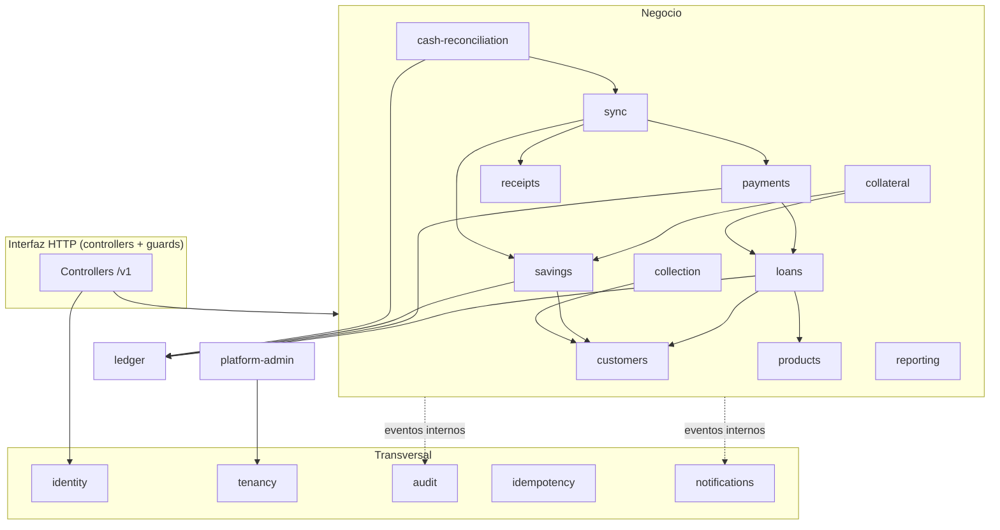
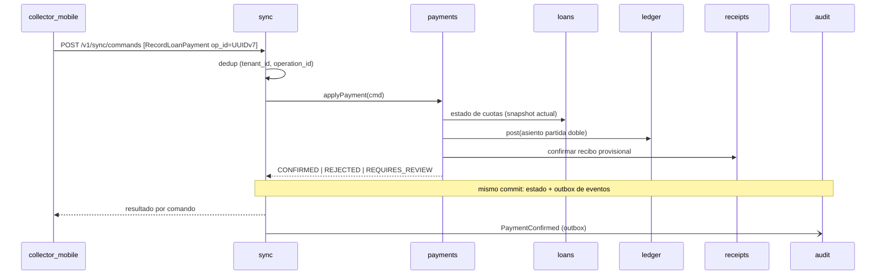

# C4 — Nivel 3: Componentes

> Estado: Propuesto (2026-11-22). Los módulos se implementan progresivamente según el roadmap
> (`docs/business/capability-map.md`). Nombres de tablas son indicativos; el modelo definitivo
> se define en el `data-model.md` de cada feature.

## 1. Kuota Core — módulos

Regla de dependencias: un módulo solo usa la **interfaz pública** (`<modulo>/public-api.ts`) de otro.
Ningún módulo lee o escribe tablas de otro módulo (Constitución IX). `ledger` no depende de ningún módulo de negocio.

## 2. Catálogo de módulos

| Módulo | Responsabilidad | Tablas que posee | Interfaz pública / eventos | NO hace |
|---|---|---|---|---|
| **identity** | Identidades globales (staff, cobradores, clientes), credenciales, OTP, PIN, dispositivos, sesiones y tokens | `identities`, `credentials`, `devices`, `sessions`, `otp_challenges` | `authenticate()`, `issueTokens()`, `revokeDevice()`; eventos `DeviceEnrolled`, `DeviceRevoked` | No guarda datos de negocio ni de KYC |
| **tenancy** | Tenants, sucursales, membresías, roles y permisos; resuelve `TenantContext` | `tenants`, `branches`, `memberships`, `roles`, `role_permissions` | `resolveContext(identity, tenantId)`, `can(permission)` | No decide reglas financieras |
| **customers** | Clientes por tenant, datos de contacto, KYC por tenant, vínculo opcional a `identity` | `customers`, `customer_contacts`, `customer_documents` | `getCustomer()`, `CustomerCreated` | No comparte registros entre tenants |
| **products** | Productos de préstamo (método, frecuencia, tasas con base, moratorios, garantía) y planes de ahorro, versionados | `loan_products`, `loan_product_versions`, `savings_plans`, `savings_plan_versions`, `business_calendars` | `getProductVersion()` | No calcula calendarios |
| **loans** | Solicitud, evaluación, aprobación, desembolso, calendario de amortización, estado de cuotas, mora, liquidación, reestructura | `loan_applications`, `loans`, `loan_installments`, `loan_events` | `LoanEngine` (puro), `LoanDisbursed`, `InstallmentOverdue` | No registra dinero fuera del ledger |
| **payments** | Recepción y aplicación de pagos según prelación (D-FIN-07), reversos de pago | `payments`, `payment_allocations` | `applyPayment(cmd)`, `PaymentConfirmed`, `PaymentReversed` | No decide conflictos de sync (lo hace `sync`) |
| **savings** | Cuentas de ahorro programado, aportaciones, rendimiento asociado, cierre y liquidación de ciclo | `savings_accounts`, `savings_deposits`, `savings_cycles` | `recordDeposit()`, `DepositConfirmed`, `CycleMatured` | No permite retiros parciales ordinarios |
| **collateral** | Garantías sobre ahorro: cálculo de disponible, bloqueo, liberación, ejecución | `collateral_pledges` | `availableCollateral()`, `pledge()`, `release()` | No mueve fondos de ahorro sin evento de liquidación |
| **ledger** | Plan de cuentas por tenant, asientos de partida doble append-only, saldos proyectados, reconciliación | `ledger_accounts`, `journal_entries`, `journal_lines`, `account_balances` | `post(entry)`, `reverse(entryId)`, `balance(account)` | No conoce reglas de préstamo/ahorro |
| **collection** | Carteras y rutas, asignación cobrador ↔ clientes, turnos | `routes`, `route_assignments`, `collector_shifts` | `assignedPortfolio(collectorId)` | No registra pagos |
| **sync** | Recepción de lotes de comandos offline, deduplicación, validación, estados, snapshots incrementales | `sync_commands`, `sync_cursors` | `pushCommands()`, `pullChanges(cursor)` | No aplica reglas financieras propias; delega a payments/savings |
| **receipts** | Folios, recibos provisionales y confirmados, firma, verificación pública | `receipts`, `device_receipt_sequences`, `receipt_signing_keys` | `issueReceipt()`, `verify(token)` | No expone PII en verificación |
| **cash-reconciliation** | Cortes de caja: esperado vs declarado vs entregado, diferencias, aprobación | `cash_counts`, `cash_handovers`, `cash_differences` | `closeShift()`, `approveCount()` | No borra ni edita cobros |
| **reporting** | Reportes operativos y regulatorios (cuando se definan) sobre proyecciones | vistas / tablas de lectura | consultas | No escribe en tablas de negocio |
| **audit** (015) | Consulta y exportación de la bitácora | — (lee `audit_events` vía `common/audit`) | consultas | No escribe; la escritura es `common/audit` (`AuditService.record()`, tabla `audit_events`, desde 001) |
| **idempotency** | Registro de claves y respuestas | `idempotency_keys` | interceptor HTTP | — |
| **notifications** | OTP, push, plantillas | `outbound_messages` | consumidor de eventos | No incluye montos/PII sensible en push |
| **platform-admin** | Alta/suspensión de tenants, soporte | (usa `tenancy`) | rol `kuota_platform` | Sin acceso a datos de negocio salvo procedimiento auditado |
| **health / config / logging** | Infraestructura transversal (001) | — | `/health/live`, `/health/ready` | — |

## 3. Flujo de ejemplo: pago capturado offline

## 4. collector_mobile — componentes

| Componente | Paquete | Responsabilidad |
|---|---|---|
| `AuthGate` | app | Sesión, PIN local, bloqueo por inactividad, revocación remota |
| `PortfolioRepository` | app + `offline_sync` | Lectura de cartera desde Drift; indica frescura (`last_synced_at`) |
| `CommandOutbox` | `offline_sync` | Persistir comandos con `operation_id`, estado, intentos; transición de estados |
| `SyncEngine` | `offline_sync` | Push por lotes con backoff, pull incremental por cursor, manejo de respuestas |
| `PaymentCaptureFlow` | app | Captura de pago/aportación, validaciones locales, simulación de aplicación (proyección) |
| `ReceiptRenderer` | app + `design_system` | Recibo de alto contraste, marca PROVISIONAL/CONFIRMADO, QR |
| `DeviceKeyStore` | `shared_core` | Llave Ed25519 del dispositivo en Keychain/Keystore; firma de comandos y recibos |
| `ShiftManager` | app | Apertura/cierre de turno, efectivo declarado, pendientes de sync |
| `ApiClient` | `api_client` (generado) | DTOs y llamadas HTTP |
| `FinancialSimulators` | `financial_domain` | Proyección de aplicación de pago y saldos (no autoritativo) |
