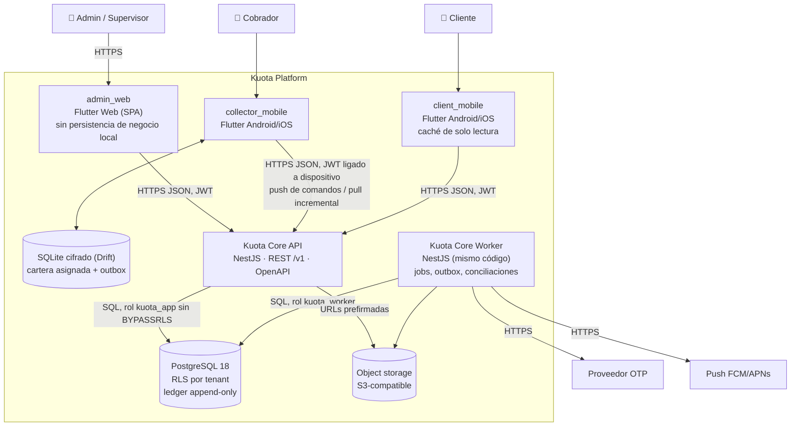

# C4 — Nivel 2: Contenedores

> Estado: Propuesto (2026-11-22). Un "contenedor" es una unidad desplegable o un almacén de datos.

## Diagrama

## Responsabilidades, datos y límites

### admin_web (Flutter Web)
- **Responsable de:** UI de administración: configuración de tenant, sucursales, usuarios y roles,
  productos de préstamo, planes de ahorro, originación y aprobación, asignación de cartera y rutas,
  revisión de operaciones `REQUIRES_REVIEW`, cortes de caja, reportes.
- **Datos:** ninguno persistente; tokens en memoria/almacenamiento de sesión (no `localStorage` para refresh token,
  se usa cookie `HttpOnly` o refresh en memoria — detalle en `docs/security/authentication.md`).
- **Límites:** no calcula saldos definitivos; usa simuladores de `financial_domain` solo para previsualizar.

### collector_mobile (Flutter)
- **Responsable de:** operar la cartera asignada offline: consulta de clientes, rutas, saldos sincronizados;
  registro de pagos y aportaciones como **comandos**; recibos provisionales; sincronización; apertura/cierre de turno.
- **Datos (SQLite cifrado con Drift):** snapshot de la cartera asignada (clientes, préstamos, calendarios,
  planes de ahorro, saldos con `snapshot_version`), outbox de comandos, recibos emitidos, secuencia de folios
  del dispositivo, llave privada del dispositivo (en Keychain/Keystore, no en SQLite).
- **Límites:** nunca modifica saldos autoritativos; muestra "saldo al último sync + operaciones pendientes".
  Bloquea nuevos cobros tras 72 h sin sync (configurable, D-SYNC-03).

### client_mobile (Flutter)
- **Responsable de:** login (OTP en enrolamiento + PIN/biometría, D-AUTH-01), consulta de préstamos, cuotas,
  pagos, ahorro, rendimientos, recibos; solicitudes de préstamo.
- **Datos:** caché de solo lectura con marca de frescura; sin operaciones financieras offline en v1.
- **Límites:** una identidad puede ver varias empresas, pero cada consulta se hace en el contexto de un tenant.

### Kuota Core API (NestJS)
- **Responsable de:** autenticación y autorización, contexto de tenant, validación contra contrato, casos de uso de
  todos los módulos, registro en ledger, idempotencia, auditoría, endpoint público de verificación de recibos,
  health checks.
- **Datos:** no tiene estado propio fuera de PostgreSQL y object storage (stateless, escalable horizontalmente).
- **Protocolos:** HTTPS REST JSON `/v1`; headers `Authorization`, `Idempotency-Key`, `X-Request-Id`,
  `X-App-Version`. Ver [api-contracts.md](api-contracts.md).
- **Límites:** sin llamadas síncronas a proveedores externos en la ruta de operaciones financieras (OTP y push se
  despachan vía worker).

### Kuota Core Worker
- **Responsable de:** procesar el outbox de eventos internos, jobs programados (devengo de intereses y moratorios
  cuando aplique, cierres de ciclo de ahorro, reconciliación del ledger, expiración de idempotencias), envío de OTP
  y push, generación de PDFs y reportes.
- **Implementación:** mismo paquete `backend`, punto de entrada distinto (`main.worker.ts`). Cola en PostgreSQL
  (pg-boss o tabla outbox propia; se decide en el plan de 001). Sin Redis en v1.
- **Límites:** cada job ejecuta en contexto de un tenant explícito; los jobs son idempotentes.

### PostgreSQL 18
- **Responsable de:** todo el estado de negocio, ledger, auditoría, idempotencia, cola de jobs.
- **Aislamiento:** RLS habilitado y forzado en tablas con `tenant_id`; roles `kuota_migrator` (owner),
  `kuota_app`, `kuota_worker`, `kuota_platform`, `kuota_readonly`. Ver [data-architecture.md](data-architecture.md).

### Object storage (S3-compatible; MinIO en local)
- **Responsable de:** documentos KYC, PDFs de recibos, exportaciones. Claves con prefijo `tenant/{tenant_id}/...`.
- **Acceso:** solo mediante URLs prefirmadas de corta duración emitidas por la API tras autorizar.

## Comunicación entre contenedores

| Origen → Destino | Tipo | Autenticación | Notas |
|---|---|---|---|
| Apps → API | HTTPS síncrono | JWT corto + refresh (ligado a dispositivo en móviles) | TLS 1.2+; certificate pinning evaluado para móviles |
| API → PostgreSQL | SQL en pool | Credenciales por rol, secreto inyectado | `SET LOCAL app.tenant_id` por transacción |
| API → Worker | Asíncrono vía tablas outbox/cola en PostgreSQL | — | Mismo commit que el cambio de negocio |
| Worker → OTP/Push | HTTPS | API keys en gestor de secretos | Reintentos con backoff |
| API/Worker → Object storage | HTTPS | Credenciales de servicio | URLs prefirmadas para clientes |
