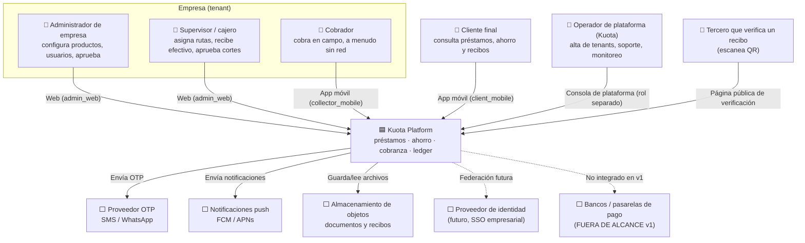

# C4 — Nivel 1: Contexto del sistema

> Estado: Propuesto (2026-11-22).

## Diagrama

## Actores

| Actor | Qué hace con Kuota | Canal | Restricciones clave |
|---|---|---|---|
| Administrador de empresa | Configura sucursales, roles, productos financieros, planes de ahorro; aprueba préstamos; consulta reportes | admin_web | MFA TOTP obligatorio para roles financieros (D-AUTH-02). Solo ve su tenant |
| Supervisor / cajero | Asigna carteras y rutas, recibe efectivo, aprueba cortes de caja, revisa operaciones `REQUIRES_REVIEW` | admin_web | Permisos por sucursal. Acciones auditadas |
| Cobrador | Consulta cartera asignada, registra pagos y aportaciones, emite recibos provisionales, sincroniza | collector_mobile | Dispositivo enrolado; PIN local; hasta 72 h offline (D-SYNC-03) |
| Cliente final | Consulta préstamos, cuotas, ahorro, recibos; solicita préstamos | client_mobile | Una identidad global, datos separados por empresa (D-AUTH-01) |
| Operador de plataforma | Alta y suspensión de tenants, soporte, monitoreo | Módulo platform-admin | Rol separado, acceso cross-tenant auditado, sin acceso por defecto a PII |
| Tercero verificador | Escanea el QR de un recibo y confirma su autenticidad | Web pública | Solo ve datos mínimos (D-RCP-01) |

## Sistemas externos

| Sistema | Uso | Datos que recibe | Estado |
|---|---|---|---|
| Proveedor OTP (SMS/WhatsApp) | Enrolamiento y recuperación de clientes y cobradores | Teléfono + código (nunca datos financieros) | Proveedor por definir |
| Push (FCM/APNs) | Avisos de vencimiento, confirmación de pago | Mensajes sin montos completos ni PII sensible | Fase posterior |
| Object storage | Documentos KYC, PDFs de recibos y reportes | Archivos cifrados en reposo, por prefijo de tenant | Proveedor pendiente D-ARC-04; local con MinIO |
| Proveedor de identidad | SSO para empresas grandes | Identidad de staff | Futuro, no en v1 |
| Bancos / pasarelas | Cobro electrónico, dispersión | — | **Fuera de alcance v1** |

## Límites del sistema

- Kuota es la **autoridad** de los saldos operativos de préstamos, ahorro y caja de cada tenant.
- Kuota **no** es el sistema contable general ni fiscal del tenant (D-LED-01, D-LEG-04).
- El cumplimiento regulatorio (país, KYC/PLD, protección de datos, captación de ahorro) está
  **pendiente de validación legal** (D-LEG-01..06, D-SAV-04) y no se asume en el diseño.
