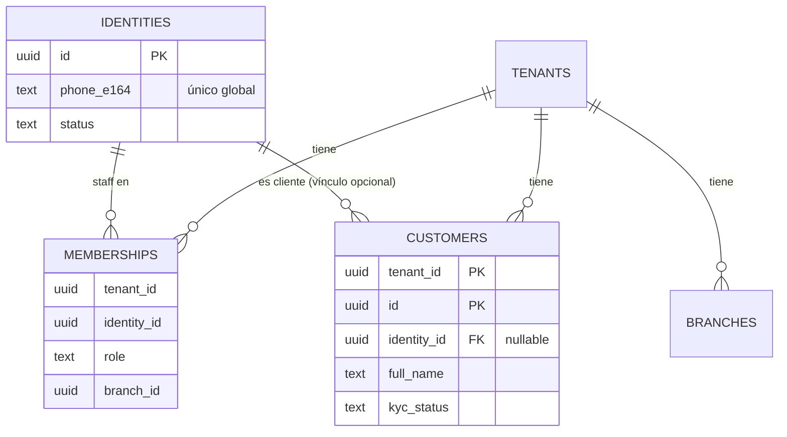
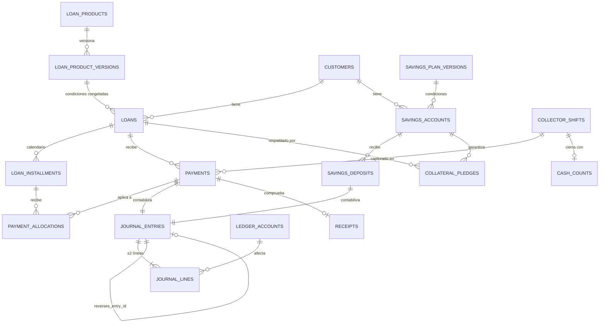

# Arquitectura de datos

> Estado: Propuesto (2026-11-22). ADR-0004 (PostgreSQL 18 + Prisma, D-ARC-01), ADR-0005 (ledger, D-FIN-01, D-LED-01).
> El modelo detallado de cada capacidad se define en `specs/NNN-*/data-model.md`; este documento fija las reglas.

## 1. Estrategia de multi-tenancy

**Base compartida, esquema compartido, columna `tenant_id` + Row-Level Security forzado.**

| Alternativa | Aislamiento | Costo operativo | Decisión |
|---|---|---|---|
| BD por tenant | Máximo | Alto (migraciones × N, conexiones) | Descartada en v1 |
| Esquema por tenant | Alto | Medio-alto | Descartada |
| Esquema compartido + RLS | Alto si se fuerza y prueba | Bajo | **Elegida** |

Política estándar aplicada a cada tabla con datos de tenant:

```sql
ALTER TABLE loans ENABLE ROW LEVEL SECURITY;
ALTER TABLE loans FORCE ROW LEVEL SECURITY;
CREATE POLICY tenant_isolation ON loans
  USING (tenant_id = current_setting('app.tenant_id', true)::uuid)
  WITH CHECK (tenant_id = current_setting('app.tenant_id', true)::uuid);
```

CI verifica (consulta a `pg_class`/`pg_policies`) que toda tabla con columna `tenant_id` tiene RLS habilitado,
forzado y con política. Claves foráneas compuestas `(tenant_id, id)` en relaciones entre tablas de tenant para
impedir referencias cruzadas.

## 2. Roles de base de datos

| Rol | Uso | Privilegios |
|---|---|---|
| `kuota_migrator` | Pipeline de migraciones | Owner de esquemas/tablas. Nunca usado por la app |
| `kuota_app` | API | DML limitado; **sin** `BYPASSRLS`; sin `UPDATE/DELETE` en ledger y auditoría |
| `kuota_worker` | Worker | Igual que `kuota_app` + tablas de cola |
| `kuota_platform` | platform-admin | Acceso a `tenants`/`memberships`; acceso cross-tenant solo vía funciones `SECURITY DEFINER` auditadas |
| `kuota_readonly` | Reportes/soporte | `SELECT` con RLS |

## 3. Identidad global vs datos por tenant



`identities` **no** tiene `tenant_id` y no contiene datos de negocio; no tiene RLS de tenant sino política por
`app.identity_id`. Una persona cliente de dos empresas = 1 `identity` + 2 `customers` independientes (KYC y documentos
duplicados por tenant). Ninguna empresa puede consultar qué otras empresas atienden a la misma identidad.

## 4. Modelo de alto nivel por módulo



Principios del modelo:
- Productos **versionados**: un préstamo referencia la versión con la que se otorgó; cambiar un producto no altera
  préstamos vigentes.
- Calendarios y estados de cuota son **proyecciones operativas**; el dinero está en el ledger.
- Operaciones financieras (`payments`, `savings_deposits`) son inmutables una vez confirmadas; se revierten con
  operación de reverso + asiento de reverso.

## 5. Ledger

```text
ledger_accounts(tenant_id, id, code, name, type[ASSET|LIABILITY|INCOME|EXPENSE|EQUITY|MEMO], currency,
                owner_type, owner_id)           -- p.ej. cartera del préstamo X, ahorro del cliente Y, caja del cobrador Z
journal_entries(tenant_id, id, entry_type, effective_date, posted_at, idempotency_key UNIQUE per tenant,
                reverses_entry_id NULL, source_type, source_id, actor_id, correlation_id)
journal_lines(tenant_id, id, entry_id, account_id, side[DEBIT|CREDIT], amount_minor BIGINT CHECK (>0), currency)
account_balances(tenant_id, account_id, balance_minor, last_entry_id)  -- proyección reconstruible
```

- Trigger de base de datos rechaza `UPDATE`/`DELETE` en `journal_entries` y `journal_lines` (además de los grants).
- Trigger diferido (`DEFERRABLE INITIALLY DEFERRED`) valida Σdébitos = Σcréditos por asiento y moneda al commit.
- Job de reconciliación compara `account_balances` contra la suma de `journal_lines` y alerta ante diferencia.

## 6. Tipos de datos

| Concepto | Tipo PostgreSQL | TypeScript | Dart |
|---|---|---|---|
| Montos | `BIGINT` unidades mínimas + `CHAR(3)` moneda | `bigint` | `int` (64-bit nativo) / `BigInt` en web* |
| Tasas, factores | `NUMERIC(18,10)` + `rate_basis` | `Decimal` (decimal.js) | `Decimal` (paquete `decimal`) |
| Fechas de negocio | `DATE` + zona horaria del tenant | `Temporal`/lib de fechas sin hora | `DateTime` fecha pura |
| Instantes | `TIMESTAMPTZ` | — | UTC |
| IDs | `UUID` (v7 para ordenabilidad) | string | string |

\* En Flutter Web `int` es double de JS: montos se manejan como `BigInt`/`Decimal` en el paquete `financial_domain`,
nunca como `int` crudo. En JSON se transportan como string (ver [api-contracts.md](api-contracts.md)).

## 7. Auditoría

`audit_log(tenant_id, id, occurred_at, actor_id, actor_role, action, entity_type, entity_id, before JSONB, after JSONB,
device_id, device_time, ip_hash, correlation_id)` — append-only (mismos controles que el ledger). `before/after` excluyen
secretos y minimizan PII.

## 8. Migraciones

- Prisma Migrate genera SQL; RLS, grants, triggers y funciones se agregan como SQL manual en la misma migración.
- Patrón **expand → migrate → contract**: agregar columnas nullable/tablas nuevas, desplegar código compatible,
  backfill, y solo en un release posterior eliminar lo viejo. Cambios destructivos requieren fase de contract aprobada.
- Migraciones se aplican en pipeline con `kuota_migrator` antes de desplegar la nueva versión; `/health/ready`
  falla si el esquema esperado no está aplicado.
- Prueba de CI: aplicar todas las migraciones sobre BD vacía + sobre snapshot del esquema de `main`.

## 9. Respaldos y retención

- Respaldos con PITR (WAL) en staging/producción; restauración probada periódicamente (procedimiento en resiliencia).
- Retención: ledger, operaciones financieras y auditoría **no se eliminan** durante el periodo legal (PENDIENTE-LEGAL,
  D-LEG-02/D-LEG-03). PII de clientes inactivos: política de anonimización pendiente de validación legal.
- Respaldos cifrados; acceso restringido y auditado.
