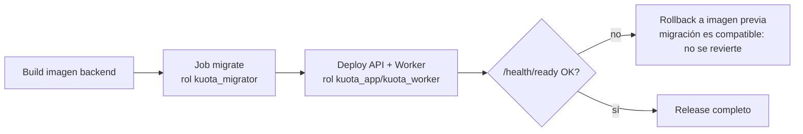

# Arquitectura de despliegue, entornos y CI/CD

> Estado: Propuesto (2026-11-22). **No se aprovisiona ningún servicio cloud** hasta resolver D-ARC-04
> (proveedor) y D-BIZ-02 (residencia de datos).

## 1. Entornos

| Entorno | Propósito | Datos | Infraestructura |
|---|---|---|---|
| `local` | Desarrollo | Sintéticos (seeds) | Docker Compose |
| `testing` | CI efímero por PR | Sintéticos, recreados por ejecución | Servicios de GitHub Actions / Testcontainers |
| `staging` | QA, UAT, validación de releases | Sintéticos o anonimizados — **nunca** copia de producción con PII | Igual a producción a menor escala (D-ARC-04) |
| `production` | Operación | Reales | D-ARC-04 |

## 2. Docker Compose local

```text
infra/docker/compose.yaml
  postgres:18     # digest fijado; script init: kuota_migrator, kuota_app, kuota_app_login (resto de roles: ADR-0004)
  minio           # object storage S3-compatible (cuando una feature lo necesite)
  mailpit / otp-mock  # captura de OTP/mensajes en local (cuando 002 lo necesite)
```

El backend corre en el host (`pnpm dev`) o en contenedor; las apps Flutter usan el entorno `local`. Solo se agregan
servicios cuando una tarea aprobada los requiera (Redis no está en v1).

## 3. Configuración y secretos

| Tipo | Ejemplos | Dónde vive |
|---|---|---|
| Configuración no secreta | `KUOTA_ENV`, `LOG_LEVEL`, `PORT`, versiones mínimas por app, `KUOTA_METRICS_HOST/PORT` | Variables de entorno; valores por entorno en `infra/environments/<env>.env.example` |
| Secretos | `DATABASE_URL_APP`, `DATABASE_URL_MIGRATOR`, `KUOTA_METRICS_TOKEN`, `JWT_SIGNING_KEY`, `RECEIPT_SIGNING_KEY`, API keys OTP | Local: `.env` no versionado. CI: GitHub Actions secrets por *environment*. Staging/prod: gestor de secretos del proveedor (D-ARC-04) |

- El arranque valida la configuración y falla ante faltantes.
- Llaves de firma (JWT, recibos) con rotación planificada (`kid` en tokens/firmas).
- Escaneo de secretos (gitleaks) en pre-commit opcional y en CI obligatorio.

## 4. Migraciones en el pipeline



Gracias a expand/contract, una versión N-1 del backend funciona con el esquema N, lo que permite rollback del código
sin revertir migraciones.

## 5. Health checks y observabilidad

| Endpoint | Verifica | Uso |
|---|---|---|
| `GET /health/live` | Proceso responde | Reinicio del contenedor |
| `GET /health/ready` | Conexión a BD (migraciones aplicadas: decisión pendiente D-ARC-06) | Enrutamiento de tráfico |

- **Logs:** JSON estructurado (pino) a stdout; campos y redacción definidos en
  [backend-architecture.md](backend-architecture.md).
- **Trazas y métricas:** OpenTelemetry SDK. En 001, exportador Prometheus *pull* en un listener interno con token del
  recolector (research R-21; Constitución §II). Exportador OTLP y backend de observabilidad: D-ARC-04.
- **Métricas mínimas:** latencia/errores por ruta, tamaño de cola de jobs, comandos de sync por estado, operaciones
  `REQUIRES_REVIEW` abiertas, resultado de reconciliación del ledger, edad de última sincronización por dispositivo.
- **Alertas críticas:** desbalance de ledger, falla de reconciliación, error de RLS (consulta sin contexto en ruta de
  negocio), cola de jobs atascada, picos de `REJECTED` por firma inválida.

## 6. CI/CD (GitHub Actions)

Diseño vigente (research R-17 de 001): un workflow `ci.yml` con `dorny/paths-filter` y jobs por componente; toda la
lógica vive en `scripts/ci/*.sh`, reproducible localmente con `scripts/ci/run-local.sh <job>`.

| Job | Disparador (path filters) | Verificaciones |
|---|---|---|
| `general` | siempre | gitleaks, editorconfig, nombre de rama ↔ `specs/NNN-*`, actionlint |
| `backend` | `backend/**`, `contracts/**`, `pnpm-lock.yaml` | lint, typecheck, dependency-cruiser, unit, integración (PostgreSQL), aislamiento multi-tenant, `db:check-rls`, cobertura, osv-scanner |
| `contracts` | `contracts/**` | Redocly lint, `oasdiff breaking` vs `main`, regenerar cliente Dart y verificar diff |
| `flutter` | `flutter/**`, `contracts/**` | format, analyze, test, `check_deps`, build Android y Web (iOS local) |
| `release-*.yml` | tags `backend-v*`, `admin-v*`, `collector-v*`, `client-v*` | build y publicación del artefacto (destino pendiente D-ARC-04; no se crea en 001) |

Un PR que modifica `contracts/` dispara backend y Flutter porque ambos dependen del contrato. Los checks requeridos
para merge se configuran como *required status checks* en la protección de `main` (acción remota que requiere aprobación).

## 7. Releases independientes

| Componente | Tag | Artefacto | Destino |
|---|---|---|---|
| Kuota Core | `backend-vX.Y.Z` | Imagen OCI (API y worker) | Registro de contenedores (D-ARC-04) |
| Kuota Admin | `admin-vX.Y.Z` | Bundle web estático | Hosting estático (D-ARC-04) |
| Kuota Collector | `collector-vX.Y.Z` | AAB / IPA | Distribución interna / tiendas |
| Kuota Client | `client-vX.Y.Z` | AAB / IPA | Tiendas |

Orden de despliegue ante cambios coordinados: **contrato compatible → backend → apps**. El backend publica la
versión mínima de cada app (`426` a versiones no soportadas, ventana D-ARC-05). Rollback: backend por imagen previa;
apps móviles no se pueden "revertir", por eso el backend debe tolerar versiones anteriores.
