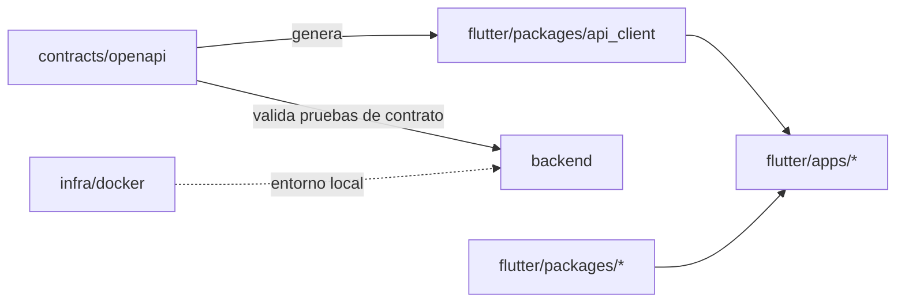

# Estrategia del monorepo

Decisión: [ADR-0001](../decisions/ADR-0001-monorepo-strategy.md). Este documento describe **cómo** se organiza y opera.

## 1. Estructura objetivo vs estado actual

| Ruta | Contenido | Estado hoy (2026-11-22) | Se crea en |
|---|---|---|---|
| `.specify/` | Config interna de Spec-Kit (memory, templates, scripts, extensions) | ✅ Existe | — |
| `.claude/skills/` | Skills de Spec-Kit para Claude Code | ✅ Existe | — |
| `specs/` | Specs por capacidad (`NNN-slug/`) | Se crea con la primera spec | 001 (`/speckit-specify`) |
| `docs/` | Arquitectura, negocio, seguridad, calidad, ADRs, procesos | ✅ Existe | — |
| `.github/pull_request_template.md` | Plantilla de PR | ✅ Existe | — |
| `.github/workflows/` | CI/CD | ❌ | 001 |
| `.github/CODEOWNERS` | Ownership por directorio | ❌ (propuesta abajo) | 001 |
| `backend/` | Kuota Core (NestJS) | ❌ | 001 (esqueleto) |
| `flutter/` | Workspace Flutter (apps + packages) | ❌ — bloqueado por D-ENV-01 | 001 |
| `contracts/openapi/` | Contrato OpenAPI | ❌ | 001 |
| `infra/docker/`, `infra/environments/` | Docker Compose, plantillas `.env.example` | ❌ | 001 |
| `scripts/` | Scripts del monorepo (verificaciones, generación) | ❌ | Cuando una tarea lo requiera |
| `package.json`, `pnpm-workspace.yaml` | Raíz del workspace TS | ❌ | 001 |

Regla: **no se crean carpetas vacías** para completar el árbol (Constitución I; `CLAUDE.md`).

```text
kuota-platform/
├── .github/{workflows/, CODEOWNERS, pull_request_template.md}
├── .claude/skills/            .specify/            specs/NNN-slug/
├── backend/                   # NestJS monolito modular (ADR-0002)
│   ├── src/{modules/, common/, main.ts}
│   ├── prisma/                # esquema + migraciones (ADR-0004)
│   └── test/
├── flutter/                   # pub workspace + Melos (ADR-0003)
│   ├── apps/{admin_web, collector_mobile, client_mobile}/
│   └── packages/{shared_core, design_system, api_client, financial_domain, offline_sync}/
├── contracts/openapi/         # kuota-core.v1.yaml (fuente de verdad REST)
├── infra/{docker/, environments/, ci/}
├── docs/{architecture, business, security, quality, decisions, process}/
├── scripts/
├── package.json  pnpm-workspace.yaml
└── README.md  CLAUDE.md  .editorconfig  .gitignore  .gitattributes
```

## 2. Componentes y límites de dependencia



- `backend/` **no** importa nada de `flutter/` y viceversa; su único punto de unión es `contracts/openapi/`.
- Las apps no se importan entre sí; comparten solo vía `flutter/packages/`.

## 3. Conventional Commits — scopes válidos

| Scope | Ruta |
|---|---|
| `backend` | `backend/` |
| `admin` | `flutter/apps/admin_web/` |
| `collector` | `flutter/apps/collector_mobile/` |
| `client` | `flutter/apps/client_mobile/` |
| `flutter-pkg` | `flutter/packages/` (se puede precisar: `flutter-pkg/api_client`) |
| `contracts` | `contracts/` |
| `infra` | `infra/` |
| `ci` | `.github/workflows/`, `infra/ci/` |
| `specs` | `specs/` |
| `docs` / `adr` | `docs/`, `docs/decisions/` |
| `constitution` | `.specify/memory/constitution.md` |
| `speckit` | `.specify/` (excepto memory), `.claude/skills/` |

Solo se usan los scopes de esta tabla. En particular, el scope de especificaciones es `specs` (no `spec`): el commit
histórico `002b28e` usó `spec` y no se reescribe; los commits nuevos deben respetar la tabla.

Ejemplos: `feat(backend): add tenant context middleware`, `fix(collector): retry sync with same operation id`,
`feat(contracts)!: rename payment amount field` (el `!` marca breaking change).

## 4. CI por directorio afectado (path filters)

| Job | Se ejecuta si cambia | Bloqueante |
|---|---|---|
| `backend` (lint, tipos, unit, integración con PostgreSQL, cobertura, dependency-cruiser) | `backend/**`, `contracts/**`, `pnpm-lock.yaml` | Sí |
| `tenancy-isolation` (pruebas de acceso cruzado y RLS) | `backend/**` | Sí |
| `contracts` (lint OpenAPI, breaking changes vs `main`, cliente Dart actualizado) | `contracts/**` | Sí |
| `flutter` (analyze, format, test por paquete afectado vía Melos) | `flutter/**`, `contracts/**` | Sí |
| `specs` (estructura `specs/NNN-*`, nombre de rama) | `specs/**`, ramas `feature/*` | Sí |
| `security` (secretos con gitleaks, dependencias) | siempre | Sí |
| `docs` (enlaces rotos, Mermaid válido) | `docs/**` | No (advertencia) |

Implementación: `dorny/paths-filter` o `on.pull_request.paths` en GitHub Actions (se define en 001).

## 5. Ownership (CODEOWNERS propuesto)

```text
# .github/CODEOWNERS (propuesta — se crea en 001 cuando existan equipos/usuarios de GitHub)
*                                   @kuota/architecture
/backend/                           @kuota/backend
/backend/src/modules/ledger/        @kuota/backend @kuota/finance-review
/backend/src/modules/loans/         @kuota/backend @kuota/finance-review
/backend/src/modules/savings/       @kuota/backend @kuota/finance-review
/backend/prisma/migrations/         @kuota/backend @kuota/architecture
/flutter/                           @kuota/mobile
/flutter/packages/financial_domain/ @kuota/mobile @kuota/finance-review
/contracts/                         @kuota/backend @kuota/mobile
/infra/  /.github/                  @kuota/architecture
/.specify/memory/constitution.md    @kuota/architecture
```

Los equipos `@kuota/*` son marcadores: la organización de GitHub **no existe** todavía y no se crea sin aprobación.

## 6. Cambios que afectan varias aplicaciones

1. **Una spec, un PR atómico** cuando contrato + backend + app(s) cambian juntos: el PR contiene el cambio de
   `contracts/openapi/`, la implementación backend, el cliente regenerado y la adaptación de apps.
   Si el PR es demasiado grande, se divide en PRs apilados **en orden**: contrato → backend → paquetes → apps.
2. **Compatibilidad primero:** el contrato evoluciona de forma aditiva (campos nuevos opcionales, endpoints nuevos).
   Los cambios incompatibles requieren nueva versión mayor del API y periodo de convivencia (Constitución XIV, D-ARC-05).
3. **Orden de despliegue: backend primero.** El backend soporta la versión nueva y la anterior del contrato antes de que
   se publique ninguna app que use la nueva.
4. **Feature flags** por tenant para activar capacidades nuevas en apps ya desplegadas sin nuevo release, y para
   desactivarlas como rollback rápido.
5. Apps móviles: el backend expone `min_supported_version` por app; versiones inferiores reciben aviso/bloqueo controlado.

## 7. Releases independientes

Tags por componente: `backend-vX.Y.Z`, `admin-vX.Y.Z`, `collector-vX.Y.Z`, `client-vX.Y.Z`, `contracts-vX.Y.Z`.
Detalle en [`docs/process/release-strategy.md`](../process/release-strategy.md).
