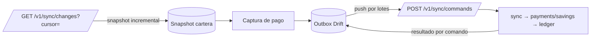
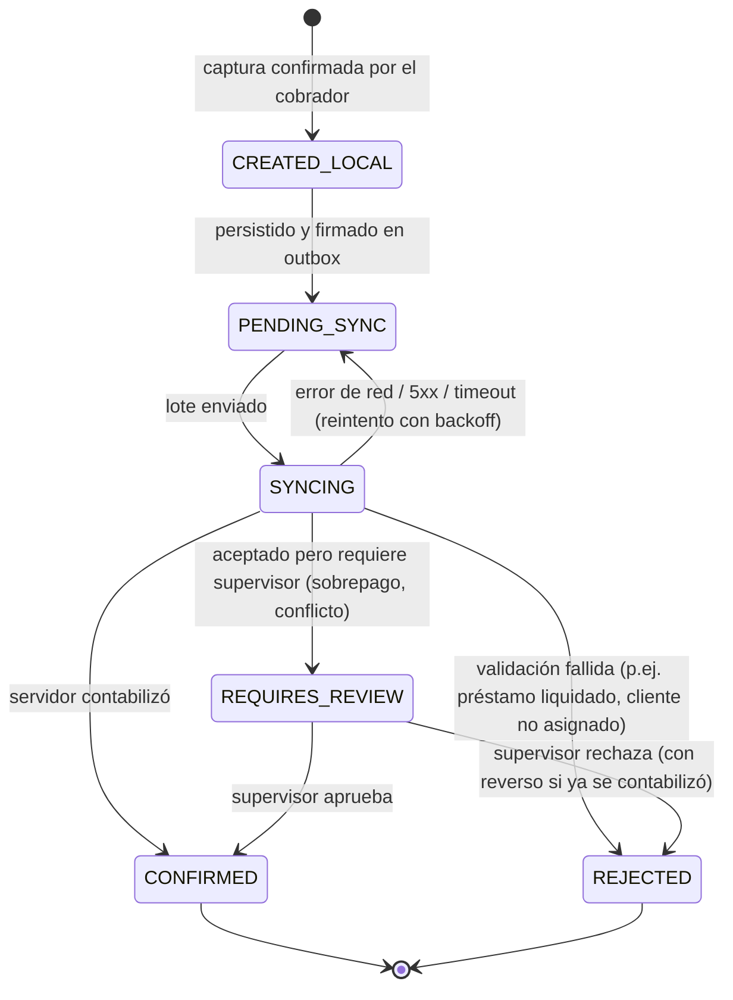

# Arquitectura offline — Kuota Collector

> Estado: Propuesto (2026-11-22). ADR-0006. Decisiones abiertas: D-SYNC-01, D-SYNC-02, D-SYNC-03,
> D-RCP-01, D-RCP-02, D-CSH-01. Constitución XI.

## 1. Modelo: sincronización por comandos

El cobrador no edita saldos: **registra hechos** ("recibí $500 del cliente X para el préstamo Y a las 10:32").
Cada hecho es un **comando** inmutable guardado en un outbox local y enviado al servidor, que lo valida, lo
contabiliza y responde con el resultado. Se descartaron la replicación de estado bidireccional y los CRDT porque
los saldos financieros no pueden fusionarse automáticamente: el servidor debe decidir.



## 2. Estructura de un comando

```json
{
  "operation_id": "0193b6f0-7c1e-7a3b-9f10-5d2c8e4a1b22",
  "type": "RecordLoanPayment",
  "device_id": "dev_…",
  "collector_id": "…",
  "shift_id": "…",
  "device_time": "2026-11-22T16:32:10-06:00",
  "device_monotonic_seq": 1842,
  "base_snapshot_version": 5531,
  "payload": { "loan_id": "…", "amount": { "amount_minor": "50000", "currency": "MXN" }, "receipt_folio": "KTA-7F3A-000231" },
  "signature": "ed25519:…"
}
```

- `operation_id` (UUIDv7 generado en el dispositivo) = clave de idempotencia. `UNIQUE(tenant_id, operation_id)` en servidor.
- `signature`: firma del dispositivo sobre el contenido canónico; el servidor verifica con la llave pública registrada
  al enrolar el dispositivo (detecta manipulación del outbox).
- `device_monotonic_seq`: detecta huecos o reordenamientos.
- Tipos v1 previstos: `RecordLoanPayment`, `RecordSavingsDeposit`, `OpenShift`, `CloseShift`, `DeclareCash`.

## 3. Estados de una operación local



| Estado | Significado | Recibo |
|---|---|---|
| `CREATED_LOCAL` | Capturado, aún no persistido/firmado (transitorio, milisegundos) | — |
| `PENDING_SYNC` | En outbox esperando envío | Provisional |
| `SYNCING` | Enviado, sin respuesta | Provisional |
| `CONFIRMED` | Contabilizado en ledger | Confirmado |
| `REJECTED` | No contabilizado; el efectivo recibido queda como diferencia a resolver en corte | Provisional anulado |
| `REQUIRES_REVIEW` | Contabilización pendiente de decisión humana | Provisional |

Validación pendiente: D-SYNC-02. Recomendación: no agregar estados en v1; **no** permitir cancelar localmente una
operación con recibo entregado (el dinero ya cambió de manos); un error de captura se corrige con un reverso aprobado.

Semántica de reintentos: `SYNCING → PENDING_SYNC` es seguro porque el servidor deduplica por `operation_id`; si el
servidor ya lo procesó, devuelve el resultado original.

## 4. Pull incremental

- `GET /v1/sync/changes?cursor=…` devuelve cambios de la cartera asignada (clientes, préstamos, cuotas, saldos,
  planes de ahorro, asignaciones) con `snapshot_version` monotónico por tenant.
- Altas/bajas de asignación: el servidor envía *tombstones*; el dispositivo elimina datos de clientes no asignados.
- Orden en cada sync: **push primero, luego pull**, para que el snapshot ya refleje las operaciones propias.
- Saldo mostrado = saldo del snapshot − operaciones propias `PENDING_SYNC/SYNCING`, etiquetado como estimado.

## 5. Conflictos

| Situación | Política propuesta |
|---|---|
| Dos cobradores cobran la misma cuota offline | El efectivo es real: ambos pagos se aceptan. El segundo genera sobrepago → `REQUIRES_REVIEW` (D-SYNC-01): aplicar a cuotas futuras, saldo a favor o devolución según decisión del supervisor |
| Pago sobre préstamo liquidado/reestructurado mientras offline | `REQUIRES_REVIEW` (no `REJECTED`): el dinero existe y debe conciliarse |
| Cliente reasignado a otro cobrador | Se acepta si `device_time` es anterior a la reasignación + tolerancia; si no, `REQUIRES_REVIEW` |
| Datos del snapshot desactualizados (`base_snapshot_version` viejo) | Servidor aplica sobre estado actual; la respuesta incluye la aplicación real (prelación D-FIN-07) que reemplaza la proyección local |
| Comando con firma inválida o secuencia anómala | `REJECTED` + alerta de seguridad + auditoría |
| Moneda/importe fuera de límites del tenant | `REJECTED` |

Ningún comando se descarta en silencio; los `REJECTED` y `REQUIRES_REVIEW` aparecen al cobrador y al supervisor.

## 6. Tiempo

- `device_time` se registra pero **no es confiable**. El servidor guarda `received_at` y calcula el desfase con el
  último sync (`server_time` devuelto en cada respuesta).
- Fecha efectiva del pago (para mora/intereses): propuesta `min(device_time ajustado, received_at)` acotada al turno
  abierto; desfases mayores a un umbral → `REQUIRES_REVIEW`. Requiere decisión de negocio (registrar en D-SYNC-02/D-FIN-06).

## 7. Límites offline (D-SYNC-03)

| Límite | Propuesta (configurable por tenant) | Efecto al exceder |
|---|---|---|
| Tiempo sin sync | 72 h | Bloqueo de nuevas capturas; solo consulta y sync |
| Efectivo acumulado no sincronizado | monto por tenant | Bloqueo de nuevas capturas |
| Número de operaciones pendientes | p.ej. 500 | Advertencia y bloqueo |
| Vigencia del token offline | 72 h + gracia | Requiere reautenticación online |

## 8. Seguridad del dispositivo

- BD local cifrada (SQLCipher) con llave en Keychain/Keystore; tokens y llave de firma en almacén seguro.
- PIN local obligatorio al abrir y tras inactividad; borrado de datos tras N intentos fallidos.
- Dispositivo enrolado y aprobado por admin; **revocación remota**: en el siguiente contacto el servidor responde
  `device-revoked`, el dispositivo borra datos y llaves. Comandos firmados con llave de dispositivo revocado después
  de la revocación → `REQUIRES_REVIEW`.
- Robo sin conexión: el riesgo residual es el efectivo y las operaciones no sincronizadas; mitigado por límites §7
  y por el corte de caja.
- Detección de root/jailbreak como señal de riesgo (no como única defensa).

## 9. Recibos provisionales

- Folio offline `{tenantPrefix}-{deviceShortId}-{seq}` (D-RCP-02), secuencia persistida en Drift.
- Recibo provisional: marca visible **PROVISIONAL**, firmado con la llave del dispositivo; QR con token opaco de
  verificación (D-RCP-01). Tras `CONFIRMED`, el servidor emite el recibo confirmado (firma del servidor) consultable en
  client_mobile y verificable vía QR.
- La página de verificación muestra el estado real: provisional / confirmado / rechazado / revertido.

## 10. Pruebas obligatorias

Red intermitente durante envío de lote; respuesta perdida tras commit en servidor; duplicados (N reintentos,
concurrentes); reloj del dispositivo adelantado/atrasado; 72 h simuladas con reloj controlado; revocación con
outbox pendiente; actualización de la app con outbox pendiente (compatibilidad de comandos, Constitución XIV).
