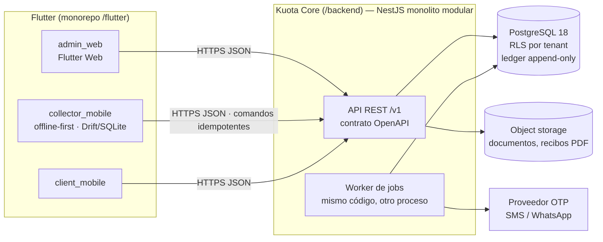

# Kuota — Visión general de arquitectura

> Estado: **Propuesto** (2026-11-22). Pendiente de revisión y aprobación. Rige la Constitución
> (`.specify/memory/constitution.md`); las decisiones abiertas usan los IDs de
> `docs/business/decisions-register.md`.

## 1. Resumen ejecutivo

Kuota es una plataforma SaaS que permite a empresas de crédito y ahorro (los **tenants**) operar
su negocio completo: configurar productos financieros, originar préstamos, administrar ahorro
programado, cobrar en campo —muchas veces en efectivo y sin internet— y conciliar el efectivo
de sus cobradores. Cada empresa ve solo sus datos.

Tres ideas guían la arquitectura:

1. **Un solo motor contable autoritativo.** El backend (Kuota Core) es el único que registra y
   confirma dinero. Todo movimiento queda en un **ledger de partida doble inmutable**; los saldos
   se derivan del ledger y pueden reconstruirse. Las apps calculan solo proyecciones.
2. **El campo no siempre tiene señal.** La app de cobradores funciona hasta 72 h sin conexión,
   guarda cada cobro como un comando con identificador único y lo envía cuando hay red. El
   servidor decide; nada se pierde ni se duplica.
3. **Aislamiento por empresa desde la base de datos.** Además de la autorización en la API,
   PostgreSQL aplica Row-Level Security: aunque haya un error en el código, una consulta sin
   contexto de empresa no devuelve datos.

Se evita la complejidad prematura: **un monorepo**, **un backend modular** (no microservicios),
**una base de datos** PostgreSQL, sin Redis ni colas externas en la primera iteración.

## 2. Vista técnica en una página

| Capa | Tecnología | Decisión |
|---|---|---|
| Repositorio | Monorepo único `kuota-platform`, un proyecto Spec-Kit | ADR-0001 |
| Backend | Node.js 26 LTS · TypeScript strict · NestJS · pnpm workspaces | ADR-0002 |
| Apps | Flutter · Dart pub workspaces · Melos · Riverpod · Drift | ADR-0003 (D-ENV-01, D-ARC-02, D-ARC-03) |
| Datos | PostgreSQL 18 · Prisma (condicionado a spike RLS) | ADR-0004 (D-ARC-01) |
| Ledger | Partida doble, BIGINT unidades mínimas + moneda | ADR-0005 (D-FIN-01, D-LED-01) |
| Offline | Sincronización por comandos (outbox) | ADR-0006 (D-SYNC-01..03) |
| Contratos | OpenAPI 3.1 en `contracts/openapi/` · cliente Dart generado | [api-contracts.md](api-contracts.md) |
| Infra | Docker Compose local · GitHub Actions · cloud pendiente | [deployment-architecture.md](deployment-architecture.md) (D-ARC-04) |

## 3. Atributos de calidad prioritarios

| Atributo | Mecanismo principal | Verificación |
|---|---|---|
| Exactitud contable | Ledger doble partida, enteros en unidades mínimas, redondeo explícito | Pruebas golden, invariante débitos = créditos, reconciliación |
| Aislamiento entre tenants | `tenant_id` + RLS FORCE + contexto por transacción | Suite de acceso cruzado en CI |
| No duplicar dinero | `Idempotency-Key` / `operation_id` + `UNIQUE(tenant_id, key)` | Pruebas de reintentos concurrentes |
| Operación sin red | Outbox local, servidor autoritativo, estados explícitos | Pruebas de red intermitente y 72 h simuladas |
| Trazabilidad | Auditoría append-only, correlation id | Pruebas de auditoría por comando |
| Evolución | Contract-first, migraciones expand/contract, versión mínima de app | oasdiff + pruebas de migración |

## 4. Límites explícitos (qué NO hace la arquitectura en v1)

- No es una contabilidad general ni sustituye al sistema contable/fiscal de cada empresa (D-LED-01).
- No procesa pagos electrónicos con bancos o pasarelas; el cobro es en efectivo o registro manual.
- No emite comprobantes fiscales (D-LEG-04 pendiente).
- No hay microservicios, Kubernetes, Redis ni event bus externo hasta que un ADR lo justifique.
- No se aprovisiona infraestructura cloud hasta resolver D-ARC-04.

## 5. Mapa de documentos

| Documento | Contenido |
|---|---|
| [c4-context.md](c4-context.md) | Actores y sistemas externos (C4 nivel 1) |
| [c4-containers.md](c4-containers.md) | Contenedores desplegables, datos y protocolos (C4 nivel 2) |
| [c4-components.md](c4-components.md) | Módulos de Kuota Core y de collector_mobile (C4 nivel 3) |
| [backend-architecture.md](backend-architecture.md) | Capas, tenant context, transacciones, idempotencia, outbox, jobs |
| [flutter-architecture.md](flutter-architecture.md) | Workspace, apps vs paquetes, Riverpod, almacenamiento seguro |
| [monorepo-strategy.md](monorepo-strategy.md) | Estructura, tooling, CI por rutas, releases, scopes de commit |
| [data-architecture.md](data-architecture.md) | Modelo de datos, RLS, roles, dinero, migraciones, respaldos |
| [api-contracts.md](api-contracts.md) | Convenciones REST/OpenAPI, errores, idempotencia, generación de cliente |
| [offline-architecture.md](offline-architecture.md) | Outbox, estados, conflictos, seguridad del dispositivo |
| [deployment-architecture.md](deployment-architecture.md) | Entornos, configuración, observabilidad, CI/CD |
| `docs/decisions/` | ADR-0001 … ADR-0006 |
| `docs/business/` | Dominio financiero, motores, capability map, registro de decisiones |
| `docs/security/` | Aislamiento, autenticación, threat model, privacidad |
| `docs/quality/` | Estrategia de pruebas, invariantes financieras, resiliencia |
