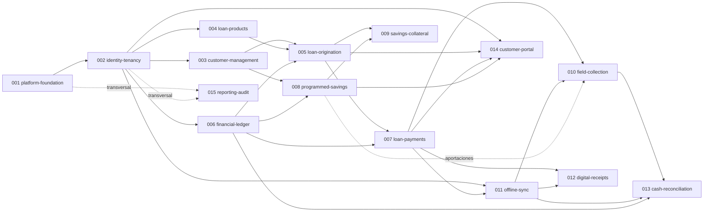

# Mapa de capacidades y roadmap de especificaciones

> Los números y nombres son una **propuesta de roadmap** [PROPUESTO]. Spec-Kit asigna el número real al crear cada
> feature (`/speckit-specify`, numeración secuencial) y crea la rama `feature/NNN-slug`. No se crean directorios
> vacíos en `specs/` para features no iniciadas.

## 1. Estado

| # | Feature | Estado |
|---|---|---|
| 001 | platform-foundation | **En especificación** |
| 002–015 | (ver tabla) | Propuesto |

## 2. Features

| # | Feature | Objetivo | Alcance principal | Depende de | Decisiones bloqueantes |
|---|---|---|---|---|---|
| 001 | platform-foundation | Base técnica verificable del monorepo | Tooling pnpm/Flutter workspace, esqueleto NestJS (health, config, logging), mecanismo de contexto de tenant + RLS con harness de pruebas, librería `money`, pipeline OpenAPI, Docker Compose, CI, plantillas de PR | — | D-ENV-01, D-ARC-01 (spike), D-ARC-02 |
| 002 | identity-tenancy | Tenants, sucursales, usuarios, roles, autenticación | Alta de tenant (plataforma), RBAC, login staff con MFA, enrolamiento de dispositivos, identidad global vs membresías | 001 | D-AUTH-01, D-AUTH-02, D-LEG-06 |
| 003 | customer-management | Registro de clientes por tenant | Alta/edición de cliente, datos de contacto, documentos, vínculo identidad↔cliente, enmascaramiento PII | 002 | D-LEG-02, D-LEG-03 |
| 004 | loan-products | Configuración versionada de productos de préstamo | Parámetros (método, tasa+base, frecuencia, plazo, gracia, moratorios, garantía), simulador | 002 | D-FIN-02…06 |
| 006 | financial-ledger | Ledger de partida doble append-only | Plan de cuentas plantilla, asientos, reversos, proyecciones de saldo, reconciliación | 002 | D-FIN-01, D-LED-01 |
| 005 | loan-origination | Solicitud, aprobación y desembolso | Solicitud, evaluación, aprobación, calendario, desembolso contabilizado | 003, 004, 006 | D-FIN-03, D-FIN-05, D-LEG-05 |
| 007 | loan-payments | Pagos, prelación, moratorios, reversos | Aplicación de pagos, moratorios, pagos parciales, excedentes, liquidación, reversos | 005, 006 | D-FIN-06, D-FIN-07, D-FIN-08 |
| 008 | programmed-savings | Planes de ahorro programado | Planes, aportaciones, rendimiento, vencimiento, liquidación, cancelación | 003, 006 | D-SAV-01…03; **D-SAV-04 bloquea producción** |
| 009 | savings-collateral | Préstamos respaldados por ahorro | Reservas, límites, liberación, compensación | 005, 008 | D-COL-01, D-COL-02 |
| 011 | offline-sync | Motor de sincronización por comandos | Outbox local, envío idempotente, pull incremental, estados, conflictos | 002, 007 | D-SYNC-01…03 |
| 010 | field-collection | App de cobradores | Cartera asignada, rutas, registro de pagos/aportaciones offline | 007, 011 (008 para aportaciones) | D-SYNC-03 |
| 012 | digital-receipts | Recibos provisionales/confirmados verificables | Folios, QR firmado, verificación pública mínima | 007, 011 | D-RCP-01, D-RCP-02, D-LEG-04 |
| 013 | cash-reconciliation | Cortes de caja de cobradores | Turnos, declaración, conteo, diferencias, aprobación, corte con pendientes | 010, 011, 006 | D-CSH-01, D-CSH-02 |
| 014 | customer-portal | App de clientes | Login, préstamos, cuotas, historial, ahorro, recibos, solicitudes | 002, 005, 007, 008 | D-AUTH-01 |
| 015 | reporting-audit | Reportes y auditoría | Reportes operativos y de cartera, consulta de auditoría, exportaciones | transversal (auditoría base desde 001/002) | D-LEG-02 |

> Nota de orden: 006 (ledger) se especifica **antes** que 005 aunque su número sea mayor; el número es solo identificador.

## 3. Dependencias

## 4. Reglas de secuenciación

1. Una feature no inicia `/speckit-plan` si alguna dependencia no tiene al menos `spec.md` aprobado.
2. Una feature no inicia `/speckit-implement` si alguna dependencia no está implementada en `main`, salvo trabajo
   explícitamente paralelizable indicado en `tasks.md`.
3. Las decisiones bloqueantes deben estar resueltas antes de aprobar el `spec.md` de la feature correspondiente;
   las marcadas **PENDIENTE-LEGAL** pueden no bloquear la construcción, pero sí la habilitación en producción.
4. Motor de cobros (007/010) no se implementa sin reglas de préstamo (004/005) y ledger (006) aprobados.
