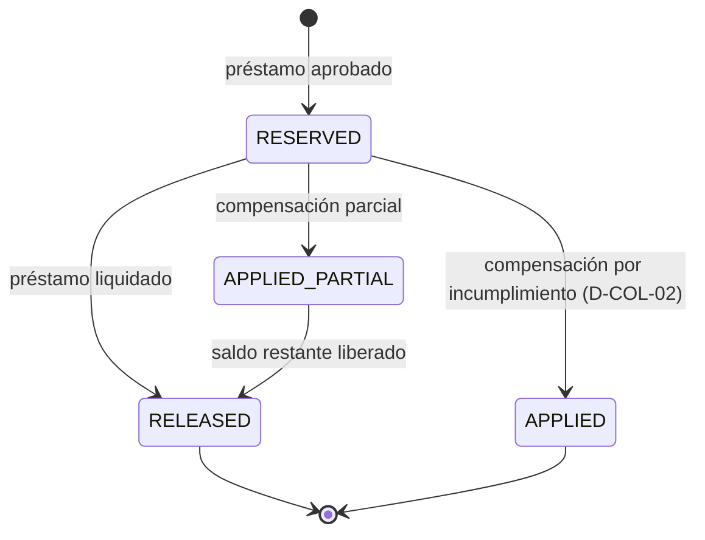

# Préstamos respaldados por ahorro

> Etiquetas: **[CONFIRMADO]** · **[PROPUESTO]** · **[PENDIENTE]** / **[PENDIENTE-LEGAL]**. Importes ilustrativos.

## 1. Concepto [CONFIRMADO]

Un cliente con ahorro programado puede solicitar un préstamo respaldado por su ahorro acumulado, hasta un porcentaje
configurable (`collateral_percentage`) en productos con `allow_savings_collateral = true`.

**Caso COL-01 (verificado):** ahorro acumulado 10,000.00 × 80 % = **8,000.00** préstamo máximo.

## 2. Base de la garantía [PENDIENTE, D-COL-01]

Recomendación [PROPUESTO]: la base es la suma de **aportaciones confirmadas** (servidor), excluyendo:
- aportaciones provisionales offline no confirmadas;
- rendimiento aún no devengado (el rendimiento solo existe al vencimiento);
- montos ya comprometidos como garantía de otros préstamos.

```
garantía_disponible = (aportado_confirmado × collateral_percentage) − Σ garantías_vigentes
```

## 3. Reserva y bloqueo [PROPUESTO]

- Al **aprobar** el préstamo se crea una **reserva de garantía** (`collateral_lien`) por el monto del préstamo (o por el
  monto de garantía requerido) ligada al plan de ahorro.
- La reserva se refleja en **cuentas de orden** (memo) del ledger: no mueve dinero, pero hace visible el compromiso.
- Mientras exista una reserva vigente, el plan no puede cancelarse ni liquidarse sin resolver la garantía.

Asiento de orden ilustrativo (COL-01):

| Cuenta | Debe | Haber |
|---|---:|---:|
| Garantías recibidas — ahorro comprometido (orden deudora) | 8,000.00 | |
| Responsabilidad por garantías (orden acreedora) | | 8,000.00 |

## 4. Préstamos simultáneos [PENDIENTE, D-COL-01]

Recomendación: se permiten mientras Σ reservas ≤ `aportado_confirmado × collateral_percentage`.

**Caso COL-02 (verificado):** ahorro 10,000.00, 80 % → límite 8,000.00. Préstamo A vigente con reserva 5,000.00 →
disponible para préstamo B = 8,000.00 − 5,000.00 = **3,000.00**.

Pendiente: ¿la reserva disminuye conforme el cliente paga el préstamo (liberación proporcional) o se mantiene completa
hasta liquidar? Recomendación v1: se mantiene completa hasta liquidación (más simple y conservador).

## 5. Escenarios

| Escenario | Regla propuesta | Estado |
|---|---|---|
| Préstamo liquidado antes del vencimiento del ahorro | Se libera la reserva (asiento de orden inverso) | [PROPUESTO] |
| Ahorro vence con préstamo vigente al corriente | El ahorro no se liquida hasta liquidar el préstamo, o se liquida solo el excedente libre | [PENDIENTE] D-COL-02 |
| Ahorro vence con préstamo en incumplimiento | Compensación del saldo adeudado contra el ahorro, con consentimiento contractual | [PENDIENTE-LEGAL] D-COL-02 |
| Incumplimiento antes del vencimiento del ahorro | No se compensa anticipadamente; se espera al vencimiento | [PROPUESTO] |
| Liquidación anticipada del préstamo usando el ahorro | Requiere autorización del cliente y del supervisor; asiento de compensación | [PENDIENTE] D-COL-02 |
| Reverso de aportación que deja la garantía insuficiente | El préstamo no se altera; se marca alerta de garantía insuficiente | [PROPUESTO] |

### 5.1 Ejemplo de compensación al vencimiento (si D-COL-02 se aprueba)

Ahorro al vencimiento: aportado 10,000.00 + rendimiento 900.00 (9 %) = 10,900.00. Préstamo con saldo exigible 2,300.00.

| Cuenta | Debe | Haber |
|---|---:|---:|
| Ahorro de clientes (pasivo) | 2,300.00 | |
| Cartera de préstamos / intereses por cobrar | | 2,300.00 |

Remanente a liquidar al cliente: 10,900.00 − 2,300.00 = **8,600.00**; se libera la reserva de orden.

## 6. Estados de la garantía



## 7. Invariantes

1. Σ reservas vigentes de un plan ≤ aportado confirmado × `collateral_percentage`.
2. Un plan con reservas vigentes no se liquida ni cancela sin resolverlas.
3. Las cuentas de orden de garantía netean a cero cuando todas las reservas están liberadas o aplicadas.
4. Casos COL-01 y COL-02 son pruebas *golden*.
