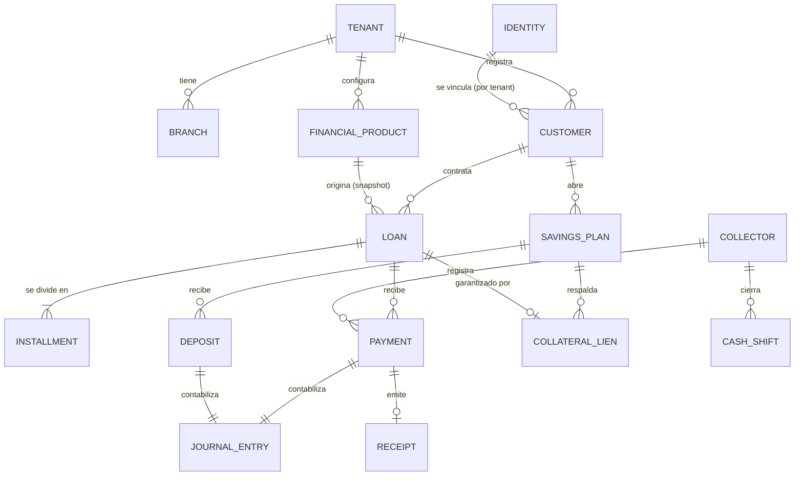
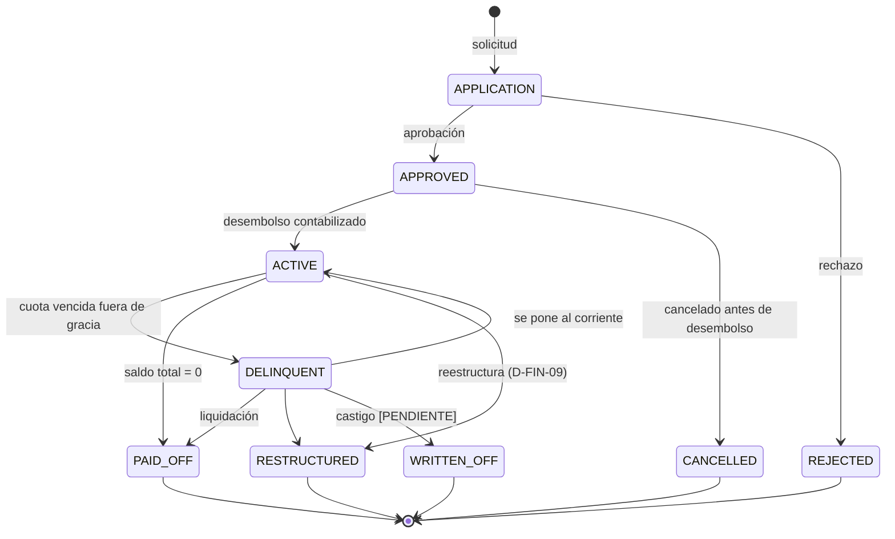

# Dominio financiero de Kuota

> Etiquetas: **[CONFIRMADO]** · **[PROPUESTO]** · **[PENDIENTE]** / **[PENDIENTE-LEGAL]**.
> Importes ilustrativos; el país y la moneda de operación no están confirmados (D-LEG-01).

## 1. Glosario

| Término | Definición |
|---|---|
| **Tenant / Empresa** | Organización cliente de Kuota que otorga préstamos y/o administra ahorro. Unidad de aislamiento de datos. |
| **Sucursal** | Unidad operativa de un tenant; agrupa cobradores, cajas y cartera. |
| **Cliente** | Persona registrada **dentro de un tenant**. La misma persona en dos tenants = dos registros de cliente independientes. |
| **Identidad** | Credencial global de autenticación (p. ej. teléfono). No contiene datos financieros. |
| **Cobrador** | Usuario de campo que registra pagos y aportaciones, normalmente en efectivo y offline. |
| **Producto financiero** | Configuración versionada de un tipo de préstamo o plan de ahorro de un tenant. |
| **Préstamo** | Contrato de crédito originado con un snapshot inmutable de parámetros del producto. |
| **Cuota** | Obligación programada (capital + interés) con fecha de vencimiento. |
| **Moratorio** | Cargo por atraso sobre cuotas vencidas fuera de gracia. |
| **Prelación** | Orden de aplicación de un pago entre conceptos y cuotas. |
| **Plan de ahorro** | Ciclo de aportaciones programadas, bloqueado, con rendimiento al vencimiento. |
| **Aportación** | Depósito al plan de ahorro. |
| **Rendimiento** | Monto que la empresa paga sobre las aportaciones confirmadas al vencimiento. |
| **Garantía (reserva)** | Compromiso de una porción del ahorro como respaldo de un préstamo. |
| **Ledger** | Registro contable de partida doble, append-only, fuente de verdad de saldos. |
| **Asiento** | Registro contable balanceado con ≥ 2 líneas (débito/crédito). |
| **Reverso** | Asiento que anula los efectos de otro, referenciándolo. |
| **Operación offline** | Comando registrado en dispositivo pendiente de confirmación por el servidor. |
| **Recibo provisional / confirmado** | Comprobante emitido en dispositivo antes de confirmación / emitido tras confirmación del servidor. |
| **Corte de caja** | Conciliación del efectivo cobrado vs entregado por un cobrador en un turno. |
| **Clave de idempotencia** | Identificador único por operación que impide efectos duplicados. |

## 2. Entidades principales (vista de negocio)

Todas las entidades salvo `IDENTITY` pertenecen a un único tenant (Constitución III).

## 3. Ciclos de vida

### 3.1 Préstamo

El estado de un préstamo es una **proyección** derivada de cuotas y del ledger; nunca se edita manualmente.

### 3.2 Plan de ahorro

Ver `savings-engine.md` §7 (`ACTIVE → MATURED → SETTLED`, `CANCELLED`).

### 3.3 Garantía

Ver `collateral-loans.md` §6 (`RESERVED → RELEASED | APPLIED`).

### 3.4 Operación offline

Estados propuestos (D-SYNC-02): `CREATED_LOCAL → PENDING_SYNC → SYNCING → CONFIRMED | REJECTED | REQUIRES_REVIEW`.
Detalle en `docs/architecture/offline-architecture.md`.

## 4. Plan de cuentas plantilla [PROPUESTO, D-LED-01]

Subledger operativo de partida doble por tenant (no sustituye la contabilidad general del tenant):

| Código | Cuenta | Naturaleza |
|---|---|---|
| 1100 | Caja sucursal | Activo |
| 1110 | Efectivo en tránsito — cobrador (una por cobrador) | Activo |
| 1200 | Cartera de préstamos — capital | Activo |
| 1210 | Intereses por cobrar | Activo |
| 1220 | Moratorios por cobrar | Activo |
| 1300 | Cuentas por cobrar a cobradores (faltantes) | Activo |
| 2100 | Ahorro de clientes | Pasivo |
| 2110 | Rendimiento por pagar | Pasivo |
| 2120 | Saldos a favor de clientes | Pasivo |
| 4100 | Ingreso por intereses | Ingreso |
| 4110 | Ingreso por moratorios | Ingreso |
| 5100 | Gasto por rendimiento de ahorro | Gasto |
| 5200 | Pérdidas por faltantes | Gasto |
| 9100 / 9200 | Garantías comprometidas / Responsabilidad por garantías | Orden |

**[PENDIENTE]** Base de reconocimiento de interés (devengado al vencimiento de cuota vs al cobro) — decisión de finanzas
(D-LED-02). Los ejemplos usan **devengo al vencimiento de cada cuota**.

## 5. Eventos contables principales (asientos de ejemplo, balanceados)

Basados en FLAT-01 (`loan-engine.md`): P = 10,000.00, cuota 1,000.00 = 833.33 capital + 166.67 interés.

| Evento | Debe | Haber |
|---|---|---|
| **Desembolso** | 1200 Cartera capital 10,000.00 | 1100 Caja sucursal 10,000.00 |
| **Vencimiento de cuota #1** (devengo interés) | 1210 Intereses por cobrar 166.67 | 4100 Ingreso por intereses 166.67 |
| **Moratorio generado** (50.00) | 1220 Moratorios por cobrar 50.00 | 4110 Ingreso por moratorios 50.00 |
| **Pago de cuota #1 + moratorio** (1,050.00) por cobrador | 1110 Efectivo en tránsito 1,050.00 | 1220 50.00 · 1210 166.67 · 1200 833.33 |
| **Entrega de efectivo** en caja | 1100 Caja 1,050.00 | 1110 Efectivo en tránsito 1,050.00 |
| **Reverso del pago** (error de captura) | 1220 50.00 · 1210 166.67 · 1200 833.33 | 1110 Efectivo en tránsito 1,050.00 |
| **Aportación de ahorro** (125.00) | 1110 Efectivo en tránsito 125.00 | 2100 Ahorro de clientes 125.00 |
| **Devengo de rendimiento** al vencimiento (SAV-01) | 5100 Gasto por rendimiento 135.00 | 2110 Rendimiento por pagar 135.00 |
| **Liquidación de ahorro** (SAV-01) | 2100 1,500.00 · 2110 135.00 | 1100 Caja 1,635.00 |
| **Reserva de garantía** (COL-01) | 9100 8,000.00 | 9200 8,000.00 |

Cada asiento: `tenant_id`, `idempotency_key`, `effective_date`, `posted_at`, actor, origen (dispositivo/servidor),
`reverses_entry_id` cuando aplica. Ver ADR-0005.

## 6. Reglas transversales

- Moneda única por tenant en v1 [PROPUESTO]; todo asiento declara moneda ISO 4217.
- Fechas contables en zona horaria del tenant; marcas de tiempo en UTC.
- Ninguna operación financiera se registra sin clave de idempotencia.
- Los saldos de préstamo, ahorro y caja se derivan del ledger y deben reconciliar diariamente.

## 7. Decisiones relacionadas

D-FIN-01…10, D-SAV-01…04, D-COL-01/02, D-LED-01, D-CSH-01/02, D-LEG-01…06 — ver `decisions-register.md`.
