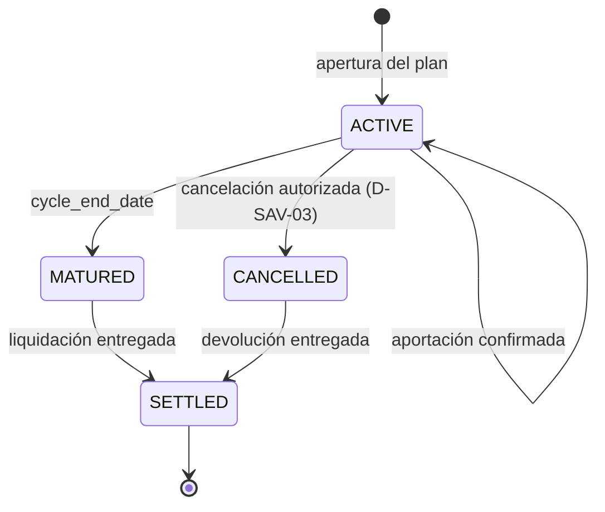

# Motor de ahorro programado (caja de ahorro)

> Etiquetas: **[CONFIRMADO]** · **[PROPUESTO]** · **[PENDIENTE]** / **[PENDIENTE-LEGAL]**. Importes ilustrativos.

> ⚠️ **[PENDIENTE-LEGAL] D-SAV-04 — bloqueante para producción.** Recibir dinero del público con promesa de
> rendimiento puede constituir una actividad regulada (captación) distinta del otorgamiento de crédito, con requisitos
> propios según el país y la figura jurídica de cada tenant (D-LEG-01, D-LEG-06). Este documento describe la mecánica
> técnica; **no** afirma que el producto sea legalmente ofrecible. La feature 008 puede especificarse y construirse,
> pero no habilitarse en producción sin dictamen legal.

## 1. Parámetros del plan

| Parámetro | Descripción | Estado |
|---|---|---|
| `frequency` | `DAILY`, `WEEKLY`, `BIWEEKLY`, `MONTHLY` | [CONFIRMADO] |
| `total_periods` | número de aportaciones del ciclo | [CONFIRMADO] |
| `fixed_deposit_amount` | monto fijo por aportación (unidades mínimas) | [CONFIRMADO] |
| `yield_percentage` | rendimiento del ciclo | [CONFIRMADO] parámetro · [PENDIENTE] semántica — D-SAV-01 |
| `cycle_start_date` / `cycle_end_date` | vigencia del ciclo | [CONFIRMADO] |

## 2. Reglas [CONFIRMADO como propuesta del negocio]

- Ahorro **bloqueado** durante el ciclo; sin retiros parciales ordinarios.
- Aportaciones programadas según el calendario del plan; se registran las aportaciones efectivamente recibidas.
- El rendimiento se asocia a las **aportaciones efectivamente pagadas**.
- Liquidación al vencimiento del ciclo.

## 3. Semántica del rendimiento [PENDIENTE, D-SAV-01]

**Recomendación [PROPUESTO]:** `yield_percentage` es un porcentaje **por ciclo** aplicado sobre el **total aportado y
confirmado** al cierre del ciclo, **sin anualizar**. El sistema nunca convierte este porcentaje en una tasa anual
automáticamente; si se requiere mostrar un equivalente anual (por divulgación), será un cálculo separado y aprobado.

```
rendimiento = round(Σ aportaciones confirmadas × yield_percentage)    (HALF_UP a 0.01, D-FIN-02)
total_a_liquidar = Σ aportaciones confirmadas + rendimiento
```

Alternativas a decidir: rendimiento proporcional al tiempo que cada aportación estuvo depositada; rendimiento solo si el
plan se completa; tasa anual prorrateada. Cada una cambia el pasivo de la empresa.

### 3.1 Casos verificados

**SAV-01 (ejemplo del negocio)** — aportado 1,500.00 · rendimiento 9 % → rendimiento **135.00** · total **1,635.00**.
Ejemplo concreto: 12 aportaciones semanales de 125.00 = 1,500.00.

**SAV-02 (aportaciones faltantes)** — mismo plan, se pagaron 10 de 12 → aportado 1,250.00 → rendimiento
`1,250.00 × 0.09` = **112.50** · total **1,362.50**.

**SAV-03 (aportación atrasada dentro del ciclo)** — la aportación #5 se paga en la semana 7 (antes del cierre): cuenta
como pagada; si se pagan las 12, el resultado es igual a SAV-01 (135.00) bajo la recomendación D-SAV-02.

## 4. Aportaciones atrasadas [PENDIENTE, D-SAV-02]

Recomendación: se aceptan aportaciones atrasadas mientras el ciclo esté vigente; cuentan para el rendimiento si se
**confirman** antes de `cycle_end_date`. Pendientes: ¿se permite pagar varias aportaciones a la vez? ¿se permiten
aportaciones adelantadas? ¿hay penalización por atraso? ¿aportaciones mayores al monto fijo?

Aportaciones registradas offline y sincronizadas después del cierre: se propone usar la **fecha de captura en dispositivo**
validada (ventana de 72 h, D-SYNC-03) para determinar si entran al ciclo; caso a confirmar.

## 5. Vencimiento y liquidación

- Al llegar `cycle_end_date`, el plan pasa a `MATURED`; se calcula el rendimiento y se registra su devengo (gasto por
  rendimiento / rendimiento por pagar).
- La liquidación (`SETTLED`) es la entrega efectiva al cliente (efectivo, transferencia o aplicación a préstamo, según
  autorización). Si existe garantía vigente (`collateral-loans.md`), primero se resuelve la garantía.
- Ver asientos en `financial-domain.md` y procedimiento en `settlement.md`.

## 6. Cancelación anticipada [PENDIENTE, D-SAV-03]

No hay retiros parciales ordinarios [CONFIRMADO]. Para cancelación total antes del vencimiento (por fuerza mayor o
decisión del cliente) se recomienda devolver **capital aportado sin rendimiento**, con autorización de supervisor y
auditoría. Alternativas: rendimiento proporcional, penalización. Si hay garantía vigente, la cancelación se bloquea.

## 7. Estados



## 8. Invariantes

1. Saldo del plan = Σ aportaciones confirmadas − reversos (derivado del ledger).
2. Sin retiros mientras `ACTIVE` (salvo cancelación autorizada).
3. Rendimiento solo se calcula sobre aportaciones confirmadas antes del cierre.
4. Monto disponible como garantía ≤ saldo aportado × `collateral_percentage` (D-COL-01).
5. Casos SAV-01, SAV-02, SAV-03 son pruebas *golden*.
