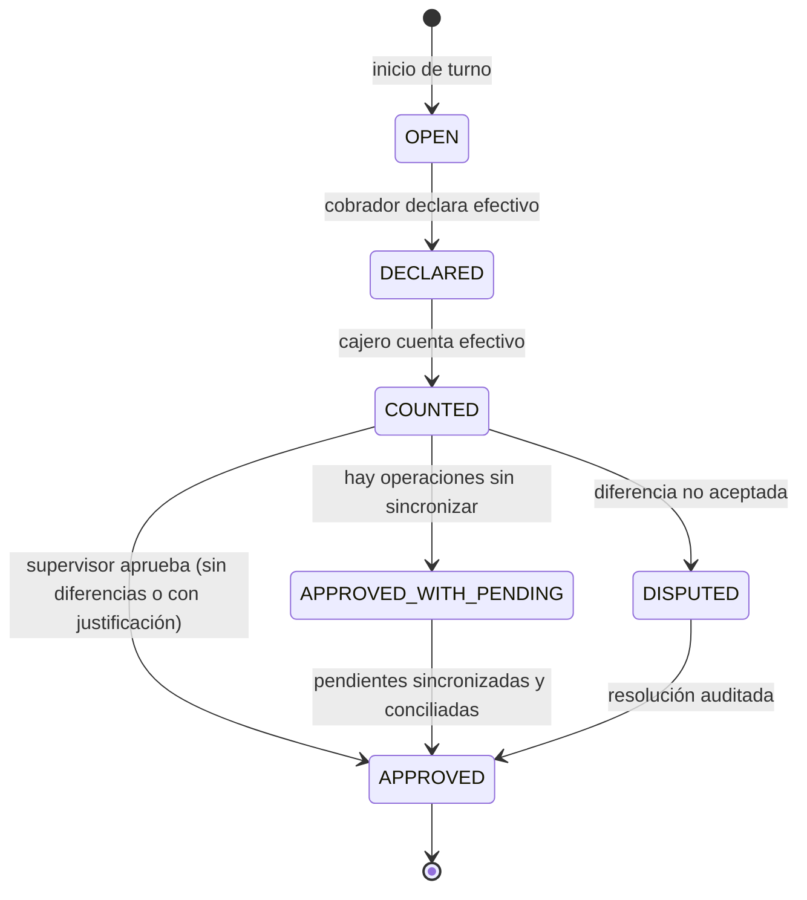

# Liquidaciones, reversos y cortes de caja

> Etiquetas: **[CONFIRMADO]** · **[PROPUESTO]** · **[PENDIENTE]** / **[PENDIENTE-LEGAL]**. Importes ilustrativos.

## 1. Liquidación anticipada de préstamo [PENDIENTE, D-FIN-08]

El monto de liquidación depende de una decisión de negocio (y posiblemente regulatoria, D-LEG-05). El motor expone una
**cotización de liquidación** con fecha de vigencia; la liquidación se ejecuta como un pago con prelación normal más el
cierre del préstamo.

### 1.1 `DECLINING_BALANCE` — caso SET-01 (verificado, basado en DB-01)

Tras pagar las cuotas 1 y 2, saldo de capital = **6,861.66**. Interés del periodo 3 = 205.85.

| Alternativa | Monto de liquidación |
|---|---:|
| A. Capital + interés completo del periodo en curso | 6,861.66 + 205.85 = **7,067.51** |
| B. Solo capital (liquidación en la fecha de vencimiento de la cuota 2) | **6,861.66** |
| C. Capital + interés prorrateado por días transcurridos | depende de D-FIN-04 |

### 1.2 `FLAT_GLOBAL` — caso SET-02 (verificado, basado en FLAT-01)

Pagadas 4 de 12 cuotas: capital pagado 3,333.32; interés pagado 666.68.

| Alternativa | Monto |
|---|---:|
| Sin bonificación (todo el interés pactado) | 6,666.68 + 1,333.32 = **8,000.00** |
| Bonificación total del interés no devengado | **6,666.68** |
| Bonificación parcial | regla de negocio |

En ambos casos se suman moratorios pendientes. Recomendación [PROPUESTO]: el producto define la política de liquidación
explícitamente; no hay valor por defecto implícito.

## 2. Liquidación de ahorro al vencimiento

Procedimiento [PROPUESTO]:
1. Cierre del ciclo (`MATURED`): congelar aportaciones; aportaciones offline pendientes se resuelven según D-SAV-02.
2. Calcular rendimiento (`savings-engine.md`) y registrar devengo.
3. Resolver garantías vigentes (`collateral-loans.md`, D-COL-02).
4. Generar orden de liquidación (monto neto) aprobada por rol autorizado.
5. Entrega (efectivo/transferencia) → asiento de liquidación; plan `SETTLED`; recibo.

Ejemplo SAV-01: liquidación 1,635.00 = 1,500.00 aportado + 135.00 rendimiento.

## 3. Reversos [CONFIRMADO como principio; Constitución V]

- Ninguna operación confirmada se edita ni elimina. Un reverso es un **nuevo asiento** con `reverses_entry_id` que
  invierte exactamente las líneas del original, con motivo, actor autorizado y auditoría.
- Reversar una operación de un corte ya aprobado genera un **ajuste** en el corte vigente (no reabre el corte cerrado).
- Reverso de pago con recibo emitido: el recibo queda marcado como **revertido** en la verificación pública.
- Reversos de reversos no se permiten; se registra la operación correcta como nueva [PROPUESTO].

## 4. Cortes de caja (conciliación de efectivo del cobrador)

### 4.1 Conceptos

| Concepto | Fuente |
|---|---|
| Cobros registrados | Operaciones creadas en el dispositivo durante el turno (incluye no sincronizadas) |
| Cobros sincronizados | Operaciones recibidas por el servidor (`CONFIRMED`, `REJECTED`, `REQUIRES_REVIEW`) |
| Cobros confirmados | Operaciones `CONFIRMED` y contabilizadas en el ledger |
| Efectivo declarado | Monto que el cobrador declara entregar |
| Efectivo entregado | Monto contado y recibido por cajero/supervisor |

**[CONFIRMADO]** No se asume que todas las operaciones offline estén sincronizadas al cerrar el turno.

### 4.2 Caso CASH-01 (verificado)

| Concepto | Monto |
|---|---:|
| Cobros registrados en dispositivo (15 operaciones) | 12,450.00 |
| Sincronizados y confirmados (14) | 11,950.00 |
| Pendiente de sincronizar (1) | 500.00 |
| Efectivo declarado | 12,400.00 |
| Efectivo entregado (contado) | 12,400.00 |
| **Diferencia entregado − registrado** | **−50.00 (faltante)** |
| Diferencia entregado − confirmado | +450.00 (incluye el pendiente de 500.00) |

Interpretación: el corte se cierra como **"corte con pendientes"** (D-CSH-01): la operación de 500.00 queda asignada a
este corte cuando se sincronice. El faltante de 50.00 se registra como diferencia a cargo del cobrador o pérdida según
D-CSH-02 [PENDIENTE, implica aspectos laborales].

Asientos ilustrativos:

| Momento | Debe | Haber |
|---|---|---|
| Cobro confirmado | Efectivo en tránsito — cobrador 11,950.00 | Cartera/intereses/moratorios/ahorro 11,950.00 |
| Entrega en caja | Caja sucursal 12,400.00 | Efectivo en tránsito — cobrador 12,400.00 |
| Sincronización tardía (500.00) | Efectivo en tránsito — cobrador 500.00 | Cartera… 500.00 |
| Faltante (D-CSH-02) | Cuenta por cobrar a cobrador / pérdida 50.00 | Efectivo en tránsito — cobrador 50.00 |

Tras los cuatro asientos, el saldo de "efectivo en tránsito — cobrador" es 11,950 + 500 − 12,400 − 50 = **0.00**.

### 4.3 Flujo

Pendientes: tolerancia de diferencias, quién aprueba (D-CSH-02), plazo máximo para operaciones pendientes (D-SYNC-03).

## 5. Invariantes

1. El saldo de efectivo en tránsito de un cobrador = Σ cobros confirmados − Σ entregas − Σ ajustes.
2. Un corte aprobado no se modifica; ajustes posteriores son nuevos asientos.
3. Casos SET-01, SET-02, CASH-01 son pruebas *golden*.
