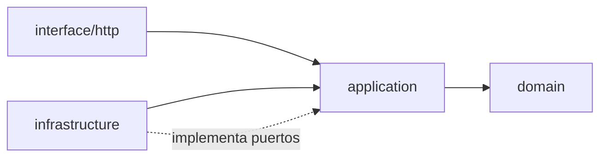

# ADR-0002: Backend — NestJS monolito modular con pnpm workspaces

- **Estado:** Propuesto
- **Fecha:** 2026-11-22
- **Decisores:** Responsable técnico
- **Relacionado:** Constitución VIII (Clean Architecture), IX (Modularidad); ADR-0004, ADR-0005; D-ARC-04

## Contexto

Kuota Core es la autoridad contable: registra y confirma operaciones financieras, aplica reglas de préstamo, ahorro y
garantía, y sirve a tres aplicaciones. Necesita transacciones ACID entre módulos (p. ej. pago → ledger → saldo del
préstamo → recibo), aislamiento multi-tenant y alta trazabilidad. El equipo es pequeño.

## Opciones consideradas

### Estilo de arquitectura
1. **Monolito modular** (un proceso desplegable, módulos con límites explícitos).
2. Microservicios por dominio (préstamos, ahorro, ledger, sync).
3. Monolito sin módulos explícitos (por capas técnicas).

### Tooling del workspace TypeScript

| Criterio | pnpm workspaces (simple) | Nx | Turborepo |
|---|---|---|---|
| Curva de aprendizaje | ✅ Mínima | ❌ Alta (generators, project graph, plugins) | ⚠️ Media |
| Paquetes TS actuales | 1 (`backend`) + tooling eventual | Pensado para decenas | Pensado para varios |
| Cache de tareas | ❌ No nativo | ✅ Local/remota | ✅ Local/remota |
| Ejecución "solo afectados" | ⚠️ Vía path filters de GitHub Actions | ✅ `nx affected` | ✅ `--filter=...[origin/main]` |
| Integración con Flutter | N/A (Flutter usa su propio workspace) | ⚠️ Plugins comunitarios | ❌ |
| Dependencia/lock-in | ✅ Ninguno | ❌ Alto | ⚠️ Bajo |

## Decisión

- **Monolito modular NestJS** sobre **Node.js 26 LTS** y **TypeScript `strict`**.
- **pnpm workspaces** sin Nx ni Turborepo. Raíz con `pnpm-workspace.yaml` que incluye `backend` (y `tooling/*` si
  aparece). pnpm se activa con `corepack` (oficial de Node).
- **Redis no se incluye en la iteración 1.** Colas/jobs y outbox de eventos sobre PostgreSQL (tabla outbox o pg-boss).
  Redis se introduce cuando haya caching o rate-limiting distribuido justificado en un `plan.md`.

### Módulos (límites de dominio)

`identity`, `tenancy`, `customers`, `products`, `loans` (originación + servicing), `payments`, `savings`, `collateral`,
`ledger`, `collection` (operación de campo, rutas), `sync`, `receipts`, `cash-reconciliation`, `reporting`, `audit`,
`notifications`, `platform-admin`.

Cada módulo:

```text
backend/src/modules/<modulo>/
├── domain/          # entidades, value objects, políticas, motores puros (sin NestJS/Prisma/HTTP)
├── application/     # casos de uso / comandos / queries, puertos (interfaces)
├── infrastructure/  # adaptadores: repositorios Prisma, SQL, clientes externos
└── interface/http/  # controladores, DTOs validados contra OpenAPI
```



Reglas:
- Un módulo **no** accede a tablas de otro módulo; usa su API pública (servicio de aplicación exportado) o eventos internos.
- `domain/` no importa `@nestjs/*`, `@prisma/*`, `express`/`fastify`. Verificado con `dependency-cruiser` en CI.
- Comunicación síncrona intra-proceso dentro de una transacción cuando la consistencia contable lo exige
  (p. ej. `payments` → `ledger`); eventos internos (outbox) para efectos secundarios (notificaciones, reportes).
- El módulo `platform-admin` es el único con operaciones cross-tenant y usa un rol de base de datos distinto.

## Consecuencias

- **Positivas:** transacciones ACID entre módulos sin sagas; un despliegue; refactor sencillo de límites mientras el
  dominio madura; costo operativo bajo.
- **Negativas:** escalamiento horizontal del proceso completo; disciplina de límites depende de lint y revisión.
- **Riesgos:** "big ball of mud" → mitigado con reglas de dependencias en CI (Constitución IX).
- **Sin Nx/Turbo:** no hay cache remota; aceptable con un solo paquete TS.

## Validación

- Lint de dependencias activo y bloqueante desde la feature 001.
- Tiempo de CI del backend medido en cada PR.

## Revisión

- Extraer un módulo a servicio solo con ADR y métricas (carga, aislamiento de fallos, equipo dedicado). Candidatos
  naturales a futuro: `sync` (picos de carga) y `reporting` (consultas pesadas, réplica de lectura).
- Reevaluar Nx/Turborepo si hay > 5 paquetes TS o CI de backend > 10 min.
- Proveedor de hosting: D-ARC-04 (pendiente; sin aprovisionar).
