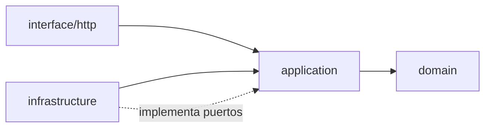

# ADR-0002: Backend — NestJS monolito modular con pnpm workspaces

- **Estado:** Aceptado con condiciones (2026-11-22, responsable del proyecto). C2-1 y C2-3 documentados en este ADR;
  **C2-2 (propiedad de tablas, D-ARC-07) debe resolverse antes de 002**.
- **Fecha:** 2026-11-22
- **Decisores:** Responsable técnico
- **Relacionado:** Constitución VIII (Clean Architecture), IX (Modularidad); ADR-0004, ADR-0005; D-ARC-04, D-ARC-07

## Contexto

Kuota Core es la autoridad contable: registra y confirma operaciones financieras, aplica reglas de préstamo, ahorro y
garantía, y sirve a tres aplicaciones. Necesita transacciones ACID entre módulos (p. ej. pago → ledger → saldo del
préstamo → recibo), aislamiento multi-tenant y alta trazabilidad. El equipo es pequeño.

## Opciones consideradas

### Estilo de arquitectura
1. **Monolito modular** (un proceso desplegable, módulos con límites explícitos).
2. Microservicios por dominio (préstamos, ahorro, ledger, sync).
3. Monolito sin módulos explícitos (por capas técnicas).

### Tooling del workspace TypeScript

| Criterio | pnpm workspaces (simple) | Nx | Turborepo |
|---|---|---|---|
| Curva de aprendizaje | ✅ Mínima | ❌ Alta (generators, project graph, plugins) | ⚠️ Media |
| Paquetes TS actuales | 1 (`backend`) + tooling eventual | Pensado para decenas | Pensado para varios |
| Cache de tareas | ❌ No nativo | ✅ Local/remota | ✅ Local/remota |
| Ejecución "solo afectados" | ⚠️ Vía path filters de GitHub Actions | ✅ `nx affected` | ✅ `--filter=...[origin/main]` |
| Integración con Flutter | N/A (Flutter usa su propio workspace) | ⚠️ Plugins comunitarios | ❌ |
| Dependencia/lock-in | ✅ Ninguno | ❌ Alto | ⚠️ Bajo |

## Decisión

- **Monolito modular NestJS** sobre **Node.js 26 LTS** y **TypeScript `strict`**.
- **pnpm workspaces** sin Nx ni Turborepo. Raíz con `pnpm-workspace.yaml` que incluye `backend` (y `tooling/*` si
  aparece). pnpm se activa con `corepack` (oficial de Node).
- **Redis no se incluye en la iteración 1.** Colas/jobs y outbox de eventos sobre PostgreSQL (tabla outbox o pg-boss).
  Redis se introduce cuando haya caching o rate-limiting distribuido justificado en un `plan.md`.

### Módulos (límites de dominio)

`identity`, `tenancy`, `customers`, `products`, `loans` (originación + servicing), `payments`, `savings`, `collateral`,
`ledger`, `collection` (operación de campo, rutas), `sync`, `receipts`, `cash-reconciliation`, `reporting`, `audit`
(solo consulta; ver *Auditoría*), `notifications`, `platform-admin`. Los módulos se crean cuando una spec los requiere.

Cada módulo:

```text
backend/src/modules/<modulo>/
├── domain/          # entidades, value objects, políticas, motores puros (sin NestJS/Prisma/HTTP)
├── application/     # casos de uso / comandos / queries, puertos (interfaces)
├── infrastructure/  # adaptadores: repositorios Prisma, SQL, clientes externos
└── interface/http/  # controladores, DTOs validados contra OpenAPI
```



Reglas:
- Un módulo **no** accede a tablas de otro módulo; usa su API pública (servicio de aplicación exportado) o eventos internos.
- `domain/` no importa `@nestjs/*`, `@prisma/*`, `express`/`fastify`. Verificado con `dependency-cruiser` en CI.
- Comunicación síncrona intra-proceso dentro de una transacción cuando la consistencia contable lo exige
  (p. ej. `payments` → `ledger`); eventos internos (outbox) para efectos secundarios (notificaciones, reportes).
- El módulo `platform-admin` es el único con operaciones cross-tenant y usa un rol de base de datos distinto.

### Propagación transaccional entre módulos (C2-1)

- Un caso de uso abre **una** transacción con `withTenant` (ADR-0004). El cliente transaccional se guarda en CLS
  (nestjs-cls) y es el único acceso a datos de los repositorios.
- Los servicios de `public-api.ts` **no abren transacciones propias**: participan en la del llamador. Si se invocan sin
  transacción activa, la abren mediante `withTenant`.
- `withTenant` anidado:

| Situación | Comportamiento |
|---|---|
| Transacción activa con el mismo tenant | Reutiliza la transacción: sin transacción nueva ni *savepoint* |
| Transacción activa con otro tenant | Error `TenantContextMismatch` y rollback de toda la transacción |
| Sin transacción activa | Abre una nueva |
| Excepción en un callback anidado | Se propaga y revierte la transacción completa; no hay rollback parcial en v1 |

- Implementación: `@nestjs-cls/transactional` 4.x con `@nestjs-cls/transactional-adapter-prisma` 2.x (existencia y
  compatibilidad con nestjs-cls 7 y Prisma verificadas en npm el 2026-11-22) o un equivalente propio en
  `common/tenant-context`. Se elige y verifica en el spike (criterio S5 de ADR-0004) y se registra en research R-04 de 001.
- Ninguna llamada HTTP externa dentro de la transacción; los efectos secundarios van por outbox.

### Propiedad de tablas (C2-2) — decisión D-ARC-07, antes de 002

La Constitución IX prohíbe que un módulo acceda a tablas de otro; dependency-cruiser solo controla *imports* y no lo
impide con un único cliente Prisma. Mecanismo propuesto (pendiente de aprobación):

1. Manifiesto `backend/db/table-ownership.json` (tabla → módulo propietario). Un verificador de catálogo, junto a
   `db:check-rls`, falla si una tabla del esquema `kuota` no tiene exactamente un propietario.
2. Modelos Prisma agrupados por módulo (esquema multiarchivo `prisma/schema/<módulo>.prisma`; soporte a verificar en la
   versión fijada) y regla de lint: en `modules/<m>/infrastructure/**` solo se accede a modelos de `<m>`. El SQL crudo
   vive en archivos por módulo y un script rechaza referencias a tablas de otros propietarios.
3. Los datos de otro módulo solo se obtienen por su `public-api.ts`.

Alternativa más fuerte, no recomendada para v1: un esquema PostgreSQL y un rol por módulo con `SET LOCAL ROLE` en cada
llamada. Aísla en la base de datos, pero complica las transacciones entre módulos y multiplica los permisos.
Mientras D-ARC-07 esté pendiente, 001 solo crea tablas de `common` (`idempotency_keys`, `audit_events`) y del módulo
técnico `dev-probe`.

### Proceso worker y rol `kuota_worker` (C2-3)

- Proceso `main.worker.ts` del mismo paquete (`docs/architecture/c4-containers.md`). Responsabilidades: publicar el
  outbox, jobs programados (reconciliación del ledger, cierres de ciclo, devengos si se aprueban, purga de
  idempotencias) y envío de OTP y push.
- Rol `kuota_worker` con credencial propia: los mismos privilegios que `kuota_app` sobre tablas de tenant (sujeto a RLS,
  sin `BYPASSRLS`) más DML en las tablas de cola y outbox. Cada job ejecuta en `withTenant` con el `tenant_id` de su
  registro. Para recorrer tenants usa una función `SECURITY DEFINER` que solo devuelve IDs de tenants activos.
- No existe en 001 (research R-16: sin cola). Se crea con la primera feature que introduzca jobs.

### Auditoría: mecanismo frente a consulta

- `common/audit`: mecanismo transversal (`AuditService.record()` y tabla `audit_events`, propiedad de `common`), que
  escribe en la misma transacción del caso de uso (implementado en 001).
- Módulo `audit` (feature 015): casos de uso de consulta y exportación, de solo lectura, a través de la API pública de
  `common/audit`. No escribe ni redefine la tabla.

## Consecuencias

- **Positivas:** transacciones ACID entre módulos sin sagas; un despliegue; refactor sencillo de límites mientras el
  dominio madura; costo operativo bajo.
- **Negativas:** escalamiento horizontal del proceso completo; disciplina de límites depende de lint y revisión.
- **Riesgos:** "big ball of mud" → mitigado con reglas de dependencias en CI (Constitución IX).
- **Sin Nx/Turbo:** no hay cache remota; aceptable con un solo paquete TS.

## Validación

- Lint de dependencias activo y bloqueante desde la feature 001.
- Tiempo de CI del backend medido en cada PR.

## Revisión

- Extraer un módulo a servicio solo con ADR y métricas (carga, aislamiento de fallos, equipo dedicado). Candidatos
  naturales a futuro: `sync` (picos de carga) y `reporting` (consultas pesadas, réplica de lectura).
- Reevaluar Nx/Turborepo si hay > 5 paquetes TS o CI de backend > 10 min.
- Proveedor de hosting: D-ARC-04 (pendiente; sin aprovisionar).
