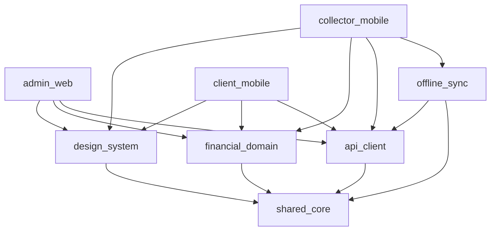

# ADR-0003: Flutter — Dart pub workspaces, Melos 8 y Riverpod

- **Estado:** Aceptado (2026-11-22, responsable del proyecto). D-ARC-02 cerrada: Riverpod
- **Fecha:** 2026-11-22
- **Decisores:** Responsable técnico, líder Flutter
- **Relacionado:** Constitución IX, XI, XII; D-ENV-01, D-ARC-02, D-ARC-03; ADR-0006

## Contexto

Tres aplicaciones Flutter (`admin_web`, `collector_mobile`, `client_mobile`) comparten modelos de dominio, cliente HTTP,
componentes visuales y lógica de simulación. Collector es offline-first (Drift/SQLite). La Constitución prohíbe duplicar
código entre apps (IX) y exige que el cliente HTTP se genere desde OpenAPI (XII).

**Entorno (D-ENV-01, aprobada):** la instalación global (Flutter 3.24.3 / Dart 3.5.3) no admite *pub workspaces*
(Dart ≥ 3.6) y **no se modifica**. El proyecto fija **Flutter 3.50.1 / Dart 3.14** con **FVM ≥ 3.2** en
`flutter/.fvmrc`. Ese archivo aún no existe: lo crea la tarea T080 de 001. Los comandos del workspace se ejecutan con
`fvm flutter …` / `fvm dart …`.

## Opciones consideradas

### Gestión del workspace
1. **Dart pub workspaces (nativo) + Melos 8** solo para scripts/versionado.
2. Melos clásico (≤ 6) con `melos bootstrap` y `pubspec_overrides.yaml`.
3. Paquetes con `path:` dependencies sin herramienta.

### Gestión de estado
| Criterio | Riverpod | Bloc |
|---|---|---|
| Inyección de dependencias | ✅ Integrada (providers), fácil de sobrescribir en tests | ⚠️ Requiere `RepositoryProvider`/get_it |
| Boilerplate | ✅ Bajo (con codegen opcional) | ❌ Alto (eventos, estados) |
| Trazabilidad de eventos | ⚠️ Menos explícita | ✅ Eventos explícitos, `BlocObserver` |
| Streams reactivos (Drift `watch`) | ✅ `StreamProvider` nativo | ✅ |
| Testabilidad | ✅ `ProviderContainer` con overrides | ✅ `bloc_test` |

## Decisión

- **Dart pub workspaces**: `flutter/pubspec.yaml` raíz con `workspace:` y cada paquete con `resolution: workspace`.
  Un solo `pubspec.lock` y resolución compartida.
- **Melos 8.x** con configuración en la sección `melos:` del `pubspec.yaml` raíz de `flutter/`, usado **solo** para
  scripts (`analyze`, `test`, `format`, generación), filtros por paquete afectado y versionado/changelog. No se usa
  `melos bootstrap` para enlazar paquetes (lo hace pub workspaces) ni `pubspec_overrides.yaml`.
- **Riverpod** como gestión de estado e inyección de dependencias (**D-ARC-02 aprobada el 2026-11-22**). Bloc queda
  descartado; reevaluarlo requiere un ADR nuevo (ver *Revisión*).
- **admin_web en Flutter Web** inicialmente (D-ARC-03), reevaluar tras el MVP por SEO irrelevante pero rendimiento de
  tablas grandes y accesibilidad.

### Paquetes

```text
flutter/
├── pubspec.yaml                  # workspace + melos
├── apps/
│   ├── admin_web/
│   ├── collector_mobile/
│   └── client_mobile/
└── packages/
    ├── shared_core/              # Result/errores, logging, reloj inyectable, config, utilidades
    ├── design_system/            # tokens, tema, componentes UI (incluye recibo de alto contraste)
    ├── api_client/               # GENERADO desde contracts/openapi (DTOs + cliente HTTP); no editar a mano
    ├── financial_domain/         # modelos de dominio, Money (Decimal/centavos), simuladores puros
    └── offline_sync/             # (propuesto) outbox Drift, motor de sincronización, estados de operación
```



Reglas de separación:
- **DTOs** (`api_client`) ≠ **modelos de dominio** (`financial_domain`); los mapeadores viven en la app o en un
  repositorio de la capa de datos.
- `financial_domain` no depende de Flutter (Dart puro) ni de `api_client`: sus simuladores son **proyecciones**, nunca
  la fuente del estado contable.
- Dinero en Dart: paquete `decimal` o enteros en centavos; prohibido `double` (Constitución IV).
- Persistencia local: Drift/SQLite con cifrado (SQLCipher o equivalente evaluado en la spec de 011).
- Credenciales: `flutter_secure_storage` (Keychain/Keystore).

### Estado de UI frente a lógica de negocio

- Riverpod solo orquesta el estado de presentación y la inyección de dependencias. Los providers no contienen reglas
  financieras.
- Reglas y cálculos: `financial_domain` (Dart puro, sin Flutter ni Riverpod). Acceso a datos: repositorios en
  `features/*/data`, que mapean DTOs de `api_client` a modelos de dominio.
- Dinero en Dart: `Money` con `BigInt` según ADR-0007, en móvil y en web.

### Offline-first

- Los estados de operación local y el motor de sincronización viven en el paquete `offline_sync` (ADR-0006), separados
  de la UI. La UI los observa (`StreamProvider`) y no cambia estados; las transiciones las hace solo el motor.

### Clave de idempotencia

- La clave (UUIDv7) se genera **al crear la operación** (comando offline u operación en línea), se persiste con ella
  (outbox en Collector; registro local de la operación pendiente en las demás apps) y se **reutiliza en cada
  reintento**.
- `api_client` y sus interceptores nunca generan ni reemplazan `Idempotency-Key`. Una escritura idempotente sin clave
  falla en el cliente antes de enviarse. En Collector, `operation_id` es la clave (ADR-0006).

### Entornos (FR-032 de 001)

- `local`, `testing`, `staging` y `production` mediante `--dart-define-from-file=config/<entorno>.json` (sin secretos).
  Los identificadores de app por entorno, para instalar varias versiones en paralelo, se definen al distribuir
  (D-ARC-04).

## Consecuencias

- **Positivas:** resolución de dependencias única, sin enlaces frágiles; código compartido real; tests de dominio sin Flutter.
- **Negativas:** requiere FVM y una versión de Flutter por proyecto (sin cambios en la instalación global).
- **Riesgos:** algunos paquetes de terceros podrían no soportar workspaces → validar en la tarea de scaffolding.

## Validación

- `fvm flutter pub get` en la raíz de `flutter/` resuelve todos los paquetes; `melos run analyze` y `melos run test`
  verdes.
- Lint que impide importar `package:flutter` desde `financial_domain`.

## Revisión

Reevaluar Riverpod vs Bloc si la auditoría de interacciones de UI se vuelve requisito regulatorio; reevaluar Flutter Web
para admin si el rendimiento de tablas/reportes no cumple los objetivos definidos en su spec.
