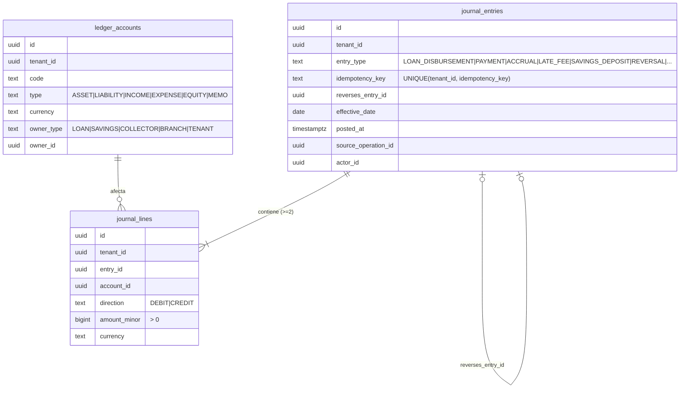

# ADR-0005: Ledger financiero de partida doble, append-only

- **Estado:** Propuesto
- **Fecha:** 2026-11-22
- **Decisores:** Responsable técnico, responsable financiero/contable
- **Relacionado:** Constitución IV, V, VI, VII; D-FIN-01, D-FIN-02, D-LED-01; feature 006-financial-ledger

## Contexto

Kuota debe mantener consistentes, para cada tenant: saldo de préstamos (capital, interés, moratorios), pagos registrados,
ahorro acumulado y rendimientos, garantías bloqueadas y efectivo en manos de cobradores. Las fuentes de inconsistencia
típicas son: saldos actualizados en varias tablas por separado, correcciones por edición directa, duplicados por
reintentos y cálculos con flotantes.

## Opciones consideradas

1. **Saldos mutables por entidad** (columna `balance` en préstamo/ahorro). Simple, pero sin trazabilidad y propenso a
   desincronización.
2. **Event sourcing completo** por agregado. Trazable, pero complejo de operar y consultar para el equipo actual.
3. **Ledger de partida doble append-only** como fuente de verdad contable, con saldos como proyecciones reconstruibles.

## Decisión

**Opción 3**: subledger operativo de **partida doble** por tenant (D-LED-01). La contabilidad general/fiscal de cada
empresa queda fuera de alcance (posible exportación futura).

### Modelo

- **Montos:** `BIGINT` en unidades mínimas + `currency` ISO 4217 (D-FIN-01). Tasas y factores: `NUMERIC(18,10)`.
- **Código:** TypeScript `bigint` para montos; `decimal.js` para cálculos intermedios con precisión y modo de redondeo
  explícitos (D-FIN-02). Dart: paquete `decimal` / centavos.
- **Invariante:** por asiento y moneda, Σ débitos = Σ créditos; verificado en la capa de dominio y por trigger diferido o
  verificación transaccional en base de datos.
- **Append-only:** `kuota_app` no tiene `UPDATE`/`DELETE` sobre `journal_entries`/`journal_lines`; trigger que rechaza
  cualquier modificación (defensa en profundidad).
- **Reversos:** un asiento `REVERSAL` con líneas espejo y `reverses_entry_id`; un asiento solo puede revertirse una vez.
- **Idempotencia:** `UNIQUE (tenant_id, idempotency_key)`.
- **Proyecciones:** `account_balances` (y saldos de préstamo/ahorro) actualizadas en la misma transacción que el asiento;
  reconstruibles desde `journal_lines`. Job de reconciliación nocturna compara proyección vs recomputo.
- **Fechas:** `effective_date` (fecha valor de negocio, p. ej. fecha de cobro offline) separada de `posted_at` (servidor).

### Catálogo de cuentas plantilla (por tenant, ajustable con aprobación contable)

| Cuenta | Tipo | Uso |
|---|---|---|
| Caja / bancos | ASSET | Efectivo de la empresa |
| Efectivo en tránsito por cobrador | ASSET | Cobrado en campo, no entregado |
| Cartera — capital | ASSET | Capital por cobrar por préstamo |
| Intereses por cobrar / devengados | ASSET | Interés exigible |
| Moratorios por cobrar | ASSET | Moratorios generados |
| Ingresos por intereses | INCOME | Reconocimiento de interés |
| Ingresos por moratorios | INCOME | — |
| Ahorro de clientes | LIABILITY | Aportaciones recibidas |
| Rendimiento por pagar | LIABILITY | Rendimiento asociado |
| Garantía bloqueada | MEMO (orden) | Ahorro comprometido como garantía |
| Diferencias de caja | ASSET/EXPENSE | Faltantes/sobrantes de cortes (D-CSH-02) |

El criterio de reconocimiento de intereses (devengo vs cobro) es decisión contable pendiente (**D-LED-02**) y se define en 006.

## Consecuencias

- **Positivas:** trazabilidad total, auditoría natural, correcciones seguras, reconciliación verificable.
- **Negativas:** más escrituras por operación; el equipo debe dominar conceptos contables; reportes requieren
  proyecciones.
- **Riesgos:** catálogo de cuentas incorrecto → validación con contador antes de implementar 006.

## Validación

Pruebas de invariante de balance, prueba de rechazo de `UPDATE`/`DELETE`, prueba de reconstrucción de saldos, prueba de
idempotencia concurrente (ver `docs/quality/financial-invariants.md`).

## Revisión

Reevaluar si se requiere contabilidad general completa o integración con sistemas contables externos.
