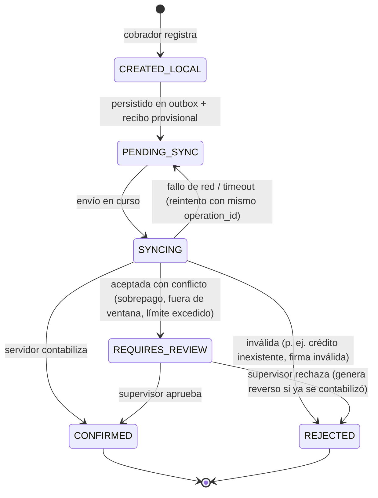

# ADR-0006: Sincronización offline por comandos idempotentes

- **Estado:** Propuesto
- **Fecha:** 2026-11-22
- **Decisores:** Responsable técnico, líder Flutter, operaciones de cobranza
- **Relacionado:** Constitución VI, XI; D-SYNC-01, D-SYNC-02, D-SYNC-03, D-RCP-02, D-CSH-01; features 010, 011, 012, 013

## Contexto

Kuota Collector debe operar **72 horas** sin conectividad: consultar cartera asignada, registrar pagos y aportaciones y
emitir recibos provisionales. El servidor es la autoridad contable. Riesgos: duplicados por reintentos, datos
desactualizados, dos cobradores cobrando el mismo crédito, relojes de dispositivo manipulados y fraude.

## Opciones consideradas

1. **Replicación de estado bidireccional** (sync de tablas, last-write-wins). Inadecuado: un saldo no se "fusiona".
2. **CRDTs**. Útil para colaboración de documentos; no modela reglas contables ni validaciones de negocio.
3. **Sincronización por comandos (outbox)**: el dispositivo registra *intenciones* (comandos) que el servidor valida y
   contabiliza; el dispositivo recibe *snapshots* de lectura.

## Decisión

**Opción 3.**

- **Push (comandos):** outbox local en Drift. Cada comando lleva:
  `operation_id` (UUIDv7 generado en el dispositivo, **es la clave de idempotencia**), `type`, `payload`, `device_id`,
  `collector_id`, `device_time`, `base_snapshot_version`, `receipt_folio` y **firma del dispositivo**.
- **Pull (lectura):** snapshots incrementales de la cartera asignada con cursor (`since_version`); datos mostrados con
  su fecha de frescura.
- **Servidor autoritativo:** valida permisos, asignación, estado del crédito, límites y firma; contabiliza en el ledger
  con `effective_date` = fecha de cobro (validada contra ventana aceptable) y `posted_at` = servidor.

### Estados de operación local (validados para v1; D-SYNC-02)

- No se agregan estados nuevos en v1. `CANCELLED_LOCAL` **no** se permite para pagos con recibo emitido (el efectivo ya
  cambió de manos); solo se considera para borradores sin recibo.
- `REJECTED` nunca se descarta en silencio: se notifica al cobrador y al supervisor y entra al corte de caja.

### Conflictos

| Escenario | Política (recomendación) |
|---|---|
| Reintento del mismo comando | Mismo `operation_id` → mismo resultado, sin duplicar (Constitución VI) |
| Mismo `operation_id`, payload distinto | Rechazo explícito + alerta de seguridad |
| Dos cobradores cobran la misma cuota | El efectivo es real: **ambos pagos se aceptan**; el excedente → `REQUIRES_REVIEW` (D-SYNC-01) |
| Snapshot desactualizado (pago ya hecho en oficina) | Se acepta; prelación recalculada en servidor; diferencias informadas |
| Crédito liquidado/reestructurado tras el snapshot | `REQUIRES_REVIEW` |
| `device_time` fuera de ventana razonable | `REQUIRES_REVIEW` + marca de posible manipulación de reloj |
| > 72 h sin sync | Bloqueo de nuevos cobros en el dispositivo (configurable por tenant, D-SYNC-03) |
| Límite de efectivo por dispositivo excedido | Bloqueo de nuevos cobros hasta sincronizar/entregar (D-SYNC-03) |

### Seguridad del dispositivo

Llave de firma por dispositivo (generada en el enrolamiento, almacenada en Keystore/Keychain); base Drift cifrada;
revocación remota del dispositivo; folios offline `{tenantPrefix}-{deviceShortId}-{seq}` (D-RCP-02).

## Consecuencias

- **Positivas:** idempotencia natural, auditoría completa de intenciones, el servidor mantiene las reglas.
- **Negativas:** la UI debe comunicar estados provisionales; los saldos offline son estimaciones.
- **Riesgos:** fraude (recibos provisionales sin sincronizar) → límites, firma, conciliación de cortes (013) y folios
  secuenciales verificables (huecos de secuencia detectables).

## Validación

Pruebas de reintento, duplicado concurrente, red intermitente, reloj desfasado, 72 h simuladas con reloj controlado y
migración de outbox entre versiones de app (Constitución XIV).

## Revisión

Reevaluar si el volumen de comandos por dispositivo o la latencia de sincronización exceden los objetivos de 011.
