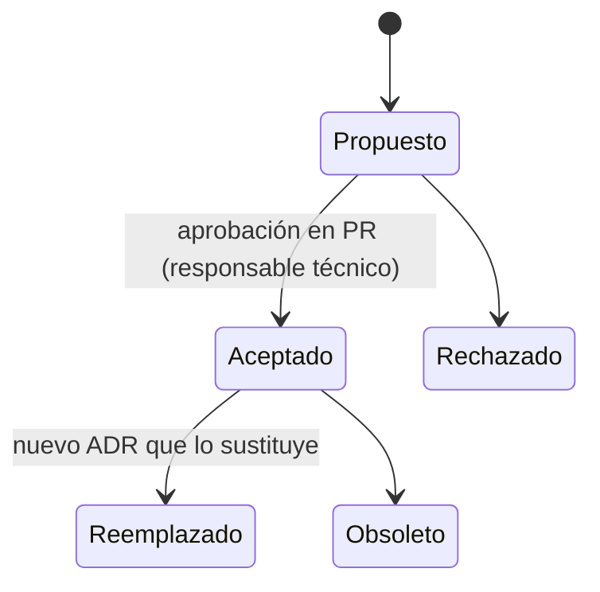

# Architecture Decision Records (ADR)

Registro de decisiones arquitectónicas de Kuota. Formato basado en **MADR** (Markdown Architectural Decision Records).

## Índice

| ADR | Título | Estado | Fecha | Decisiones pendientes relacionadas |
|---|---|---|---|---|
| [ADR-0001](ADR-0001-monorepo-strategy.md) | Estrategia de repositorio: monorepo único | Propuesto | 2026-11-22 | — |
| [ADR-0002](ADR-0002-backend-architecture.md) | Backend: NestJS monolito modular + pnpm workspaces | Propuesto | 2026-11-22 | D-ARC-04 |
| [ADR-0003](ADR-0003-flutter-workspace.md) | Flutter: pub workspaces + Melos 8 + Riverpod | Propuesto | 2026-11-22 | D-ENV-01, D-ARC-02, D-ARC-03 |
| [ADR-0004](ADR-0004-database-orm.md) | PostgreSQL 18 + Prisma con RLS | Propuesto (condicionado a spike) | 2026-11-22 | D-ARC-01 |
| [ADR-0005](ADR-0005-financial-ledger.md) | Ledger de partida doble append-only | Propuesto | 2026-11-22 | D-FIN-01, D-FIN-02, D-LED-01 |
| [ADR-0006](ADR-0006-offline-sync.md) | Sincronización offline por comandos idempotentes | Propuesto | 2026-11-22 | D-SYNC-01, D-SYNC-02, D-SYNC-03 |

Las decisiones de negocio, financieras y legales pendientes se registran en
[`docs/business/decisions-register.md`](../business/decisions-register.md) con identificadores `D-*`.

## Ciclo de vida



- Un ADR **Propuesto** documenta la recomendación; no autoriza implementación hasta pasar a **Aceptado**
  (excepto spikes explícitamente marcados como tareas de validación en `tasks.md`).
- Un ADR aceptado **no se edita** en su sustancia: se crea uno nuevo que lo reemplaza (`Reemplaza: ADR-XXXX`).
- Cambiar cualquier elemento de la sección *Restricciones de stack y tecnología* de la Constitución requiere ADR.

## Plantilla

```markdown
# ADR-NNNN: <Título>

- **Estado:** Propuesto | Aceptado | Rechazado | Reemplazado por ADR-XXXX | Obsoleto
- **Fecha:** YYYY-MM-DD
- **Decisores:** <roles>
- **Relacionado:** <specs, ADRs, decisiones D-*>

## Contexto
Problema, fuerzas, restricciones (Constitución), supuestos.

## Opciones consideradas
1. Opción A — …
2. Opción B — …

## Decisión
Opción elegida y razón principal.

## Consecuencias
- Positivas: …
- Negativas / costos: …
- Riesgos y mitigaciones: …

## Validación
Cómo se comprobará que la decisión funciona (pruebas, spike, métricas).

## Revisión
Condiciones que obligan a reevaluar la decisión.
```
