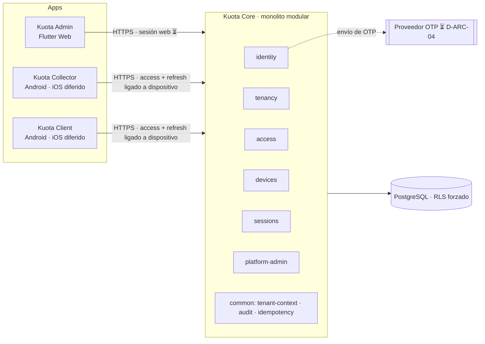
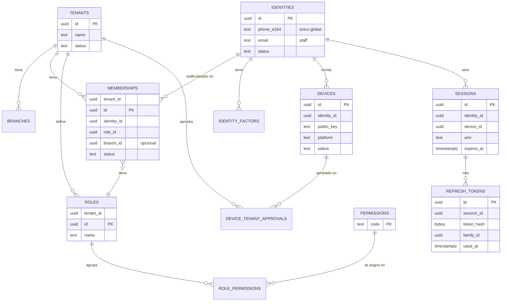
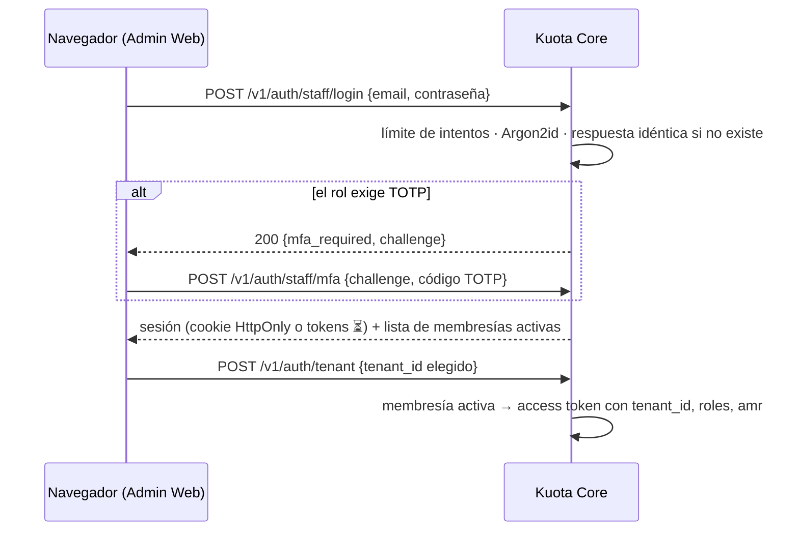
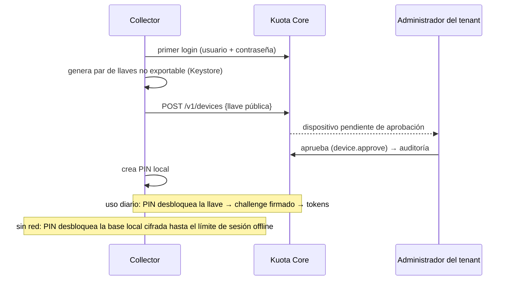

# 002-identity-tenancy — Especificación preliminar

> **BORRADOR (2026-11-23). No es la especificación oficial de 002.** El procedimiento de Spec-Kit (`/speckit-specify`
> → clarify → plan → tasks → analyze → aprobación) no se ha ejecutado porque crea una rama, y las ramas no están
> autorizadas (Aprobación 10 de 001). Los identificadores `P-US`, `P-FR` y `P-NFR` son provisionales y se renumerarán
> en la spec oficial. Todo lo que depende de una decisión pendiente lo indica ("⏳ D-…").

## 1. Objetivo y alcance

**Objetivo:** que cada persona entre a Kuota con una identidad única y verificada y que, dentro de cada empresa
(tenant), solo pueda hacer lo que su membresía y su rol permiten. El backend es la única autoridad (Constitución II).

**Dentro:** tenants y sucursales; identidad global; membresías, roles y permisos por tenant; autenticación de staff,
cobradores y clientes; dispositivos; sesiones, tokens y revocación; recuperación de acceso; administración de
plataforma mínima; auditoría y pruebas de aislamiento MT-01, MT-07 y MT-08.

**Fuera:** datos y KYC de clientes y `customer_links` (003); préstamos, ahorro y ledger (004–008); sincronización
offline (011); portal del cliente más allá del acceso (014); despliegue real (D-ARC-04).

## 2. Historias de usuario propuestas

| ID | Historia | Prioridad propuesta |
|---|---|---|
| P-US1 | Como operador de plataforma, doy de alta un tenant y su primer administrador, con auditoría y MFA resistente a phishing | P1 |
| P-US2 | Como staff, inicio sesión en Kuota Admin con contraseña (y TOTP si mi rol lo exige ⏳ D-AUTH-02) y elijo la empresa en la que trabajo si tengo varias membresías | P1 |
| P-US3 | Como administrador de tenant, invito personas, asigno roles y sucursales, y suspendo o revoco membresías | P1 |
| P-US4 | Como cobrador, enrolo mi dispositivo, un administrador lo aprueba y después entro con PIN; puedo trabajar sin red hasta el límite configurado ⏳ D-SYNC-03 | P2 |
| P-US5 | Como cliente, activo Kuota Client con el teléfono que registró la empresa (OTP ⏳ D-AUTH-01), creo un PIN y entro con PIN o biometría | P2 |
| P-US6 | Como persona que perdió el acceso, lo recupero sin que un SIM-swap baste, y las sesiones anteriores quedan revocadas | P2 |
| P-US7 | Como persona o administrador, veo y revoco sesiones y dispositivos; la reutilización de un refresh revoca toda la familia | P1 |
| P-US8 | Como responsable de seguridad, cada evento de acceso queda auditado sin datos sensibles y nadie de un tenant ve datos de otro | P1 |

## 3. Requisitos funcionales propuestos

| ID | Requisito |
|---|---|
| P-FR1 | El contexto de tenant de cada solicitud autenticada proviene del token verificado; `tenant_id` del cliente se ignora o rechaza (MT-07) |
| P-FR2 | Una identidad global por persona; sin datos de negocio; un tenant no puede saber si una identidad existe en otro tenant |
| P-FR3 | Membresía = (tenant, identidad, rol, sucursal opcional, estado); solo las activas habilitan acceso |
| P-FR4 | Permisos definidos por el sistema; roles por tenant que agrupan permisos; cada endpoint declara su permiso (tabla Endpoint Access) |
| P-FR5 | Contraseña de staff con hash Argon2id y política mínima ⏳ D-AUTH-02 |
| P-FR6 | Factor TOTP obligatorio para los roles que se decidan ⏳ D-AUTH-02 |
| P-FR7 | Enrolamiento de dispositivo con par de llaves no exportable; aprobación por administrador para cobradores; revocación con borrado remoto |
| P-FR8 | Acceso por *challenge* firmado por la llave del dispositivo, desbloqueada con PIN o biometría ⏳ D-AUTH-01 |
| P-FR9 | Access token corto y asimétrico; refresh opaco con rotación y detección de reutilización ⏳ (sin ID de decisión) |
| P-FR10 | Cambio de tenant = nuevo access token con el `tenant_id` elegido, solo con membresía activa |
| P-FR11 | Recuperación con un segundo control además del OTP, periodo de espera y aviso ⏳ D-AUTH-01 |
| P-FR12 | Revocación de sesiones por identidad, sesión o dispositivo |
| P-FR13 | Límite de intentos y de tasa por IP, identidad y teléfono; respuestas idénticas exista o no la cuenta |
| P-FR14 | Auditoría de inicio y fallo de sesión, enrolamiento, cambio de PIN, teléfono o factor, revocaciones y accesos de plataforma |
| P-FR15 | Endpoints de plataforma con prefijo propio, rol de base de datos `kuota_platform`, MFA y motivo registrado; cada operación queda en `platform_audit_events` (mecanismo de 001, T099), nunca en `audit_events` de un tenant |
| P-FR16 | Login, OTP y recuperación registrados en Endpoint Access como puntos de entrada de autenticación con controles ⏳ D-AUTH-03 |

## 4. Requisitos no funcionales propuestos

| ID | Requisito |
|---|---|
| P-NFR1 | RLS habilitado y forzado en toda tabla con `tenant_id`; tablas globales con política por `app.identity_id` y lista blanca explícita en `db:check-rls` |
| P-NFR2 | Propiedad de tablas por módulo verificada en CI ⏳ D-ARC-07 |
| P-NFR3 | OTP, contraseñas, PIN, tokens y secretos TOTP nunca en logs, métricas ni respuestas de error; la redacción de 001 se amplía |
| P-NFR4 | Métricas de autenticación con etiquetas acotadas (resultado, método); nunca identidad, teléfono, correo ni tenant |
| P-NFR5 | Llaves de firma fuera del repositorio; rotación con `kid` ⏳ D-ARC-04 |
| P-NFR6 | Cobertura 90/80 (Constitución X) y gates de 001 en verde |
| P-NFR7 | Contrato OpenAPI primero; cliente Dart generado (Constitución XII); ninguna pantalla sin su contrato |

## 5. Contenedores (C4, nivel 2)



## 6. Modelo entidad-relación propuesto



Propiedad y RLS por tabla: `adr-propuesta-d-arc-07.md` §4.2.

## 7. Matriz de roles y permisos (PROPUESTA para decidir; no hay catálogo aprobado)

Roles candidatos por tenant y permisos de 002 (los permisos financieros llegarán con 004–008):

| Permiso (002) | Administrador del tenant | Supervisor de sucursal | Cobrador | Solo lectura |
|---|---|---|---|---|
| `membership.invite` / `membership.revoke` | ✓ | — | — | — |
| `role.manage` | ✓ | — | — | — |
| `branch.manage` | ✓ | — | — | — |
| `device.approve` / `device.revoke` | ✓ | ✓ (su sucursal) | — | — |
| `session.revoke.others` | ✓ | — | — | — |
| `session.revoke.own` | ✓ | ✓ | ✓ | ✓ |
| `audit.read.access` | ✓ | — | — | — |

Plataforma (fuera de los roles de tenant): `platform.tenant.create`, `platform.breakglass` (MFA resistente a phishing,
motivo, caducidad). Clientes: sin roles de staff; su acceso a datos de cliente llega con 003/014.

## 8. Flujos

### 8.1 Staff en Kuota Admin (⏳ D-AUTH-02; modelo de sesión web ⏳ CORS)



### 8.2 Enrolamiento y acceso del cobrador (⏳ D-SYNC-03)



### 8.3 Enrolamiento y acceso del cliente (⏳ D-AUTH-01; OTP ⏳ D-ARC-04)

```mermaid
sequenceDiagram
  participant C as Client
  participant API as Kuota Core
  Note over API: el tenant ya registró el teléfono (003)
  C->>API: POST /v1/auth/enroll/start {teléfono}
  API-->>C: 202 siempre (antienumeración); OTP al teléfono si procede
  C->>API: POST /v1/auth/enroll/verify {OTP, llave pública}
  C->>C: crea PIN; llave en Keystore desbloqueada con PIN o biometría
  C->>API: POST /v1/auth/challenge {device_id}
  API-->>C: nonce
  C->>API: POST /v1/auth/token {device_id, firma(nonce)}
  API-->>C: access (≈10 min) + refresh rotativo ligado al dispositivo
```

### 8.4 Sesiones y revocación

- `POST /v1/auth/refresh`: rota el refresh. Si llega uno ya usado → revoca la familia, audita y alerta.
- Revocación por sesión, dispositivo o identidad; el access token expira en minutos.
- Revocar un dispositivo: la app borra su base local en el siguiente contacto (ver `decisiones-pendientes.md` §2).

Las rutas de este apartado son ilustrativas: se fijan en el contrato OpenAPI de 002 antes de cualquier pantalla.

## 9. Gestión de secretos

| Secreto | Dónde | Local/testing | Entornos reales |
|---|---|---|---|
| Llave privada de firma de tokens | Servidor | Par efímero generado al arrancar; nunca versionado | Gestor del proveedor ⏳ D-ARC-04 |
| Secretos TOTP | `identity_factors` cifrados | Llave de cifrado de desarrollo fuera del repo | KMS ⏳ D-ARC-04 |
| Hash de contraseñas | `identity_credentials` (Argon2id) | — | — |
| Refresh tokens | Solo su hash en servidor | — | — |
| Credenciales del proveedor OTP | Entorno del servidor | Emisor técnico sin envío real, solo local/testing | ⏳ D-ARC-04 |
| Llave del dispositivo, tokens en móvil | Keystore/Keychain | Igual | Igual |

## 10. Aislamiento multi-tenant

- Tablas por tenant con `tenant_isolation` + FORCE; tablas globales con política por `app.identity_id`; tablas de
  plataforma sin acceso de `kuota_app`.
- Pruebas: MT-01 por endpoint (A recibe 404 sobre B), MT-07, MT-08 y la suite `describeTenantIsolation` de 001 para
  cada recurso nuevo.
- El cambio de tenant nunca reutiliza el access token anterior.

## 11. Estrategia de pruebas

| Nivel | Qué |
|---|---|
| Unitarias | Política de contraseñas, rotación de refresh y detección de reutilización, verificación de firmas, cálculo de permisos |
| Integración (Testcontainers) | RLS de cada tabla nueva, `withIdentity` y pre-autenticación (pruebas negativas), revocación, auditoría en la misma transacción |
| Tenancy | MT-01, MT-07, MT-08 con `describeTenantIsolation` |
| Contrato | Cada endpoint de 002 contra el contrato (Ajv), incluidos 401/403/404/429 |
| Seguridad | Fuerza bruta, enumeración, reutilización de refresh, token de otro tenant, dispositivo revocado, OTP vencido o reutilizado |
| Apps | Pruebas de widget con servidor falso; Android en emulador y Web en Chrome por cada fase vertical; iOS diferido (Aprobación 9) |
| Gates | `prove-gates.sh` amplía sus defectos de referencia (p. ej. un módulo que usa una tabla ajena ⏳ D-ARC-07) |

## 12. Riesgos y dependencias

| Riesgo | Mitigación propuesta |
|---|---|
| Búsqueda de identidad antes de autenticar abre una vía de enumeración o de bypass de RLS | Funciones `SECURITY DEFINER` mínimas, respuestas idénticas, límites de tasa, pruebas negativas |
| Toma de cuentas por SIM-swap | Recuperación con segundo control y periodo de espera |
| Robo de dispositivo del cobrador | PIN, llave no exportable, revocación con borrado remoto, sesión offline limitada |
| Filtración de la llave de firma | Rotación con `kid`, vida corta del access token, custodia en gestor de secretos |
| CSRF/XSS en Admin Web | Decisión de sesión web antes de implementar; CORS sigue sin credenciales hasta entonces |
| Erosión de límites entre módulos | D-ARC-07 antes de la primera tabla |

Dependencias: D-ARC-07, D-AUTH-01/02/03, D-LEG-06, D-ARC-04 (OTP y llaves), D-SYNC-03, D-LEG-02, catálogo de roles,
almacenamiento seguro móvil, sesión web/CORS. Ver `decisiones-pendientes.md`.

## 13. Orden de implementación propuesto

Ver `roadmap-aplicaciones.md`: fases verticales (contrato + backend + pantalla) que empiezan solo tras aprobar las
decisiones de cada fase.
