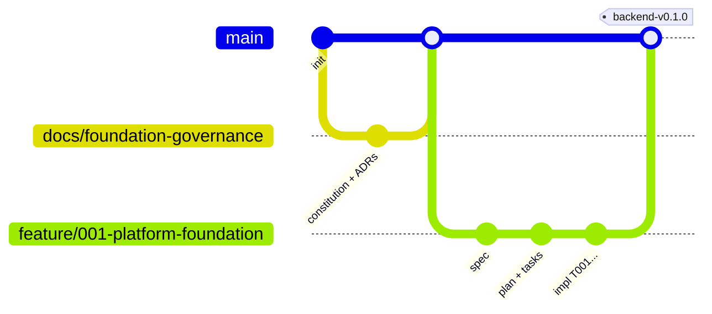

# Flujo de Git

Aplica la Constitución (§Flujo de desarrollo y quality gates). Scopes de commit y path filters:
[`docs/architecture/monorepo-strategy.md`](../architecture/monorepo-strategy.md).

## 1. Ramas

| Rama | Origen | Uso | Creación |
|---|---|---|---|
| `main` | — | Siempre desplegable; protegida | — |
| `feature/NNN-slug` | `main` | Feature de Spec-Kit (spec → código) | Automática con `/speckit-specify` (hook `speckit.git.feature`, prefijo `feature`) |
| `fix/<slug>` | `main` | Corrección de defecto | Manual |
| `hotfix/<componente>-<slug>` | tag de release | Corrección urgente en producción | Manual |
| `chore/<slug>` | `main` | Tooling, dependencias, Spec-Kit | Manual |
| `docs/<slug>` | `main` | Documentación, ADRs, Constitución (`docs/constitution-*`) | Manual |



- Una rama = una feature/corrección. Vida corta (objetivo < 5 días hábiles para ramas de código; las de spec pueden
  durar más).
- Rebase sobre `main` antes de solicitar revisión; merge a `main` por **squash** (código) o **merge commit** (ramas de
  spec con historial útil), siempre vía PR.

## 2. Commits — Conventional Commits

```text
<type>(<scope>)[!]: <descripción en imperativo, inglés o español, ≤ 72 chars>

<cuerpo opcional: por qué>

Refs: specs/NNN-slug T012
BREAKING CHANGE: <si aplica>
```

Tipos: `feat`, `fix`, `refactor`, `perf`, `test`, `docs`, `build`, `ci`, `chore`, `revert`.
Se validará con commitlint en CI (tarea de 001). Commits de código referencian la tarea (`T###`).

## 3. Pull Requests

- Plantilla obligatoria: [`.github/pull_request_template.md`](../../.github/pull_request_template.md).
- Tamaño objetivo: < 400 líneas de cambio no generado.
- Requisitos para merge:
  - CI verde (todos los jobs bloqueantes del componente afectado).
  - **1 aprobación**; **2 aprobaciones** si toca ledger, motores financieros (`loans`, `payments`, `savings`,
    `collateral`, `financial_domain`), autenticación, RLS/tenancy, migraciones o la Constitución.
  - **Mantenedor único (vigente, Constitución v1.1.0)**: mientras haya un solo mantenedor, las áreas de 2 aprobaciones
    requieren 1 aprobación humana + checklist constitucional + `/speckit-analyze` sin CRITICAL + CI verde.
  - Conversaciones resueltas; rama actualizada con `main`.
  - Referencia a `specs/NNN-*/tasks.md` (Constitución I).

### Code review — qué verificar

1. Corresponde a tareas aprobadas; nada fuera de alcance.
2. Sin flotantes para dinero; redondeo según spec.
3. Ledger: sin `UPDATE`/`DELETE`; correcciones por reverso.
4. Toda escritura financiera con idempotencia y auditoría.
5. Tablas nuevas con `tenant_id`, RLS forzado y prueba de acceso cruzado.
6. Migración compatible (expand/contract).
7. Contrato OpenAPI actualizado antes del código; sin breaking changes no declarados.
8. Logs sin PII.
9. Pruebas presentes y significativas (casos numéricos de referencia en lógica financiera).

## 4. Pruebas obligatorias antes de merge

Definidas por componente en `docs/quality/testing-strategy.md`. Mínimo: lint, tipos, unitarias, integración del
componente afectado, cobertura (90 % dominio financiero / 80 % resto), contrato y aislamiento multi-tenant.

## 5. Protección de `main` (propuesta lista para aplicar)

> **Pendiente:** el repositorio aún no tiene remoto en GitHub. Estas reglas se aplican cuando el responsable
> apruebe crear el remoto; no se crea organización ni repositorio sin autorización.

- Requerir PR antes de merge; prohibir push directo y force-push; prohibir borrado de `main`.
- Requerir status checks: `backend`, `tenancy-isolation`, `contracts`, `flutter`, `specs`, `security` (según aplique).
- Requerir 1 aprobación + aprobación de CODEOWNERS; descartar aprobaciones al cambiar el PR.
- Requerir historial lineal y conversaciones resueltas.
- Requerir commits firmados (recomendado).
- Aplicar las reglas también a administradores.

## 6. Manejo de secretos

- Nunca versionar secretos. Solo `.env.example` con valores ficticios (`.gitignore` ya excluye `.env*`, llaves y
  keystores).
- Local: `.env` no versionado. CI: GitHub Actions secrets/environments. Staging/producción: gestor de secretos del
  proveedor (pendiente D-ARC-04).
- Escaneo de secretos (gitleaks) en CI y recomendado como pre-commit hook.
- Si un secreto se filtra: **rotarlo inmediatamente** (reescribir historial no basta), registrar incidente.

## 7. Versionamiento

Versionado semántico por componente con tags `backend-vX.Y.Z`, `admin-vX.Y.Z`, `collector-vX.Y.Z`, `client-vX.Y.Z`,
`contracts-vX.Y.Z`. Detalle: [`release-strategy.md`](release-strategy.md).

## 8. Rollback

| Nivel | Mecanismo |
|---|---|
| Código | `git revert` del commit/PR (nunca reescribir historial de `main`) |
| Despliegue backend | Redesplegar la imagen del tag anterior (inmutable) |
| Base de datos | Migraciones **forward-only**: no hay "down" en producción; se corrige con nueva migración. Gracias a expand/contract, la versión anterior del backend funciona con el esquema expandido |
| Datos financieros | Nunca se editan: reversos contables (Constitución V) |
| Apps móviles | No hay rollback en tiendas: feature flags para desactivar + hotfix; `min_supported_version` |
| Feature activa | Desactivar feature flag por tenant |
