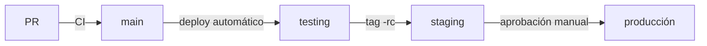

# Estrategia de releases

Cada componente del monorepo se versiona y publica de forma **independiente** (ADR-0001).

## 1. Componentes y tags

| Componente | Tag | Artefacto | Destino |
|---|---|---|---|
| Kuota Core | `backend-vX.Y.Z` | Imagen Docker inmutable (digest) | Entorno según D-ARC-04 |
| Contrato API | `contracts-vX.Y.Z` | `kuota-core.vN.yaml` | Repositorio (y docs de API) |
| Kuota Admin | `admin-vX.Y.Z` | Build Flutter Web | Hosting estático (D-ARC-04) |
| Kuota Collector | `collector-vX.Y.Z+build` | APK/AAB (y IPA si aplica) | Distribución interna/MDM o tienda |
| Kuota Client | `client-vX.Y.Z+build` | AAB / IPA | Google Play / App Store |

## 2. Versionado semántico

- **MAJOR**: cambio incompatible (API: rompe clientes; app: requiere migración de datos local no reversible).
- **MINOR**: funcionalidad nueva compatible.
- **PATCH**: correcciones.
- Pre-releases: `-rc.N` para staging.
- Versiones derivadas de Conventional Commits del path del componente (`feat` → minor, `fix` → patch, `!` → major);
  changelog por componente (Melos para paquetes Flutter; herramienta TS a definir en 001).

El **API** tiene además versión de ruta (`/v1`). Una versión mayor del API convive con la anterior durante la ventana
de soporte de apps (D-ARC-05, recomendación: N-2 versiones o 90 días).

## 3. Entornos y promoción

- Producción requiere aprobación manual (GitHub Environments) y release notes.
- Ningún entorno cloud se aprovisiona sin aprobación (D-ARC-04).

## 4. Compatibilidad API ↔ apps

- El backend publica `GET /v1/meta/compatibility` con `min_supported_version` por app.
- Orden obligatorio: **backend primero** (soporta contrato nuevo + anterior), luego apps.
- Collector: los comandos offline creados con versiones anteriores DEBEN sincronizarse (Constitución XIV); el servidor
  acepta versiones de esquema de comando dentro de la ventana de soporte.
- Feature flags por tenant para activar funcionalidades de forma gradual.

## 5. Checklist de release

- [ ] CI verde en el commit etiquetado
- [ ] Migraciones revisadas (solo expand en este release si hay contract pendiente)
- [ ] Contrato sin breaking changes no declarados
- [ ] Pruebas de invariantes financieras y aislamiento multi-tenant verdes
- [ ] Release notes y changelog
- [ ] Plan de rollback definido

## 6. Rollback

| Componente | Rollback |
|---|---|
| Backend | Redesplegar imagen del tag anterior; esquema compatible por expand/contract (sin migraciones "down") |
| Admin web | Republicar build anterior |
| Apps móviles | Sin rollback en tienda: desactivar feature flag + hotfix acelerado; subir `min_supported_version` solo si hay riesgo |
| Datos financieros | Nunca se editan: reversos contables |
