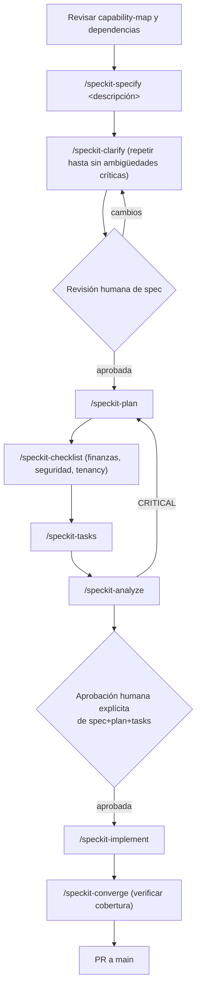

# Flujo de trabajo con GitHub Spec-Kit

Versión instalada: **specify-cli 1.4.3** (oficial `github/spec-kit`, integración `claude`, scripts `sh`).
Instalación, verificación y actualización: [`environment.md`](environment.md).

## 1. Separación de artefactos

| Ubicación | Qué contiene | Quién lo modifica |
|---|---|---|
| `.specify/memory/constitution.md` | Constitución (principios no negociables) | `/speckit-constitution` vía PR `docs/constitution-*` |
| `.specify/templates/`, `.specify/scripts/`, `.specify/integrations/` | Archivos **gestionados** por Spec-Kit | Solo `specify init`/upgrade (verificar con `specify integration status`) |
| `.specify/extensions/git/git-config.yml` | Config de ramas (prefijo `feature`, commits convencionales, auto-commit off) | Revisión de arquitectura |
| `.specify/extensions.yml` | Hooks registrados por extensiones | `specify extension ...` |
| `.specify/feature.json` | Puntero local a la feature activa (ignorado por git) | Scripts de Spec-Kit |
| `.claude/skills/speckit-*/` | Skills para Claude Code | Gestionado por Spec-Kit |
| `specs/NNN-slug/` | **Documentos funcionales** de cada feature | Skills `/speckit-*` + revisión humana |
| `docs/` | Arquitectura, ADRs, negocio, procesos (transversal) | PRs `docs/*` |

No se colocan documentos funcionales dentro de `.specify/` ni archivos de configuración de Spec-Kit dentro de `specs/`.

## 2. Skills disponibles (verificadas en `.claude/skills/`)

| Skill | Propósito | Artefactos |
|---|---|---|
| `/speckit-constitution` | Crear/enmendar la Constitución | `.specify/memory/constitution.md` |
| `/speckit-specify` | Crear la spec desde una descripción | rama `feature/NNN-slug`, `specs/NNN-slug/spec.md`, `checklists/requirements.md` |
| `/speckit-clarify` | Hasta 5 preguntas dirigidas; codifica respuestas | Sección *Clarifications* en `spec.md` |
| `/speckit-plan` | Plan técnico | `plan.md`, `research.md`, `data-model.md`, `contracts/`, `quickstart.md` |
| `/speckit-tasks` | Tareas ordenadas por dependencias | `tasks.md` |
| `/speckit-analyze` | Consistencia spec/plan/tasks/Constitución (solo lectura) | Reporte |
| `/speckit-checklist` | Checklists de calidad de requisitos por dominio | `specs/NNN/checklists/*.md` |
| `/speckit-converge` | Contrasta código vs spec y agrega tareas faltantes | `tasks.md` (append) |
| `/speckit-implement` | Ejecuta `tasks.md` | Código — **requiere aprobación humana explícita** |

Extensión `git` v1.0.8 (incluida en Spec-Kit):

| Skill | Propósito |
|---|---|
| `/speckit-git-feature` | Crea rama `feature/NNN-slug` (numeración secuencial) |
| `/speckit-git-validate` | Valida que la rama actual sigue la convención |
| `/speckit-git-remote` | Detecta el remoto Git (no crea remotos) |
| `/speckit-git-initialize` | Inicializa el repo si no existe (no-op aquí) |
| `/speckit-git-commit` | Auto-commit tras un comando (deshabilitado por configuración) |

### Hooks registrados (`.specify/extensions.yml`)

| Evento | Hook | Obligatorio |
|---|---|---|
| `before_constitution` | `speckit.git.initialize` | Sí |
| `before_specify` | `speckit.git.feature` | Sí — crea la rama antes de la spec |
| `before_clarify/plan/tasks/analyze/implement/checklist` | `speckit.git.commit` | Opcional |
| `after_*` | `speckit.git.commit` | Opcional |

Con `auto_commit.default: false`, los commits son explícitos y siguen Conventional Commits.

## 3. Ciclo de una funcionalidad



### Paso a paso

1. Partir de `main` actualizado: `git switch main && git pull` (cuando exista remoto).
2. Confirmar en [`docs/business/capability-map.md`](../business/capability-map.md) que las dependencias de la feature
   están al menos en estado *Planned/Approved*.
3. Ejecutar `/speckit-specify <descripción funcional, sin tecnología>`. El hook crea `feature/NNN-slug` y
   `specs/NNN-slug/spec.md`. Verificar con `/speckit-git-validate`.
4. Ejecutar `/speckit-clarify`; registrar decisiones pendientes con su ID `D-*`
   ([`decisions-register.md`](../business/decisions-register.md)) — nunca asumirlas.
5. Commit: `docs(specs): add NNN-slug specification`. Abrir PR de borrador para revisión de la spec.
6. Tras aprobación de la spec: `/speckit-plan <restricciones técnicas>`; revisar *Constitution Check*.
7. `/speckit-checklist` para dominios sensibles (finanzas, seguridad, multi-tenant).
8. `/speckit-tasks`; `/speckit-analyze` hasta 0 hallazgos CRITICAL.
9. **Gate humano:** aprobación explícita registrada (comentario en PR). Sin ella, **no** se ejecuta `/speckit-implement`.
10. Implementar por tareas (`T###`), commits que referencian la tarea; `/speckit-converge` al final.

## 4. Variables útiles

- `SPECIFY_FEATURE` / `SPECIFY_FEATURE_DIRECTORY`: fijar la feature activa en la shell (lo indican los scripts).
- `SPECIFY_INIT_DIR`: ejecutar contra otro proyecto `.specify/` (no se usa: un solo proyecto, ADR-0001).
- `GIT_BRANCH_NAME`: forzar nombre de rama exacto (evitar; rompe la convención).

## 5. Comprobaciones

```bash
specify check
specify integration status      # debe reportar 0 archivos gestionados modificados/faltantes
specify extension list
.specify/scripts/bash/check-prerequisites.sh --json
```
