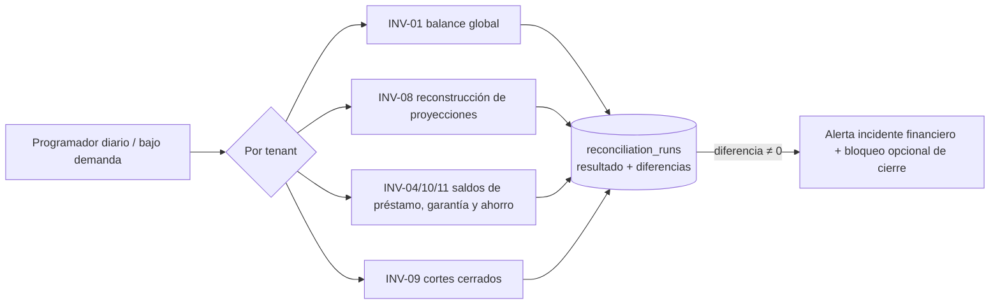

# Invariantes financieras

> Estado: **Propuesto** · 2026-11-22 · Principios: **IV, V, VI**. Modelo contable: ADR-0005 (partida doble, BIGINT en
> unidades mínimas + moneda, D-FIN-01).
> Cada invariante es verificable por pruebas (P) y, cuando aplica, por el job de reconciliación (J).
> Una violación en producción es un **incidente financiero** (alerta inmediata, principio XIII).

## 1. Invariantes

| ID | Invariante | Expresión | Verificación | Feature |
|---|---|---|---|---|
| INV-01 | **Balance de partida doble** | Para cada asiento y moneda: Σ débitos = Σ créditos; cada asiento tiene ≥ 2 líneas | (P) constraint/trigger diferido al commit + property-based; (J) agregado global por tenant y moneda = 0 | 006 |
| INV-02 | **Inmutabilidad** | Ninguna fila de `journal_entries`/`journal_lines` cambia ni desaparece después de insertarse | (P) `UPDATE`/`DELETE` falla para `kuota_app`; (J) conteo y hash encadenado por tenant (si se adopta en 006) | 006 |
| INV-03 | **Reverso exacto** | Un reverso tiene las mismas líneas con signo opuesto y referencia `reverses_entry_id`; un asiento se reversa a lo más una vez | (P) unitaria + `UNIQUE (reverses_entry_id)` | 006, 007 |
| INV-04 | **Saldo de préstamo** | Saldo de capital = principal desembolsado − Σ capital aplicado por pagos confirmados + Σ capital de reversos de pagos | (P) property-based sobre secuencias de pagos/reversos; (J) proyección vs ledger | 005, 007 |
| INV-05 | **Consistencia del calendario** | Σ capital de cuotas = principal; Σ interés de cuotas = interés total calculado; saldo tras última cuota = 0 (tras ajuste de redondeo D-FIN-02) | (P) golden + property-based | 005 |
| INV-06 | **No negatividad** | Saldos de capital, interés, moratorios, ahorro y garantía disponible ≥ 0; un pago no aplica más que lo adeudado (el excedente se trata según D-SYNC-01) | (P) property-based; constraint en proyecciones | 007, 008, 009 |
| INV-07 | **Idempotencia** | Para cada `(tenant_id, idempotency_key)` existe a lo más un asiento/operación; reintentos devuelven el mismo resultado | (P) N envíos concurrentes = 1 efecto; `UNIQUE` en BD | 006, 007, 011 |
| INV-08 | **Reconstrucción de saldos** | Toda proyección (`account_balances`, saldos de préstamo, ahorro, caja) = recomputación desde el ledger | (P) prueba de reconstrucción; (J) diario por tenant | 006 |
| INV-09 | **Conciliación de caja** | Por turno de cobrador: efectivo esperado = Σ cobros confirmados asignados al turno (incluidos tardíos, D-CSH-01); diferencia = entregado − esperado y está registrada en el ledger | (P) integración; (J) cortes cerrados sin diferencia no registrada | 013 |
| INV-10 | **Garantía ≤ ahorro** | Σ garantías bloqueadas activas de un cliente ≤ ahorro confirmado × `collateral_percentage` (D-COL-01) | (P) concurrencia (dos solicitudes simultáneas); (J) | 009 |
| INV-11 | **Ahorro** | Saldo de ahorro = Σ aportaciones confirmadas − Σ liquidaciones; rendimiento devengado = Σ (aportación pagada elegible × % del ciclo) según D-SAV-01/D-SAV-02 | (P) golden (1,500.00 × 9 % = 135.00); (J) | 008 |
| INV-12 | **Moneda** | Ninguna operación mezcla monedas; cada línea tiene moneda ISO 4217 y monto entero | (P) tipos de dominio + constraint | 006 |
| INV-13 | **Aislamiento contable** | Todas las líneas de un asiento pertenecen al mismo tenant que el asiento | (P) FK compuesta `(tenant_id, entry_id)`; (J) | 006 |
| INV-14 | **Paridad de simulación** | El simulador Flutter (`financial_domain`) y el motor del backend producen resultados idénticos para los fixtures golden | (P) ambos suites consumen los mismos fixtures en CI | 004, 005, 008 |

## 2. Cómo se prueban

- **Golden**: fixtures JSON versionados (`contracts/fixtures/financial/` o ubicación definida en plan 001) con montos como
  enteros en unidades mínimas y tasas como cadenas decimales. Aprobados por negocio antes de implementar el motor.
- **Property-based** (fast-check en TS; `glados` o generadores propios en Dart): generación de plazos, tasas, frecuencias,
  secuencias de pagos parciales, reversos y reintentos; verifican INV-01, 03–08, 10–12.
- **Integración** con PostgreSQL real (Testcontainers) para constraints, triggers y concurrencia (INV-02, 07, 10, 13).
- **Mutación** (opcional, nightly) sobre motores financieros para medir la calidad de las pruebas.

## 3. Job de reconciliación

- Solo lectura: el job **nunca corrige** datos; las correcciones se hacen con reversos aprobados (principio V).
- Resultados almacenados y auditables; métrica `kuota_reconciliation_differences_total` (principio XIII).
- Se ejecuta también en CI nightly sobre datos sintéticos y antes de cada release.

## 4. Decisiones pendientes que afectan invariantes

D-FIN-02 (redondeo, INV-05), D-FIN-07 (prelación, INV-04), D-FIN-08 (prepagos), D-SAV-01/02 (INV-11), D-COL-01 (INV-10),
D-SYNC-01 (sobrepagos, INV-06), D-CSH-01/02 (INV-09). Mientras estén pendientes, las pruebas golden correspondientes
quedan marcadas como **pendientes de aprobación** y las tareas dependientes, bloqueadas.
