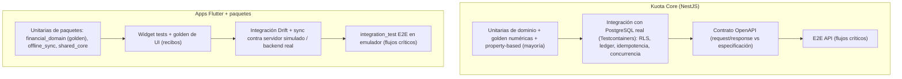

# Estrategia de pruebas

> Estado: **Propuesto** · 2026-11-22 · Principios: **X. Test-Driven Validation**, IV, V, VI, III, XI, XII.
> Herramientas concretas se confirman en el `plan.md` de 001-platform-foundation.

## 1. Pirámide por componente

| Componente | Herramientas propuestas | Cobertura mínima |
|---|---|---|
| Backend – dominio financiero (`loans`, `payments`, `savings`, `collateral`, `ledger`) | Jest o Vitest (a decidir en plan 001), fast-check | **90 % líneas y ramas** |
| Backend – resto | Jest/Vitest, Supertest, Testcontainers (PostgreSQL) | 80 % |
| `flutter/packages/financial_domain` | `package:test`, `glados` (property-based) o generadores propios | **90 %** |
| Otros paquetes Flutter | `package:test`, `flutter_test` | 80 % |
| Apps Flutter | `flutter_test`, golden tests, `integration_test` | Flujos críticos cubiertos (sin umbral de líneas en UI) |
| Contratos | Spectral (lint), oasdiff (breaking changes), validación de respuestas | 100 % endpoints con prueba de contrato |

## 2. Tipos de prueba

| Tipo | Propósito | Ejemplo |
|---|---|---|
| Unitaria | Reglas puras, deterministas (reloj y calendario inyectados) | Cálculo de una cuota |
| **Golden numérica** | Casos de referencia aprobados por negocio, entradas → salidas exactas al centavo, en archivos versionados (`fixtures/*.json`) compartidos entre TS y Dart | Tabla de amortización de 12 cuotas mensuales |
| **Property-based** | Invariantes para entradas aleatorias | Σ capital de cuotas = principal, para cualquier plazo/tasa |
| Integración BD | Comportamiento real de PostgreSQL: RLS, constraints, triggers, transacciones | `UPDATE` en `journal_lines` falla |
| Contrato | Backend cumple OpenAPI; cliente Dart generado al día | Respuesta de `POST /payments` valida contra esquema |
| Multi-tenant | Aislamiento (MT-01..MT-09, ver `docs/security/multi-tenant-isolation.md`) | Tenant A → 404 en recurso de B |
| Concurrencia | Carreras en pagos, sincronización y garantías | 2 pagos simultáneos al mismo préstamo |
| E2E | Flujos de punta a punta | Cobro offline → sync → recibo confirmado → corte |
| Offline / red intermitente | Comportamiento con cortes, latencia, respuestas perdidas | Respuesta perdida tras commit en servidor → reintento idempotente |
| Seguridad | Autorización negativa, escaneo de dependencias y secretos, SAST | Rol cobrador no puede reversar pagos |

Los **casos golden** son la especificación ejecutable compartida: el backend (autoridad) y `financial_domain` (simulador
en Flutter) deben producir los mismos resultados para los mismos fixtures; una divergencia es un defecto.

## 3. Cobertura funcional obligatoria

| Área | Pruebas mínimas | Feature |
|---|---|---|
| Intereses | Golden por método (FLAT_GLOBAL, DECLINING_BALANCE) × frecuencia (DAILY, WEEKLY, BIWEEKLY, MONTHLY) × base de tasa (D-FIN-03) | 004, 005 |
| Amortizaciones | Σ capital = principal; saldo final = 0; calendario con días inhábiles (D-FIN-05) | 005 |
| Moratorios | FIXED_PER_INSTALLMENT y DAILY_PERCENTAGE; gracia (`grace_days`); topes (D-FIN-06); límite de días | 007 |
| Rendimientos | Rendimiento solo sobre aportaciones pagadas; ejemplo 1,500.00 × 9 % = 135.00; sin anualización (D-SAV-01) | 008 |
| Redondeos | Modo y escala de D-FIN-02; ajuste de última cuota; montos con residuo de centavo | 004–008 |
| Pagos parciales | Prelación moratorios → interés → capital (D-FIN-07); cuota más antigua primero | 007 |
| Liquidaciones | Liquidación total anticipada (D-FIN-08); liquidación de ahorro al vencimiento | 007, 008 |
| Reversos | Reverso restaura saldos exactos; reverso de reverso prohibido o definido; no se modifica el original | 006, 007 |
| Garantías | Préstamo ≤ % de ahorro confirmado (D-COL-01); bloqueo/liberación; préstamos simultáneos | 009 |
| Conciliaciones | Corte con/sin pendientes (D-CSH-01); diferencias; operaciones tardías | 013 |
| Reintentos offline | Reenvío tras timeout; respuesta perdida; app reiniciada a mitad de sync | 011 |
| Duplicados | Misma clave N veces (secuencial y concurrente) = 1 efecto; misma clave con otro contenido = error | 006, 007, 011 |
| Concurrencia | Pagos simultáneos al mismo préstamo; dos cobradores (D-SYNC-01); dos garantías sobre el mismo ahorro | 007, 009, 011 |
| Seguridad | Autorización negativa por endpoint y rol; tokens revocados; firma de dispositivo inválida | 002, 011 |
| Multi-tenancy | MT-01..MT-09 | 001, 002, todas |
| Fallos de red | Timeouts, 5xx, corte durante upload, reanudación de descarga incremental | 011 |

## 4. Pipelines y gates

| Validación | PR (afectado por paths) | Merge a `main` | Nightly | Release | ¿Bloquea PR? |
|---|---|---|---|---|---|
| Lint + formato (TS, Dart, Markdown) | ✅ | ✅ | — | ✅ | **Sí** |
| Tipos (`tsc --noEmit`, `dart analyze`) | ✅ | ✅ | — | ✅ | **Sí** |
| Reglas de arquitectura (dependencias de capas/módulos, flotantes en dinero) | ✅ | ✅ | — | ✅ | **Sí** |
| Unitarias + golden + property-based (componentes afectados) | ✅ | ✅ (todo) | ✅ (property-based con más iteraciones) | ✅ | **Sí** |
| Cobertura (umbrales §1) | ✅ | ✅ | — | ✅ | **Sí** |
| Integración backend con PostgreSQL (Testcontainers) | ✅ si cambia `backend/` o `contracts/` | ✅ | ✅ | ✅ | **Sí** |
| Multi-tenant MT-* y verificación de RLS en catálogo | ✅ si cambia `backend/` | ✅ | ✅ | ✅ | **Sí** |
| Contrato: lint OpenAPI + breaking changes vs `main` + cliente Dart regenerado sin diff | ✅ si cambia `contracts/`, `backend/` o `api_client` | ✅ | — | ✅ | **Sí** (breaking change requiere aprobación explícita y versión mayor) |
| Pruebas de migración (aplicar sobre esquema de `main`) | ✅ si cambia migraciones | ✅ | — | ✅ | **Sí** |
| Escaneo de secretos | ✅ siempre | ✅ | — | ✅ | **Sí** |
| Escaneo de dependencias (vulnerabilidades altas/críticas) | ✅ | ✅ | ✅ | ✅ | **Sí** (altas/críticas) |
| Widget/golden tests Flutter | ✅ si cambia `flutter/` | ✅ | — | ✅ | **Sí** |
| Concurrencia y offline (escenarios largos, 72 h simuladas) | Subconjunto rápido | ✅ | ✅ completo | ✅ | Subconjunto: **Sí** |
| E2E (API y `integration_test` en emulador) | — | ✅ | ✅ | ✅ | No (bloquea release) |
| Job de reconciliación sobre datos de prueba | — | — | ✅ | ✅ | No (bloquea release) |
| Build de artefactos (imagen Docker, apps) | ✅ (verificación) | ✅ | — | ✅ firmado | **Sí** |

Reglas:

- Los PR ejecutan solo lo afectado por *path filters*, **excepto** cuando cambian `contracts/`, `.specify/memory/` o
  configuración de CI, que disparan la suite completa.
- Pruebas omitidas (`skip`) requieren issue y aprobación explícita (principio X); una prueba *flaky* se trata como defecto.
- Las tareas de prueba preceden a las de implementación en `tasks.md`.

## 5. Datos de prueba

- Fixtures sintéticos; **nunca** datos reales de clientes en pruebas ni en entornos no productivos.
- Generadores con semilla registrada para reproducir fallos de property-based.
- Al menos dos tenants en todo escenario de integración para detectar fugas de aislamiento.
