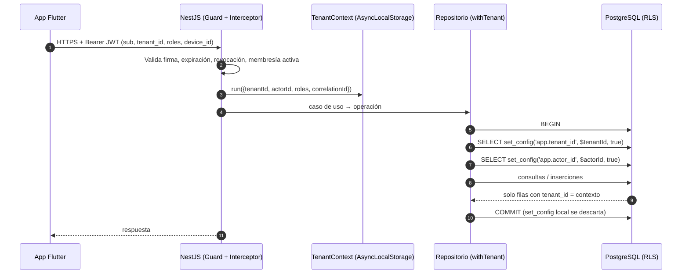
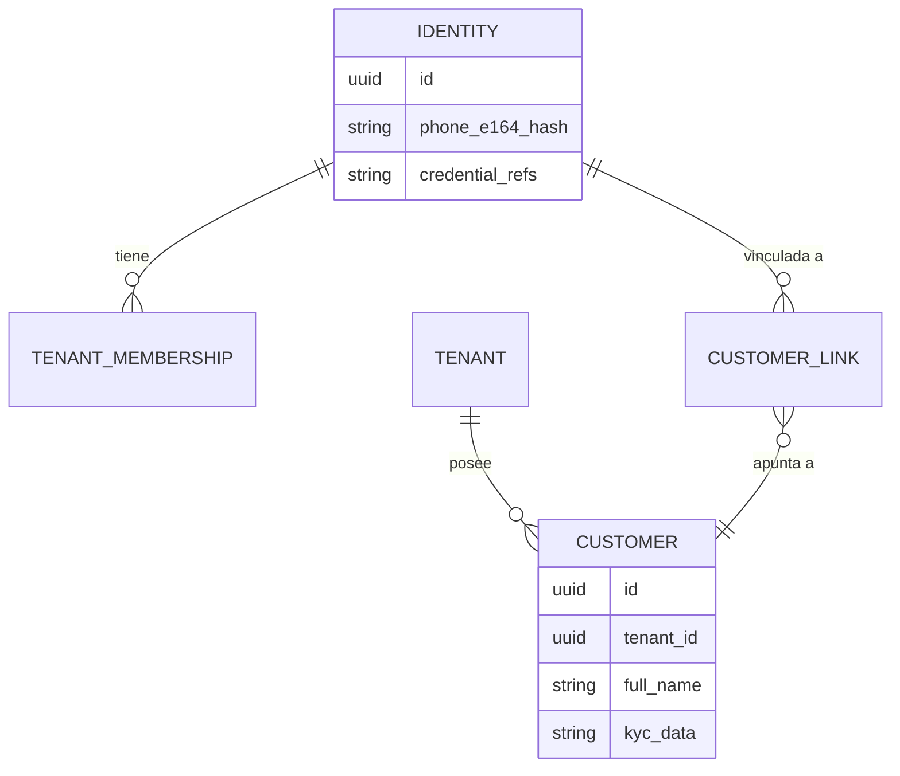

# Aislamiento multi-tenant

> Estado: **Propuesto** · 2026-11-22 · Principio constitucional: **III. Aislamiento multi-tenant (NO NEGOCIABLE)**
> Relacionado: ADR-0002, ADR-0004, `docs/security/authentication.md`, `docs/security/threat-model.md`.

## 1. Modelo seleccionado

| Opción | Descripción | Aislamiento | Costo operativo | Decisión |
|---|---|---|---|---|
| Base de datos por tenant | Una BD PostgreSQL por empresa | Máximo | Alto (migraciones × N, conexiones × N) | Descartada para v1 |
| Esquema por tenant | Un `schema` por empresa | Alto | Medio-alto (migraciones × N, catálogos grandes) | Descartada para v1 |
| **Esquema compartido + `tenant_id` + RLS** | Todas las tablas de negocio con `tenant_id`; PostgreSQL filtra por política | Alto si RLS es **forzado** y el rol de app no lo evita | Bajo | **Seleccionada** |

Razón: Kuota espera muchos tenants pequeños y medianos; el modelo compartido escala operativamente y RLS proporciona
una **segunda barrera** independiente del código de aplicación (defensa en profundidad). Un tenant con requisitos de
aislamiento físico (contrato o regulación, ver D-BIZ-02) podría migrarse a una instancia dedicada con el mismo esquema.

## 2. Reglas obligatorias

1. Toda tabla con datos de negocio tiene `tenant_id UUID NOT NULL` con FK a `tenants(id)`.
2. Toda tabla de negocio tiene `ENABLE ROW LEVEL SECURITY` **y** `FORCE ROW LEVEL SECURITY`.
3. La aplicación se conecta con el rol `kuota_app`: `NOLOGIN` heredado por `kuota_app_login`, **sin** `BYPASSRLS`,
   **no** propietario de las tablas, sin `SUPERUSER`.
4. Las migraciones usan un rol distinto (`kuota_migrator`, propietario de las tablas). Nunca se usa en runtime.
5. El `tenant_id` del contexto se obtiene **exclusivamente** de la identidad autenticada (JWT validado), nunca de
   path/query/body/headers enviados por el cliente.
6. Las claves únicas de negocio incluyen `tenant_id` (p. ej. `UNIQUE (tenant_id, idempotency_key)`, `UNIQUE (tenant_id, folio)`).
7. Las FKs entre tablas de tenant incluyen `tenant_id` (FK compuesta `(tenant_id, loan_id)`) para impedir referencias
   cruzadas entre empresas incluso por error de aplicación.
8. Las respuestas a recursos de otro tenant devuelven **404** (no 403), para no revelar existencia.

## 3. Roles de base de datos

| Rol | Uso | Privilegios |
|---|---|---|
| `kuota_migrator` | CI/CD de migraciones | Propietario de esquema; DDL. Credencial solo en pipeline de despliegue |
| `kuota_app` | Privilegios de la API (`NOLOGIN`) | DML en tablas de negocio sujeto a RLS; sin `UPDATE`/`DELETE` en tablas de ledger y auditoría |
| `kuota_app_login` | Credencial de la API Kuota Core | `LOGIN`, miembro de `kuota_app` |
| `kuota_worker` | Proceso worker (ADR-0002, C2-3) | Como `kuota_app` + tablas de cola/outbox; sujeto a RLS |
| `kuota_platform` | Módulo `platform-admin` (operaciones cross-tenant) | Funciones `SECURITY DEFINER` auditadas; conexión separada |
| `kuota_readonly` | Réplicas/reportes (futuro) | `SELECT` sujeto a RLS |

Fuente única de roles: ADR-0004.

## 4. Políticas SQL de ejemplo

```sql
-- Helper: tenant del contexto actual (NULL si no se fijó → ninguna fila visible)
CREATE FUNCTION app_current_tenant() RETURNS uuid
LANGUAGE sql STABLE AS $$
  SELECT nullif(current_setting('app.tenant_id', true), '')::uuid
$$;

ALTER TABLE loans ENABLE ROW LEVEL SECURITY;
ALTER TABLE loans FORCE ROW LEVEL SECURITY;

CREATE POLICY tenant_isolation ON loans
  USING (tenant_id = app_current_tenant())
  WITH CHECK (tenant_id = app_current_tenant());

-- Ledger: solo lectura e inserción para la app
REVOKE UPDATE, DELETE ON journal_entries, journal_lines FROM kuota_app;
CREATE POLICY tenant_isolation ON journal_entries
  USING (tenant_id = app_current_tenant())
  WITH CHECK (tenant_id = app_current_tenant());
```

Verificación automatizada en CI (consulta al catálogo):

```sql
-- Debe devolver 0 filas: tablas con columna tenant_id sin RLS habilitado, forzado o sin política
SELECT c.relname
FROM pg_class c
JOIN pg_namespace n ON n.oid = c.relnamespace AND n.nspname = 'kuota'
JOIN pg_attribute a ON a.attrelid = c.oid AND a.attname = 'tenant_id' AND NOT a.attisdropped
WHERE c.relkind IN ('r', 'p')
  AND (NOT c.relrowsecurity OR NOT c.relforcerowsecurity
       OR NOT EXISTS (SELECT 1 FROM pg_policies p WHERE p.schemaname = n.nspname AND p.tablename = c.relname));
```

## 5. Flujo de contexto en NestJS



Puntos clave:

- `set_config(..., true)` es **local a la transacción**: al terminar, la conexión vuelve al pool sin contexto.
- Si una consulta se ejecuta fuera del wrapper transaccional, `app_current_tenant()` es `NULL` → **0 filas** (falla segura).
- Los jobs en segundo plano (outbox, conciliación) reciben `tenant_id` del registro que procesan y abren su propio contexto.
- Un guard global rechaza cualquier ruta de negocio sin `TenantContext`. Toda ruta sin autenticación es una excepción de
  la Constitución §II: pertenece a una categoría admisible y figura en la tabla *Endpoint Access* de su spec. El login
  (002) y la verificación pública de recibos (012) **no** están hoy en esa lista cerrada: se resuelven con D-AUTH-03.

## 6. Riesgos con pooling de conexiones

| Riesgo | Causa | Mitigación |
|---|---|---|
| Fuga de contexto entre solicitudes | `SET` de sesión (no local) que persiste en la conexión reutilizada | Solo `set_config(..., true)` dentro de transacción; prueba que reutiliza una conexión y verifica contexto vacío |
| PgBouncer en modo *transaction* | Variables de sesión no son confiables entre sentencias fuera de transacción | Todo acceso de negocio dentro de transacción explícita; prohibido `SET` de sesión |
| Consultas fuera de transacción por el ORM | Llamadas directas al cliente base | Solo `common/tenant-context` usa el cliente base; los repositorios reciben el cliente transaccional de `withTenant` (regla de lint; spike D-ARC-01, criterios S1–S5 de ADR-0004) |
| Prepared statements cacheados | Compartidos entre tenants | Las políticas usan `current_setting` evaluado en ejecución; prueba de regresión |

## 7. Identidad global vs cliente por tenant

Una misma persona puede ser cliente de varias empresas (y además usuaria de la app Kuota Client).



- `identities` (global, **sin datos de negocio**): teléfono verificado, credenciales, dispositivos vinculados.
- `customers` (por tenant): nombre, domicilio, KYC, documentos, préstamos, ahorro. **Cada tenant tiene su propio registro**,
  aunque sea la misma persona. No se comparten documentos ni KYC entre tenants.
- `customer_links`: relación identidad → cliente por tenant, creada solo por invitación/enrolamiento del tenant y aceptada
  por la persona (OTP). Visible solo para la propia identidad autenticada y para el módulo de plataforma.

Controles para no compartir datos indebidamente:

1. Un tenant **no puede** buscar personas por teléfono/CURP en otros tenants ni saber si existen en Kuota.
2. El alta de cliente en un tenant nunca autocompleta datos de otro tenant.
3. Kuota Client muestra a la persona sus relaciones con varias empresas, pero cada consulta se ejecuta con el contexto del
   tenant seleccionado (token con `tenant_id` activo; cambio de tenant = nuevo token de alcance).
4. La deduplicación o scoring entre empresas (buró interno) está **fuera de alcance** y requeriría consentimiento y
   validación legal (D-LEG-02).

## 8. Operaciones de plataforma (cross-tenant)

- Solo el módulo `platform-admin`, con rol de BD `kuota_platform`, endpoints en un prefijo separado y no expuestos a apps de tenant.
- Requieren MFA, rol de plataforma y motivo registrado; cada acceso genera auditoría con `target_tenant_id`.
- Acceso de soporte a datos de un tenant: *break-glass* con aprobación y tiempo limitado (proceso a definir en 002/015).

## 9. Pruebas obligatorias (gate bloqueante de PR)

| ID | Prueba | Nivel |
|---|---|---|
| MT-01 | Usuario de tenant A recibe 404 al leer/actualizar cada recurso de tenant B (por endpoint) | Integración API |
| MT-02 | Consulta sin `app.tenant_id` devuelve 0 filas en toda tabla de negocio | Integración BD |
| MT-03 | `INSERT` con `tenant_id` distinto al contexto falla (`WITH CHECK`) | Integración BD |
| MT-04 | Catálogo: toda tabla con `tenant_id` tiene RLS habilitado y forzado | CI (consulta §4) |
| MT-05 | El rol `kuota_app` no tiene `BYPASSRLS` ni es propietario | CI |
| MT-06 | Reutilización de conexión del pool no conserva contexto | Integración BD |
| MT-07 | `tenant_id` enviado por el cliente en body/query es ignorado o rechazado | Integración API |
| MT-08 | Misma persona en 2 tenants: cada tenant ve solo su registro de cliente | Integración API |
| MT-09 | Jobs en segundo plano procesan solo el tenant del registro | Integración |

Features responsables: el mecanismo y MT-02..06 en **001-platform-foundation**; identidad, membresías y MT-01/07/08 en
**002-identity-tenancy**; cada feature posterior agrega MT-01 para sus endpoints.

## 10. Suite reutilizable de acceso cruzado: `describeTenantIsolation` (FR-016; T034, T037, T044)

Cada feature que expone un recurso por tenant DEBE aplicar la suite a ese recurso. Así cubre MT-01 y MT-07 por
endpoint, además de la concurrencia de US2-6.

**Qué genera** (`backend/test/tenancy/describe-tenant-isolation.ts`), con dos tenants nuevos por ejecución y un
marcador único en cada registro:

| Caso | Expectativa |
|---|---|
| Lectura por id de otro tenant, en ambos sentidos | 404 `not-found` sin revelar la existencia ni el contenido |
| Listado completo (todas las páginas) | Solo registros propios; coincide con el conteo directo en la base |
| Update y delete cruzados | 404 y sin efecto: el propietario ve el registro igual y el conteo no cambia |
| `tenant_id` ajeno en el body | Rechazado (400) o asignado al propio; nunca crea ni modifica datos del otro tenant |
| Tenant en la query u otros encabezados | Ignorado |
| Sin contexto o con contexto inválido | 401 `tenant-context-required` y nada escrito |
| ≥ 50 solicitudes concurrentes intercaladas de 2 tenants | Ninguna observa datos del otro; los conteos cuadran |

**Cómo aplicarla a un recurso nuevo:** crear `backend/test/tenancy/<recurso>.tenancy.spec.ts`. El ejemplo de
referencia es `dev-probe.tenancy.spec.ts`.

```ts
describeTenantIsolation({
  name: 'loans (/v1/loans)',
  collectionPath: '/v1/loans',                     // POST crea, GET lista; el elemento es `${collectionPath}/{id}`
  markerField: 'reference',                        // campo de la respuesta que lleva el marcador
  createBody: (marker) => ({ reference: marker /* … resto del cuerpo válido */ }),
  updateBody: (item, marker) => ({ reference: marker, version: item.version }),
  createHeaders: () => ({ 'idempotency-key': randomUUID() }),
  contextHeaders: (tenant) => ({ /* 002: credenciales de un usuario miembro del tenant */ }),
  async setup() {
    // Aplicación real (createApp) + PostgreSQL efímero (startTestDatabase); countRows cuenta en la base sin RLS
    // (superusuario del contenedor de prueba) para probar que un rechazo no escribió nada.
    return { baseUrl, countRows: (tenantId) => …, close: async () => { … } };
  },
});
```

**Reglas:**
- Sin mocks de la base ni de RLS. La suite debe fallar si el aislamiento no existe: con RLS desactivado en el contenedor
  efímero, 6 de sus 9 casos fallan (verificado al introducirla, 2026-11-22).
- Base efímera por suite (Testcontainers). Nunca el volumen de `make up` ni una base compartida.
- No depende de registros preexistentes: crea los suyos.
- En 001 el contexto es el encabezado técnico `X-Kuota-Dev-Tenant` (solo local/testing). Desde 002, `contextHeaders`
  usará la identidad autenticada.

**Ejecución:**
- `pnpm --filter backend test:tenancy` ejecuta solo `backend/test/tenancy/` y sale con un código distinto de cero si
  falla algún caso.
- La misma suite forma parte de `pnpm --filter backend test` y, por tanto, de `make test`.
- El gate de CI dedicado se conecta en G12 (US3).
