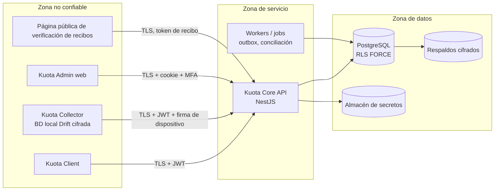

# Threat model de Kuota

> Estado: **Propuesto** · 2026-11-22 · Metodología: STRIDE por contenedor + catálogo de riesgos de negocio.
> Se revisa en cada feature (sección de riesgos de seguridad del `spec.md`, principio II).

## 1. Activos

| Activo | Criticidad |
|---|---|
| Ledger y saldos (préstamos, ahorro, caja) | Crítica |
| Datos personales de clientes (identificación, contacto, domicilio, KYC) | Crítica |
| Efectivo en poder de cobradores | Alta |
| Credenciales, llaves de firma (JWT, recibos), secretos | Crítica |
| Configuración financiera de productos (tasas, moratorios) | Alta |
| Bitácora de auditoría | Alta |
| Disponibilidad de sincronización y cobranza | Alta |

## 2. Fronteras de confianza

## 3. STRIDE por contenedor

| Contenedor | S (Suplantación) | T (Manipulación) | R (Repudio) | I (Divulgación) | D (Denegación) | E (Elevación) |
|---|---|---|---|---|---|---|
| Kuota Core API | Tokens robados → vida corta, rotación, device binding | Payload alterado → validación contra OpenAPI, servidor recalcula montos | Acciones sin rastro → auditoría con actor/dispositivo | Fuga cross-tenant → RLS FORCE + 404 | Abuso de endpoints → rate limiting, límites de tamaño | Rol escalado → RBAC en backend, permisos por endpoint, pruebas negativas |
| Workers/jobs | Job ejecutado con tenant equivocado → contexto desde el registro | Doble procesamiento → idempotencia por clave | — | Logs con PII → redacción | Colas saturadas → backpressure, reintentos acotados | Job con rol privilegiado → mismo rol `kuota_app` |
| PostgreSQL | Credencial de app filtrada → secretos rotables, red privada | `UPDATE` de ledger → `REVOKE` + triggers, append-only | — | Dump robado → cifrado en reposo, respaldos cifrados | Consultas costosas → timeouts, índices | Rol de app con BYPASSRLS → prueba MT-05 |
| Kuota Collector | Otro usuario en el dispositivo → PIN + llave por cobrador | BD local editada (root) → servidor no confía en saldos locales; firmas de operación | Cobrador niega cobro → recibo firmado, operación firmada con hora de dispositivo y servidor | Dispositivo robado → BD cifrada, borrado remoto, expiración 72 h | Sin red → offline-first | App modificada → señales de integridad (no única defensa) |
| Kuota Client | SIM swap → OTP solo enrolamiento + device binding | — | — | Dispositivo compartido → PIN/biometría, enmascaramiento | — | Acceso a otro tenant → token por tenant + `customer_link` |
| Kuota Admin | Phishing de staff → MFA, passkeys (evolución) | CSRF → SameSite + token CSRF | Cambios de configuración → auditoría antes/después | Exportaciones masivas → permisos, marca de agua, auditoría | — | Admin de tenant actúa como plataforma → módulo y rol separados |
| Verificación pública de recibos | Recibo falso con QR propio → firma Ed25519 verificada en servidor | — | — | Enumeración de recibos → token opaco no secuencial, datos mínimos | Scraping → rate limiting | — |

## 4. Catálogo de riesgos de negocio

| # | Riesgo | Amenaza | Impacto | Mitigación | Control verificable | Feature |
|---|---|---|---|---|---|---|
| R-01 | Datos personales | Exposición por API, logs, exportaciones o dispositivo perdido | Daño a titulares, sanciones (PENDIENTE-LEGAL), reputación | Minimización, enmascaramiento por rol, cifrado, logs sin PII | Pruebas de redacción de logs; pruebas de enmascaramiento por rol; inventario de datos en cada spec | 001, 002, 003, 015 |
| R-02 | Operaciones duplicadas | Reintentos de red, doble toque, re-sincronización | Doble cargo/abono, saldos erróneos | Clave de idempotencia por operación (UUIDv7 del dispositivo), `UNIQUE (tenant_id, idempotency_key)` | Prueba de N envíos concurrentes = 1 efecto contable | 006, 007, 011 |
| R-03 | Saldos alterados | Modificación directa de saldo o asiento | Pérdida financiera, fraude | Saldos derivados del ledger; ledger append-only; reversos | Prueba que `UPDATE`/`DELETE` en ledger falla; job de reconstrucción de saldos sin diferencias | 006 |
| R-04 | Fraude de cobradores | Cobrar y no registrar; registrar menos; recibos falsos; ocultar operaciones | Pérdida de efectivo, clientes afectados | Recibo firmado entregado al cliente (foto), consulta del cliente en Kuota Client, folios secuenciales por dispositivo con detección de huecos, cortes de caja, límites de efectivo | Reporte de huecos de folio; conciliación de corte; alertas de discrepancia | 010, 012, 013, 014 |
| R-05 | Acceso entre empresas | Bug de aplicación, IDOR, token manipulado | Fuga masiva de datos, pérdida de confianza | RLS FORCE, contexto desde JWT, FKs compuestas, 404 | Suite MT-01..MT-09 bloqueante | 001, 002 |
| R-06 | Robo de dispositivos | Robo de celular del cobrador con efectivo y datos | Fuga de datos, operaciones fraudulentas | BD local cifrada, PIN, borrado remoto, expiración 72 h, revocación de llave | Prueba de revocación: operaciones posteriores al reporte → REQUIRES_REVIEW | 002, 011 |
| R-07 | Recibos falsificados | Imagen editada o QR propio | Disputas, fraude a clientes | QR con token firmado; verificación en servidor; distinción provisional/confirmado/revertido | Prueba de verificación con firma inválida → "no válido" | 012 |
| R-08 | Manipulación de base de datos | Acceso privilegiado interno o credencial filtrada | Alteración del ledger | Separación de roles, sin `UPDATE`/`DELETE`, auditoría de BD, hashes encadenados de asientos (evaluar en 006), respaldos inmutables | Verificación periódica de cadena de hash / reconciliación | 006, 015 |
| R-09 | Sincronización fraudulenta | Operaciones inyectadas, hora de dispositivo manipulada, replay | Pagos ficticios, cortes alterados | Firma de operación con llave del dispositivo, validación de asignación de cartera, hora del servidor como autoritativa, ventana de aceptación, detección de deriva de reloj | Pruebas de replay, firma inválida, reloj desfasado | 011 |
| R-10 | Conciliaciones incorrectas | Operaciones no sincronizadas al cierre, errores de captura | Faltantes no detectados, sanciones internas injustas | Corte con pendientes (D-CSH-01), asignación de operaciones tardías al corte original, aprobación de supervisor, ajustes vía ledger | Invariante de conciliación de caja (ver `financial-invariants.md`, INV-09) | 013 |

## 5. Riesgos residuales y decisiones pendientes

- Fraude colusorio cobrador–cliente: mitigación parcial; requiere controles de negocio (rotación de rutas, visitas aleatorias).
- Root/jailbreak: no se puede impedir; se trata como señal de riesgo.
- Decisiones relacionadas: D-AUTH-01, D-AUTH-02, D-SYNC-01, D-SYNC-03, D-RCP-01, D-RCP-02, D-CSH-01, D-CSH-02, D-LEG-02.
