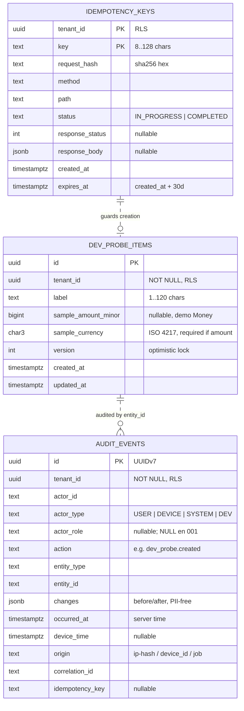

# Data Model: Platform Foundation (001)

**Spec**: [spec.md](spec.md) · **Research**: [research.md](research.md)

Alcance: solo estructuras **técnicas** reutilizables. No hay entidades de negocio (empresa, usuario, cliente, préstamo)
— pertenecen a 002+. Todas las tablas con `tenant_id` tienen RLS **habilitado y forzado** (Constitución III).

## Roles de base de datos

| Rol | LOGIN | BYPASSRLS | Owner de tablas | Uso |
|---|---|---|---|---|
| `kuota_migrator` | sí | no | **sí** | Migraciones (CI/CD, local). Nunca en runtime |
| `kuota_app` | no | **no** | no | Rol de privilegios de la API |
| `kuota_app_login` | sí | no | no | Credencial de la API; `IN ROLE kuota_app` |

Privilegios de `kuota_app`: `SELECT, INSERT, UPDATE, DELETE` en `dev_probe_items` e `idempotency_keys`;
**solo `SELECT, INSERT`** en `audit_events`; sin DDL; `USAGE` en el esquema `kuota`.

## Contexto de sesión (por transacción)

| GUC | Tipo | Fijado por | Uso |
|---|---|---|---|
| `app.tenant_id` | uuid (texto) | `set_config(..., true)` en `withTenant` | Políticas RLS |
| `app.actor_id` | texto | ídem | Auditoría (default) |
| `app.correlation_id` | texto | ídem | Auditoría |

Política estándar (plantilla para toda tabla de tenant):

```text
USING      (tenant_id = nullif(current_setting('app.tenant_id', true), '')::uuid)
WITH CHECK (tenant_id = nullif(current_setting('app.tenant_id', true), '')::uuid)
```

Sin contexto → `current_setting` devuelve `NULL` → la comparación nunca es verdadera → 0 filas (FR-013).



## Entidades

### `dev_probe_items` — Recurso técnico de demostración (FR-017)

| Campo | Tipo | Reglas |
|---|---|---|
| `id` | `uuid` | PK, UUIDv7 generado por el servidor |
| `tenant_id` | `uuid` | NOT NULL; default `current_setting('app.tenant_id')::uuid`; nunca desde el body (FR-012) |
| `label` | `text` | 1–120 caracteres; sin PII (dato sintético) |
| `sample_amount_minor` | `bigint` | Opcional; ejercita la convención de dinero (FR-022) |
| `sample_currency` | `char(3)` | Requerido si hay monto; `CHECK` de consistencia |
| `version` | `int` | Bloqueo optimista; incrementa en cada actualización |
| `created_at`, `updated_at` | `timestamptz` | Hora del servidor |

- Solo se expone si el módulo `dev-probe` está habilitado (`KUOTA_ENV ∈ {local, testing}`); en staging/producción el
  módulo no se registra (la tabla puede existir vacía).
- Operaciones: crear (idempotente, auditada), obtener por id, listar (cursor), actualizar label, eliminar.
  Existen para cubrir lectura/listado/modificación/borrado de la suite de acceso cruzado (FR-016).

### `idempotency_keys` (FR-023, FR-024)

- Política de 001 (FR-023, FR-024). No es la política definitiva de operaciones financieras: 007 y 011 la analizan y
  aprueban por separado.
- PK compuesta `(tenant_id, key)` → la misma clave en dos tenants son operaciones independientes (US6-3).
- `key`: 8–128 caracteres `[A-Za-z0-9_-]`; recomendado UUID. Formato inválido → 400 problem `validation-error`.
- `request_hash`: SHA-256 de `method + path + JSON canónico del body` (claves ordenadas).
- **Concurrencia**: todo el flujo ocurre en **una sola transacción** de `withTenant`. Primero se toma
  `pg_try_advisory_xact_lock` sobre un hash de `(tenant_id, key)`:
  - si **no** se obtiene, otra solicitud con la misma clave está en proceso → 409 `idempotency-request-in-progress` con
    `Retry-After: 1` (segundos), sin tocar la tabla;
  - si se obtiene, se lee la fila y se decide según las respuestas a duplicados (abajo). El bloqueo se libera al
    confirmar o revertir, por lo que no quedan filas `IN_PROGRESS` huérfanas tras una caída.
  - Una colisión del hash de 64 bits entre claves distintas solo provoca un 409 espurio (reintentable), nunca un efecto
    cruzado: la decisión final usa la fila con PK `(tenant_id, key)`.
- **Expiración**: `expires_at = created_at + 30 días`. Una fila con `expires_at <= now()` se trata como inexistente: se
  elimina dentro de la misma transacción y la solicitud se procesa como nueva. La purga masiva es manual (R-16).
- **Transiciones**:

```mermaid
stateDiagram-v2
    [*] --> IN_PROGRESS: bloqueo obtenido y sin fila vigente → INSERT
    IN_PROGRESS --> COMPLETED: comando confirma (misma transacción guarda respuesta)
    IN_PROGRESS --> [*]: comando falla → fila eliminada en rollback
    COMPLETED --> [*]: expires_at alcanzado → tratada como inexistente; eliminada al reutilizar la clave o por purga
```



- Respuestas a duplicados: mismo hash + `COMPLETED` → respuesta almacenada + `Idempotent-Replayed: true`;
  bloqueo no obtenido (otra solicitud en proceso) → 409 `idempotency-request-in-progress` + `Retry-After`; hash
  distinto → 422 `idempotency-key-reused`. `IN_PROGRESS` solo es visible dentro de la transacción que lo crea.
- Solo se almacenan respuestas 2xx y 4xx deterministas (no 5xx: un 5xx permite reintento).

### `audit_events` (FR-025)

- Append-only: `REVOKE UPDATE, DELETE`, más trigger `BEFORE UPDATE OR DELETE → RAISE EXCEPTION`.
- Escrito en la **misma transacción** que el comando auditado.
- `changes` solo contiene campos no sensibles (lista permitida por tipo de entidad); nunca PII en claro.
- `actor_type = DEV` solo posible con el mecanismo técnico de 001; 002 introduce `USER`/`DEVICE`.
- `actor_role` (nullable): en 001 siempre `NULL`, porque el contexto técnico no tiene identidad ni roles; ningún
  encabezado ni campo del body puede fijarlo. Desde 002 lo asigna `AuditService` a partir del rol de la membresía
  autenticada en `TenantContext` (contexto de autorización del servidor), nunca de un valor del cliente. 002 decide
  si pasa a ser obligatorio para `actor_type = USER` (cambio expand → contract, Constitución XIV).

### Objetos de valor (no persistidos por sí mismos)

- **Money**: `amountMinor` (entero con signo, arbitrario) + `currency` (ISO 4217). Invariantes: operaciones solo entre
  la misma moneda; escala = `minorUnits` de la moneda; redondeo explícito obligatorio. JSON: `{ "amount_minor": "<string>", "currency": "XXX" }`.
- **RoundingMode**: `HALF_UP | HALF_EVEN | DOWN | UP | FLOOR | CEILING`.
- **CompatibilityInfo**: `api_version` (semver), `min_supported` por app (`admin`, `collector`, `client`) en semver,
  `server_time` (para detección de desfase de reloj en apps futuras).
- **Money fixture**: `id`, `operation` (`add|subtract|multiply|allocate|parse|format`), `inputs`, `rounding`,
  `expected` | `expected_error`. Esquema en [contracts/money-fixture.schema.json](contracts/money-fixture.schema.json).

## Verificación automática de RLS (FR-015)

Consulta de catálogo ejecutada en CI tras migrar: falla si existe alguna tabla del esquema `kuota` con columna
`tenant_id` donde `relrowsecurity = false` o `relforcerowsecurity = false`, o sin al menos una política. Lista blanca
explícita y vacía en 001 (tablas globales futuras deben declararse en ella con justificación).
