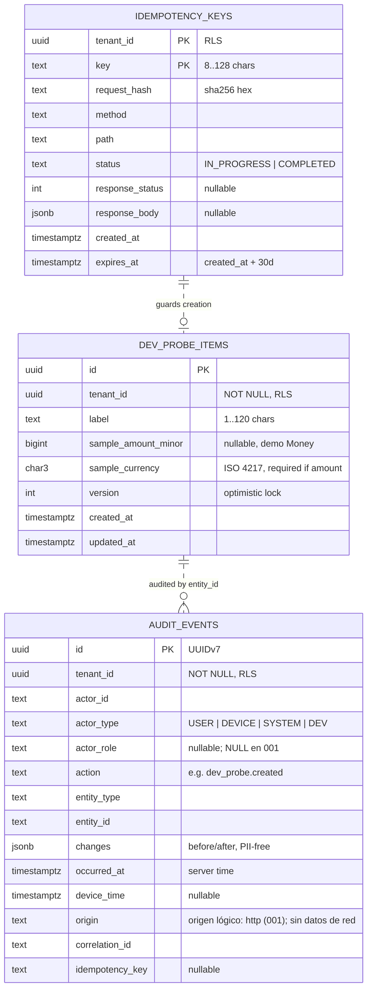

# Data Model: Platform Foundation (001)

**Spec**: [spec.md](spec.md) · **Research**: [research.md](research.md)

Alcance: solo estructuras **técnicas** reutilizables. No hay entidades de negocio (empresa, usuario, cliente, préstamo)
— pertenecen a 002+. Todas las tablas con `tenant_id` tienen RLS **habilitado y forzado** (Constitución III).

## Roles de base de datos

| Rol | LOGIN | BYPASSRLS | Owner de tablas | Uso |
|---|---|---|---|---|
| `kuota_migrator` | sí | no | **sí** | Migraciones (CI/CD, local). Nunca en runtime |
| `kuota_app` | no | **no** | no | Rol de privilegios de la API |
| `kuota_app_login` | sí | no | no | Credencial de la API; `IN ROLE kuota_app` |
| `kuota_maintenance` | no | no | no | Privilegios de mantenimiento: purga de claves de idempotencia vencidas (US6, 0002) |
| `kuota_maintenance_login` | sí | no | no | Credencial de la purga manual; `IN ROLE kuota_maintenance`; `CONNECTION LIMIT 2` |

Privilegios de `kuota_app`: `SELECT, INSERT, UPDATE, DELETE` en `dev_probe_items` e `idempotency_keys`;
**solo `SELECT, INSERT`** en `audit_events`; sin DDL; `USAGE` en el esquema `kuota`.

Privilegios de `kuota_maintenance` (migración `0002_idempotency_maintenance`, 2026-11-23):
- `SELECT (tenant_id, key, expires_at)` y `DELETE` en `idempotency_keys`, nada más;
- políticas `maintenance_select_expired` y `maintenance_delete_expired`, que solo exponen filas con
  `expires_at <= now()`;
- sin acceso a `audit_events` ni a `dev_probe_items`.

Los roles se crean en el aprovisionamiento de plataforma (`infra/docker/postgres/init/02-maintenance-roles.sql`), porque
`kuota_migrator` es `NOCREATEROLE`. Ese paso debe ejecutarse antes de 0002.

## Contexto de sesión (por transacción)

| GUC | Tipo | Fijado por | Uso |
|---|---|---|---|
| `app.tenant_id` | uuid (texto) | `set_config(..., true)` en `withTenant` | Políticas RLS |
| `app.actor_id` | texto | ídem | Auditoría (default) |
| `app.correlation_id` | texto | ídem | Auditoría |

Política estándar (plantilla para toda tabla de tenant):

```text
USING      (tenant_id = nullif(current_setting('app.tenant_id', true), '')::uuid)
WITH CHECK (tenant_id = nullif(current_setting('app.tenant_id', true), '')::uuid)
```

Sin contexto → `current_setting` devuelve `NULL` → la comparación nunca es verdadera → 0 filas (FR-013).



## Entidades

### `dev_probe_items` — Recurso técnico de demostración (FR-017)

| Campo | Tipo | Reglas |
|---|---|---|
| `id` | `uuid` | PK, UUIDv7 generado por el servidor |
| `tenant_id` | `uuid` | NOT NULL; default `current_setting('app.tenant_id')::uuid`; nunca desde el body (FR-012) |
| `label` | `text` | 1–120 caracteres; sin PII (dato sintético) |
| `sample_amount_minor` | `bigint` | Opcional; ejercita la convención de dinero (FR-022) |
| `sample_currency` | `char(3)` | Requerido si hay monto; `CHECK` de consistencia |
| `version` | `int` | Bloqueo optimista; incrementa en cada actualización |
| `created_at`, `updated_at` | `timestamptz` | Hora del servidor |

- Solo se expone si el módulo `dev-probe` está habilitado (`KUOTA_ENV ∈ {local, testing}`); en staging/producción el
  módulo no se registra (la tabla puede existir vacía).
- Operaciones: crear (idempotente, auditada), obtener por id, listar (cursor), actualizar label, eliminar.
  Existen para cubrir lectura/listado/modificación/borrado de la suite de acceso cruzado (FR-016).

### `idempotency_keys` (FR-023, FR-024)

- Política de 001 (FR-023, FR-024). No es la política definitiva de operaciones financieras: 007 y 011 la analizan y
  aprueban por separado.
- PK compuesta `(tenant_id, key)` → la misma clave en dos tenants son operaciones independientes (US6-3).
- `key`: 8–128 caracteres `[A-Za-z0-9_-]`; recomendado UUID. Formato inválido → 400 problem `validation-error`.
- `request_hash`: SHA-256 de `method + path + JSON canónico del body` (claves ordenadas).
- **Concurrencia**: todo el flujo ocurre en **una sola transacción** de `withTenant`. Primero se toma
  `pg_try_advisory_xact_lock` sobre un hash de `(tenant_id, key)`:
  - si **no** se obtiene, otra solicitud con la misma clave está en proceso → 409 `idempotency-request-in-progress` con
    `Retry-After: 1` (segundos), sin tocar la tabla;
  - si se obtiene, se lee la fila y se decide según las respuestas a duplicados (abajo). El bloqueo se libera al
    confirmar o revertir, por lo que no quedan filas `IN_PROGRESS` huérfanas tras una caída.
  - Una colisión del hash de 64 bits entre claves distintas solo provoca un 409 espurio (reintentable), nunca un efecto
    cruzado: la decisión final usa la fila con PK `(tenant_id, key)`.
- **Expiración**: `expires_at = created_at + 30 días`. Una fila con `expires_at <= now()` se trata como inexistente: se
  elimina dentro de la misma transacción y la solicitud se procesa como nueva. La purga masiva es manual (R-16).
- **Transiciones**:

```mermaid
stateDiagram-v2
    [*] --> IN_PROGRESS: bloqueo obtenido y sin fila vigente → INSERT
    IN_PROGRESS --> COMPLETED: comando confirma (misma transacción guarda respuesta)
    IN_PROGRESS --> [*]: comando falla → fila eliminada en rollback
    COMPLETED --> [*]: expires_at alcanzado → tratada como inexistente; eliminada al reutilizar la clave o por purga
```



- Respuestas a duplicados: mismo hash + `COMPLETED` → respuesta almacenada + `Idempotent-Replayed: true`;
  bloqueo no obtenido (otra solicitud en proceso) → 409 `idempotency-request-in-progress` + `Retry-After`; hash
  distinto → 422 `idempotency-key-reused`. `IN_PROGRESS` solo es visible dentro de la transacción que lo crea.
- Solo se almacenan respuestas 2xx y 4xx deterministas (no 5xx: un 5xx permite reintento).

### `audit_events` (FR-025)

- Append-only: `REVOKE UPDATE, DELETE`, más trigger `BEFORE UPDATE OR DELETE → RAISE EXCEPTION`.
- Escrito en la **misma transacción** que el comando auditado.
- `changes` solo contiene campos no sensibles (lista permitida por tipo de entidad); nunca PII en claro.
- `actor_type = DEV` solo posible con el mecanismo técnico de 001; 002 introduce `USER`/`DEVICE`.
- `actor_role` (nullable): en 001 siempre `NULL`, porque el contexto técnico no tiene identidad ni roles; ningún
  encabezado ni campo del body puede fijarlo. Desde 002 lo asigna `AuditService` a partir del rol de la membresía
  autenticada en `TenantContext` (contexto de autorización del servidor), nunca de un valor del cliente. 002 decide
  si pasa a ser obligatorio para `actor_type = USER` (cambio expand → contract, Constitución XIV).
- `origin` (`NOT NULL`): **origen lógico** del evento, es decir, la vía por la que llegó la operación. Enmienda del
  2026-11-23 (Aprobación 5, minimización de datos):
  - **Valores admitidos:** lista cerrada en el servidor (`AUDIT_ORIGINS`). En 001 solo existe la vía HTTP, así que el
    único valor es `http`, fijado por `AuditActorGuard` en toda operación `@Audited()`. Una vía nueva (apps de 002,
    procesos o jobs, sincronización de 011) añade su categoría con una enmienda de este documento cuando exista. No se
    adelantan valores para integraciones que todavía no existen.
  - **Prohibido:**
    - direcciones IPv4 o IPv6;
    - hashes o HMAC de IP;
    - direcciones de proxy y valores de `X-Forwarded-For`, `X-Real-IP` o `Forwarded`;
    - cualquier identificador de red derivado;
    - identificadores de personas o de dispositivos concretos.

    Si una vía futura necesita identificar un dispositivo, se evalúa con minimización antes de persistirlo y no se hace
    en este campo sin una enmienda.
  - **Procedencia:** el valor lo decide el servidor. Ningún encabezado, campo del body ni parámetro de query puede fijarlo.
  - **Diferencias con otros campos:**
    - `origin` no es identidad: el actor está en `actor_id`/`actor_type` y sale de `TenantContext`;
    - `origin` no se usa para autorizar;
    - `origin` no correlaciona: la correlación por solicitud es `correlation_id`.
  - **Justificación:** FR-025 exige registrar el origen, no la red. Ningún flujo usa un dato de red, y `audit_events` es
    append-only y no tiene retención definida (PENDIENTE-LEGAL). Antes se guardaba `ip-hash:<sha256(IP)>`, un dato
    personal seudonimizado de forma débil: una IPv4 se recupera por búsqueda exhaustiva
    (`docs/security/audit-origin-privacy-assessment.md`).
  - **Compatibilidad:**
    - sin cambio de esquema (`text NOT NULL`);
    - los eventos ya almacenados con `ip-hash:` no se reescriben ni se borran (append-only), así que los consumidores
      deben tolerar ese valor histórico;
    - la minimización se aplica a los eventos nuevos.

### `platform_audit_events` (T099; Constitución III y VII; migración `0003_platform_audit`)

Auditoría de **operaciones de plataforma** (cross-tenant), separada de `audit_events`, que exige `tenant_id`: nunca se
usa un tenant ficticio. Propietario lógico: `common/audit`. Hoy la escribe solo la purga de idempotencia (T079).

| Campo | Tipo | Notas |
|---|---|---|
| `id` | `uuid` PK | `uuidv7()` |
| `run_id` | `uuid` NOT NULL | Ejecución; `UNIQUE (run_id, status)` y un solo resultado (`started` → `succeeded` o `failed`) |
| `operation` | `text` NOT NULL | Lista cerrada: `idempotency.purge` |
| `status` | `text` NOT NULL | `started` · `succeeded` · `failed` |
| `executed_by` | `text` NOT NULL | `session_user`, fijado por trigger: el ejecutor no puede falsearlo |
| `occurred_at` | `timestamptz` NOT NULL | `clock_timestamp()`, fijado por trigger |
| `correlation_id` | `uuid` NOT NULL | Correlación con el proceso que lanza la operación |
| `dry_run` | `boolean` NOT NULL | Modo inspección |
| `batch_size`, `max_batches` | `integer` NULL | Parámetros de la ejecución |
| `expired_before`, `affected_rows` | `bigint` NULL | Recuentos (nunca claves, tenants ni contenidos) |
| `batches` | `integer` NULL | Lotes completados |
| `result_code` | `text` NULL | `ok` o código acotado (`^[a-z0-9-]{1,40}$`, p. ej. `sqlstate-55p03`); nunca mensajes |

- **Permisos:** `kuota_maintenance` solo `INSERT` (sin lectura); `kuota_app` y PUBLIC, ninguno. RLS habilitada y
  forzada con una única política (`maintenance_insert_audit`, INSERT). Sin política de lectura: ni el runtime, ni el
  mantenimiento, ni el propietario leen filas. El rol de lectura de plataforma llega con 002.
- **Append-only:** triggers que rechazan `UPDATE`, `DELETE` y `TRUNCATE` incluso al propietario y al superusuario.
  Retención: sin mecanismo de borrado; la política de retención de la auditoría sigue pendiente de decisión.
- **Transacción:** el inicio se confirma antes de borrar (si no puede escribirse, no se purga); cada lote es su
  transacción; el resultado se escribe al final. Un `started` sin resultado identifica una ejecución incompleta.
- **Verificación:** `db:check-rls` comprueba RLS forzada, propietario, ausencia de privilegios de PUBLIC y runtime, la
  política exacta y los triggers.

### Objetos de valor (no persistidos por sí mismos)

- **Money** (ADR-0007, D-FIN-01): `amountMinor` (entero con signo dentro del rango de `BIGINT`; `bigint` en TS,
  `BigInt` en Dart) + `currency` (ISO 4217 del catálogo). Invariantes: operaciones solo entre la misma moneda; escala =
  `minorUnits` de la moneda; redondeo explícito obligatorio; resultado fuera de rango → `AMOUNT_OUT_OF_RANGE`. JSON:
  `{ "amount_minor": "<string canónico>", "currency": "XXX" }`. Errores: `CURRENCY_MISMATCH`, `ROUNDING_REQUIRED`,
  `INVALID_AMOUNT`, `TOO_MANY_DECIMALS`, `AMOUNT_OUT_OF_RANGE`, `UNSUPPORTED_CURRENCY`. Dominio simétrico:
  −9223372036854775807 … 9223372036854775807 (−9223372036854775808 queda fuera, aunque `BIGINT` lo admita).
- **RoundingMode**: `HALF_UP | HALF_EVEN | DOWN | UP | FLOOR | CEILING`.
- **CompatibilityInfo**: `api_version` (semver), `min_supported` por app (`admin`, `collector`, `client`) en semver,
  `server_time` (para detección de desfase de reloj en apps futuras).
- **Money fixture**: `id`, `operation` (`add|subtract|multiply|allocate|parse|format|from_json`), `inputs`, `rounding`,
  `expected` | `expected_error`. Esquema en [contracts/money-fixture.schema.json](contracts/money-fixture.schema.json).

## Verificación automática de RLS (FR-015)

Consulta de catálogo ejecutada en CI tras migrar: falla si existe alguna tabla del esquema `kuota` con columna
`tenant_id` donde `relrowsecurity = false` o `relforcerowsecurity = false`, o sin al menos una política. Lista blanca
explícita y vacía en 001 (tablas globales futuras deben declararse en ella con justificación).

## Implementación en `0001_foundation` (G2, 2026-11-22)

Migración `backend/prisma/migrations/0001_foundation/migration.sql`, verificada con
`backend/test/integration/foundation-schema.spec.ts` (24 pruebas sobre PostgreSQL 18.7). Concreta las reglas de este
documento así:

| Regla del modelo | Forma en SQL |
|---|---|
| `id` UUIDv7 del servidor | `DEFAULT uuidv7()` (nativo de PostgreSQL 18) en `dev_probe_items.id` y `audit_events.id` |
| `tenant_id` del contexto, nunca del body | `DEFAULT nullif(current_setting('app.tenant_id', true), '')::uuid` + `NOT NULL` + política `WITH CHECK` |
| `label` 1–120 · `version` ≥ 1 · monto con moneda | `CHECK` de longitud, `version >= 1` y `(sample_amount_minor IS NULL) = (sample_currency IS NULL)`; `sample_currency ~ '^[A-Z]{3}$'` |
| Dominio simétrico de Money (ADR-0007) | `CHECK (sample_amount_minor <> -9223372036854775808)` |
| `key` 8–128 `[A-Za-z0-9_-]` · `request_hash` SHA-256 · `status` | `CHECK` de formato; hash `^[0-9a-f]{64}$`; `status IN ('IN_PROGRESS','COMPLETED')`; `method ~ '^[A-Z]+$'` |
| Solo respuestas 2xx/4xx deterministas | `response_status` nulo o en 200–299 / 400–499; `COMPLETED` exige `response_status` |
| `expires_at = created_at + 30d` | Ambos con `now()` por defecto (hora de inicio de la transacción) + `CHECK (expires_at > created_at)` |
| Auditoría: actor, acción, entidad, origen y correlación (FR-025) | `NOT NULL` en `actor_id`, `actor_type`, `action`, `entity_type`, `entity_id`, `origin`, `correlation_id`; `actor_id` y `correlation_id` toman su valor por defecto de `app.actor_id` y `app.correlation_id`; `actor_role`, `device_time` e `idempotency_key` admiten nulo; `changes` debe ser un objeto JSON |
| Append-only (R-07) | Grants (`kuota_app`: solo `SELECT`, `INSERT`) + trigger por fila `BEFORE UPDATE OR DELETE` + trigger por sentencia `BEFORE TRUNCATE` |
| Índices | PK; `UNIQUE (tenant_id, id)` en `dev_probe_items` (FK compuestas y cursor por tenant); `(tenant_id, occurred_at)` en `audit_events`; `(expires_at)` en `idempotency_keys` (purga, T079) |

**Decisión de implementación — rol de la política RLS.** Este documento no fija a qué rol aplica la política estándar.
Se declaró `FOR ALL TO kuota_app` (mínimo privilegio). Consecuencia verificada: con `FORCE ROW LEVEL SECURITY`,
`kuota_migrator` (propietario) **no ve ni modifica filas** por DML aunque fije el contexto. Una migración de datos
futura (backfill) necesitará una política explícita para el migrador o un `NO FORCE` temporal dentro de una migración
revisada. Un rol futuro como `kuota_worker` solo quedará cubierto si es miembro de `kuota_app` o si se le añade una
política propia (ADR-0002, C2-3).

**Comportamiento observado — inserción sin contexto.** Falla con `42501` (violación de `WITH CHECK` de RLS) y no con
`23502` (`NOT NULL`): PostgreSQL evalúa la política primero. En ambos casos se rechaza (fail-closed).
