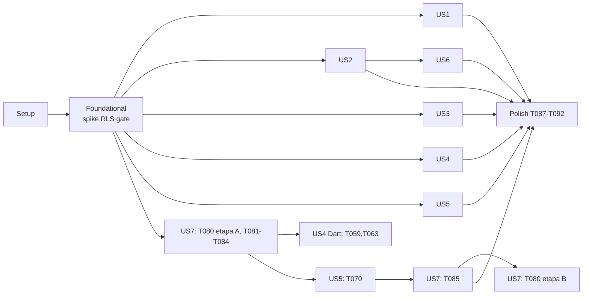

---

description: "Task list for 001-platform-foundation"
---

# Tasks: Platform Foundation

**Input**: Design documents from `/specs/001-platform-foundation/`

**Prerequisites**: plan.md, spec.md, research.md, data-model.md, contracts/, quickstart.md

**Tests**: OBLIGATORIAS. La Constitución (X. Test-Driven Validation) exige que las pruebas se escriban antes o junto con
la implementación y fallen primero. En cada historia, las tareas de prueba preceden a las de implementación.

**Organization**: Tareas agrupadas por historia de usuario (spec.md) para implementación y verificación independientes.

**Gate de implementación**: `/speckit-implement` NO se ejecuta sin aprobación humana explícita (Constitución I).

## Format: `[ID] [P?] [Story] Description`

- **[P]**: Paralelizable (archivos distintos, sin dependencias de tareas incompletas)
- **[Story]**: Historia de usuario (US1..US7)
- Rutas relativas a la raíz del repositorio `kuota-platform/`
- T093–T096 se añadieron tras `/speckit-analyze` (2026-11-22) y se ubican en su fase; no se renumeró para conservar las
  referencias existentes a T001–T092
- T098 (`app_shell`) se añadió el 2026-11-23 con la Aprobación 11
- T097 (CORS) se añadió el 2026-11-23 con la Aprobación 8 (hueco de especificación detectado al conectar `admin_web`)

---

## Phase 1: Setup (Shared Infrastructure)

**Purpose**: Toolchains fijados, workspace raíz y entorno local base (research R-01, R-17, R-18, R-19)

- [X] T001 Crear `.nvmrc` (Node 26) y `package.json` raíz con `"packageManager": "pnpm@12.x"` fijado, `engines` y scripts agregadores vacíos en `package.json`
- [X] T002 Crear `pnpm-workspace.yaml` con el paquete `backend` (sin Nx/Turborepo, ADR-0002) en `pnpm-workspace.yaml`
- [X] T003 [P] Crear `.env.example` con todas las variables requeridas, valores ficticios y descripción (`KUOTA_ENV`, `KUOTA_DEV_TENANT_CONTEXT`, `DATABASE_URL_APP`, `DATABASE_URL_MIGRATOR`, `LOG_LEVEL`, `API_VERSION`, `MIN_SUPPORTED_ADMIN/COLLECTOR/CLIENT`) en `.env.example`
- [X] T004 [P] Crear `infra/docker/compose.yaml` con `postgres:18` fijado por digest, volumen nombrado y healthcheck `pg_isready` (R-18) en `infra/docker/compose.yaml`
- [X] T005 [P] Crear script de roles `kuota_migrator`, `kuota_app` (NOLOGIN, NOBYPASSRLS) y `kuota_app_login`, y la base `kuota_test`, según data-model.md (Roles de base de datos) en `infra/docker/postgres/init/01-roles.sql`
- [X] T006 [P] Crear `scripts/dev/doctor.sh`, que verifica Node 26, pnpm 12, Docker, FVM ≥ 3.2 y la versión de Flutter de `.fvmrc`, y falla indicando la versión requerida (US1-4, FR-003), en `scripts/dev/doctor.sh`
- [X] T007 Inicializar el backend NestJS 12 con builder SWC, TypeScript 7 en modo `strict` solo para typecheck (R-02) y scripts `dev/build/typecheck/lint/test` en `backend/package.json`, `backend/nest-cli.json` y `backend/tsconfig.json`
- [X] T008 [P] Configurar Vitest 5 con `unplugin-swc`, cobertura v8 y umbrales por glob (`src/common/money/**` y `**/domain/**` ≥ 90 %, resto ≥ 80 %, Constitución X) en `backend/vitest.config.ts`
- [X] T009 [P] Configurar ESLint (`typescript-eslint`) y Prettier, incluida la regla que prohíbe usar el cliente Prisma fuera de `src/common/tenant-context/` (R-04), en `backend/eslint.config.mjs`
- [X] T010 [P] Configurar dependency-cruiser: `domain/` no importa `@nestjs/*`, `@prisma/*`, `pg`, `express`, `infrastructure/` ni `interface/`; los módulos solo importan el `index.ts` público de otros (R-11). En `backend/.dependency-cruiser.cjs`
- [X] T011 [P] Configurar Testcontainers (`@testcontainers/postgresql` con `postgres:18`), que aplica roles y migraciones y entrega URLs para `kuota_app_login` y `kuota_migrator`, en `backend/test/support/postgres.ts`

**Checkpoint**: se cumplen `pnpm install`, `pnpm --filter backend typecheck` y `scripts/dev/doctor.sh`. Si TypeScript 7 falla con NestJS 12, se fija la 6.x y se registra en research.md (R-02).

---

## Phase 2: Foundational (Blocking Prerequisites)

**Purpose**: Spike RLS (decide D-ARC-01), esquema base, configuración, logging, errores y contrato base

**⚠️ CRITICAL**: Ninguna historia empieza antes de terminar esta fase. Si el spike T014 falla, se DETIENE la feature y se activa el fallback de R-04 (Kysely) con ADR-0004 actualizado antes de continuar.

- [X] T012 Crear y verificar la migración inicial SQL, neutral respecto al ORM y referencia canónica del esquema inicial mientras no haya una decisión formal distinta: esquema `kuota`, tablas `dev_probe_items`, `idempotency_keys` y `audit_events` con los campos, tipos y `CHECK` de data-model.md: `dev_probe_items.id`, `dev_probe_items.tenant_id`, `dev_probe_items.label`, `dev_probe_items.sample_amount_minor`, `dev_probe_items.sample_currency`, `dev_probe_items.version`, `dev_probe_items.created_at`, `dev_probe_items.updated_at`; `idempotency_keys.tenant_id`, `idempotency_keys.key`, `idempotency_keys.request_hash`, `idempotency_keys.method`, `idempotency_keys.path`, `idempotency_keys.status`, `idempotency_keys.response_status`, `idempotency_keys.response_body`, `idempotency_keys.created_at`, `idempotency_keys.expires_at`; `audit_events.id`, `audit_events.tenant_id`, `audit_events.actor_id`, `audit_events.actor_type`, `audit_events.actor_role`, `audit_events.action`, `audit_events.entity_type`, `audit_events.entity_id`, `audit_events.changes`, `audit_events.occurred_at`, `audit_events.device_time`, `audit_events.origin`, `audit_events.correlation_id`, `audit_events.idempotency_key`. Incluye `ENABLE` y `FORCE ROW LEVEL SECURITY` y la política estándar de data-model.md. En `backend/prisma/migrations/0001_foundation/migration.sql` (enmienda del 2026-11-22: `schema.prisma` pasa a T014)
- [X] T013 Añadir a la misma migración los grants de data-model.md (Roles de base de datos): `kuota_app` con DML en `dev_probe_items`/`idempotency_keys` y solo `SELECT`/`INSERT` en `audit_events`, más el trigger `BEFORE UPDATE OR DELETE` que lanza excepción en `audit_events` (R-07). En `backend/prisma/migrations/0001_foundation/migration.sql`
- [X] T014 Crear `backend/prisma/schema.prisma` (esquema `kuota`, generador con `@prisma/adapter-pg`; modelos alineados con la migración 0001 sin reemplazarla ni regenerarla), `backend/prisma.config.ts` (credenciales de migración y runtime separadas, sin secretos versionados), `backend/prisma/migrations/migration_lock.toml` y el cliente Prisma del spike; e implementar el spike RLS con Prisma 7 + `adapter-pg` que evalúa los criterios **S1–S8** de ADR-0004 §Validación (research R-04): S1 contexto ausente sin error, también en conexión reutilizada; S2 ≥ 50 solicitudes de 2 tenants, pool 2–5, 0 cruces y reutilización demostrada de `pg_backend_pid()`; S3 privilegios y `WITH CHECK`; S4 ruta de error; S5 `withTenant` anidado; S6 migraciones solo con `kuota_migrator`; S7 SQL crudo; S8 latencia (referencia). Configuración fija (pool, `maxWait`/`timeout`, semilla, 20 repeticiones); imprime PASS/FAIL por criterio y la decisión según la regla del ADR. En `backend/scripts/spike-rls.ts`
- [X] T015 Evaluar el resultado del spike y obtener la aprobación humana de Prisma o Kysely (D-ARC-01); registrar el resultado (criterios, cifras de latencia, decisión aprobada o fallback) en la sección "Resultado del spike" de `docs/decisions/ADR-0004-database-orm.md` y en `specs/001-platform-foundation/research.md` (R-04). Requiere aprobación humana de D-ARC-01
- [X] T016 [P] Implementar el módulo de configuración con validación de variables de entorno y los guards de arranque: aborta si `KUOTA_DEV_TENANT_CONTEXT=enabled` con `KUOTA_ENV ∈ {staging, production}` (R-05), y aborta si `KUOTA_METRICS_TOKEN` falta o tiene menos de 32 caracteres cuando `KUOTA_ENV ∈ {staging, production}` o `KUOTA_METRICS_HOST` no es de loopback (R-21). Variables `KUOTA_METRICS_HOST` (por defecto `127.0.0.1`), `KUOTA_METRICS_PORT` (9464) y `KUOTA_METRICS_TOKEN` (valor ficticio en `.env.example`). En `backend/src/common/config/`
- [X] T017 [P] Escribir la prueba de configuración: el arranque falla con `KUOTA_ENV=production` y dev-tenant habilitado, y es válido con `local`/`testing`; falla en `staging`/`production` sin token de métricas o con token corto, y en cualquier entorno con `KUOTA_METRICS_HOST=0.0.0.0` sin token (FR-040). En `backend/test/unit/config/dev-tenant-guard.spec.ts` y `backend/test/unit/config/metrics-guard.spec.ts`
- [X] T018 [P] Escribir la prueba de redacción de logs: emite teléfono, correo, token, OTP, identificador fiscal y encabezado `authorization` conocidos y verifica que no aparecen en la salida (FR-010, SC-009), en `backend/test/unit/logging/redaction.spec.ts`
- [X] T019 Implementar el logging con nestjs-pino: JSON, `correlation_id` desde `X-Correlation-Id` (UUID validado) o UUIDv7 generado, módulo, nivel, tenant y actor desde CLS, `redact.paths` y serializador de patrones (R-15). En `backend/src/common/logging/`
- [X] T020 [P] Escribir la prueba del filtro de errores: toda excepción produce `application/problem+json` con `type`, `title`, `status`, `code` y `correlation_id`, sin stack ni datos sensibles (FR-011), en `backend/test/unit/errors/problem-filter.spec.ts`
- [X] T021 Implementar el filtro global problem+json (RFC 9457) con los códigos estables del contrato (`Problem.code`), en `backend/src/common/errors/`
- [X] T022 Materializar el contrato fuente multiarchivo a partir de `specs/001-platform-foundation/contracts/kuota-core.v1.openapi.yaml`, separando `paths/`, `schemas/`, `parameters/` y `responses/`, en `contracts/openapi/kuota-core.v1.yaml`
- [X] T023 [P] Configurar Redocly 2 (preset recommended, excepciones justificadas para health 4xx y servidor localhost) con las reglas propias de R-13: `Idempotency-Key` requerido si `x-kuota-idempotent`, errores `application/problem+json` y montos vía `$ref Money`. En `contracts/openapi/redocly.yaml`
- [X] T024 [P] Crear los scripts raíz `contracts:lint`, `contracts:bundle` y `contracts:breaking` (oasdiff 1.39 fijado, contra el bundle de `main`) en `package.json` y `scripts/contracts/breaking.sh`
- [X] T025 Crear `AppModule` con el registro condicional de módulos (`dev-probe` solo si `KUOTA_ENV ∈ {local, testing}` y `KUOTA_DEV_TENANT_CONTEXT=enabled`; FR-040) y el bootstrap con prefijo de versión `/v1` para rutas versionadas, en `backend/src/app.module.ts` y `backend/src/main.ts`

**Checkpoint**: el spike está en PASS y aprobado, se cumple `pnpm contracts:lint` y las pruebas T017, T018 y T020 pasan.

---

## Phase 3: User Story 1 - Entorno local reproducible y ejecutable (Priority: P1) 🎯 MVP

**Goal**: Un comando levanta el almacén de datos y el servicio central. Los chequeos de vida y disponibilidad responden, la compatibilidad está disponible y un comando corre todas las pruebas.

**Independent Test**: Desde un clon limpio, seguir quickstart.md §1–2. `/health/ready` devuelve `ok`; con la base detenida devuelve 503 mientras `/health/live` sigue en 200; `test-all.sh` termina en verde.

### Tests for User Story 1 ⚠️

- [X] T026 [P] [US1] Escribir la prueba de integración de health, sin credenciales (excepciones de FR-040): `live` 200 con exactamente `{"status":"ok"}`; `ready` 200 con la BD arriba y 503 con `checks.database.status=down` con la BD detenida (US1-1, US1-2); con la BD caída, el cuerpo no contiene host, puerto, nombre de base, versión ni mensaje de error, en `backend/test/integration/health.spec.ts`
- [X] T027 [P] [US1] Escribir la prueba de integración de compatibilidad: sin credenciales devuelve `CompatibilityInfo` desde la configuración, sin campos adicionales ni encabezados reflejados (FR-040), `client_supported` según `X-App-Version` y 400 problem si el formato del encabezado es inválido, en `backend/test/integration/meta-compatibility.spec.ts`
- [X] T093 [P] [US1] Escribir la prueba de integración de métricas (US1-5, FR-039, FR-040). Acceso: con el token configurado, 200 con `Authorization: Bearer <token>`, 401 sin token o con token inválido; por defecto la escucha es `127.0.0.1`. Contenido: tras solicitudes a `/health/live`, `/v1/meta/compatibility` y una ruta inexistente, el endpoint expone `http_server_request_duration_seconds` con etiquetas `route` (plantilla), `method` y `status`, `kuota_http_errors_total` por `code`, métricas del pool de PostgreSQL y del proceso; ninguna etiqueta contiene UUIDs de tenant, valores de encabezados ni rutas concretas con ids; el puerto de la API no sirve `/metrics`. En `backend/test/integration/metrics.spec.ts`

### Implementation for User Story 1

- [X] T028 [P] [US1] Implementar el módulo health con `@nestjs/terminus` (`/health/live` sin consultar dependencias; `/health/ready` con indicador PostgreSQL usando `kuota_app_login`, mapeando el resultado de terminus a `ReadinessStatus` sin `info`/`error`/`details` y enviando el detalle del fallo solo al log) en `backend/src/modules/health/`
- [X] T094 [US1] Implementar el módulo de métricas con OpenTelemetry (R-21): `MeterProvider` con `PrometheusExporter` (`preventServerStart: true`), interceptor HTTP que etiqueta por plantilla de ruta, contador de errores alimentado por el filtro problem+json (T021), gauges del pool de `adapter-pg`, métricas del proceso, y servidor HTTP propio en `KUOTA_METRICS_HOST:KUOTA_METRICS_PORT` que exige `Authorization: Bearer` comparado en tiempo constante (`crypto.timingSafeEqual`) antes de delegar en `getMetricsRequestHandler`. Configuración y guard en T016. En `backend/src/common/metrics/`
- [X] T029 [P] [US1] Implementar el módulo meta con `GET /v1/meta/compatibility` (versión de API y mínimas por app desde config, `server_time`, parseo de `X-App-Version`) en `backend/src/modules/meta/`
- [X] T030 [US1] Crear `scripts/dev/up.sh` (doctor → compose up → espera de salud de la BD → migraciones con `kuota_migrator` → `pnpm --filter backend dev` → espera de `/health/ready`) y `scripts/dev/down.sh`, con mensajes accionables si el puerto está ocupado o falla la migración (Edge Cases), en `scripts/dev/`
- [X] T031 [P] [US1] Crear `Makefile` con los objetivos `up`, `down`, `test`, `test-affected` y `doctor`, que delegan en `scripts/dev/*`, en `Makefile`
- [X] T032 [US1] Crear `scripts/dev/test-all.sh` (backend + contratos + Flutter si existe `flutter/`) y `scripts/dev/test-affected.sh <base>`, que detecta componentes con `git diff --name-only` usando los mismos filtros que CI (FR-002), en `scripts/dev/`
- [X] T033 [US1] Añadir la guía de inicio para desarrolladores (prerrequisitos, `cp .env.example .env`, `make up`, verificación) al `README.md`, enlazando `specs/001-platform-foundation/quickstart.md`

**Checkpoint**: quickstart.md §1–2 pasa en un clon limpio.

---

## Phase 4: User Story 2 - Aislamiento entre empresas demostrable y reutilizable (Priority: P1)

**Goal**: El contexto de tenant por operación, el RLS forzado verificado automáticamente y una suite reutilizable de acceso cruzado sobre `dev_probe_items`.

**Independent Test**: quickstart.md §3: `test:tenancy` y `db:check-rls` en verde; consultas cruzadas devuelven 404; una consulta sin contexto devuelve 0 filas.

### Tests for User Story 2 ⚠️

- [X] T034 [P] [US2] Crear el helper reutilizable `describeTenantIsolation(resource)`, que genera casos de lectura por id → 404, listado sin elementos ajenos, update/delete cruzados → 404 sin efecto, body con otro `tenant_id` rechazado o ignorado, y ≥ 50 solicitudes intercaladas de 2 tenants (US2-1, US2-3, US2-6; FR-016), en `backend/test/tenancy/describe-tenant-isolation.ts`
- [X] T035 [P] [US2] Escribir la prueba de base de datos: con `kuota_app_login`, una consulta sin `set_config` devuelve 0 filas en cada tabla de tenant; `kuota_app` no es owner ni tiene `BYPASSRLS` y no puede hacer DDL (US2-2, US2-5; FR-013, FR-014), en `backend/test/integration/rls-database.spec.ts`
- [X] T036 [P] [US2] Escribir la prueba del verificador de catálogo: crea en un esquema temporal una tabla con `tenant_id` sin `FORCE` y verifica que `check-rls` falla nombrándola (US2-4), en `backend/test/integration/check-rls.spec.ts`
- [X] T096 [P] [US2] Escribir la prueba de deshabilitación de dev-probe (FR-040, excepción `/v1/dev/*`): al construir la app con `KUOTA_ENV=staging` y `KUOTA_ENV=production` (dev-tenant deshabilitado), todas las operaciones de `/v1/dev/probe-items` responden 404, envíen o no `X-Kuota-Dev-Tenant`, y no se escribe ninguna fila; con `KUOTA_ENV=testing` y el mecanismo deshabilitado, también 404. En `backend/test/integration/dev-probe-disabled.spec.ts`
- [X] T037 [US2] Aplicar `describeTenantIsolation` a `dev_probe_items` (create/get/list/patch/delete del contrato) en `backend/test/tenancy/dev-probe.tenancy.spec.ts`

### Implementation for User Story 2

- [X] T038 [US2] Implementar `TenantContext` sobre nestjs-cls (`tenantId`, `actorId`, `actorType`, `actorRole` —siempre `null` en 001, sin ningún encabezado que lo fije—, `correlationId`) y `DevTenantGuard`, que lee `X-Kuota-Dev-Tenant`/`X-Kuota-Dev-Actor` solo cuando la configuración lo permite (R-05) y responde 401 `tenant-context-required` si falta, en `backend/src/common/tenant-context/`
- [X] T039 [US2] Implementar `TenantPrismaService.withTenant(fn)`: transacción interactiva con `set_config('app.tenant_id'|'app.actor_id'|'app.correlation_id', …, true)` como primera sentencia, cliente transaccional propagado por CLS y semántica de anidamiento de ADR-0002 (C2-1: mismo tenant reutiliza la transacción; otro tenant → error y rollback), siguiendo el patrón aprobado en T015, en `backend/src/common/tenant-context/tenant-prisma.service.ts`
- [X] T040 [P] [US2] Implementar el dominio de `dev-probe`: entidad `DevProbeItem` con las validaciones de data-model.md (`dev_probe_items.label`, `dev_probe_items.sample_amount_minor`/`dev_probe_items.sample_currency` con consistencia monto↔moneda, `dev_probe_items.version`) sin dependencias de framework, en `backend/src/modules/dev-probe/domain/`
- [X] T041 [US2] Implementar el repositorio Prisma de `dev-probe` vía `withTenant` (`dev_probe_items.id` como UUIDv7 generado por el servidor según data-model.md; `dev_probe_items.tenant_id` tomado del contexto, nunca del body; FR-012), con paginación por cursor y bloqueo optimista por `dev_probe_items.version`, en `backend/src/modules/dev-probe/infrastructure/`
- [X] T042 [US2] Implementar los casos de uso y el controlador de `dev-probe` (`createDevProbeItem`, `listDevProbeItems`, `getDevProbeItem`, `updateDevProbeItem`, `deleteDevProbeItem`) conforme al contrato, con 404 para recursos de otros tenants y 409 `version-conflict`. `createDevProbeItem` exige `Idempotency-Key` desde US2 mediante `IdempotencyKeyPipe`, que valida presencia y formato según data-model.md `idempotency_keys.key` y responde 400 `validation-error`; la deduplicación (reproducción, 409 y 422) llega en US6 (T076). Archivos: `backend/src/modules/dev-probe/application/`, `backend/src/modules/dev-probe/interface/` y `backend/src/common/idempotency/idempotency-key.pipe.ts`
- [X] T043 [US2] Implementar el verificador de catálogo `db:check-rls`, que falla si hay tablas del esquema `kuota` con `tenant_id` sin `relrowsecurity`, sin `relforcerowsecurity` o sin políticas, con una lista blanca vacía (data-model.md, Verificación automática de RLS), en `backend/scripts/check-rls.ts` y el script `db:check-rls` de `backend/package.json`
- [X] T044 [US2] Añadir el script `test:tenancy` y documentar en `docs/security/multi-tenant-isolation.md` cómo una feature futura aplica `describeTenantIsolation` a sus recursos, en `backend/package.json` y `docs/security/multi-tenant-isolation.md`

**Checkpoint**: quickstart.md §3 pasa y SC-002 se cumple.

---

## Phase 5: User Story 3 - Quality gates automáticos en cada Pull Request (Priority: P1)

**Goal**: CI por componente afectado con gates bloqueantes, ejecutable localmente con los mismos scripts, sin publicar en remoto.

**Independent Test**: quickstart.md §8. `scripts/ci/run-local.sh <job>` reproduce cada job y `actionlint` valida los workflows. La prueba de los 6 gates defectuosos se cierra en la Polish phase (T087), cuando existan los gates de US4 y US5.

### Tests for User Story 3 ⚠️

- [X] T045 [P] [US3] Escribir la prueba del detector de componentes afectados: un cambio solo en `docs/` → solo `general`; `backend/**` → `general` + `backend`; `contracts/**` → `general` + `contracts` + `backend` + `flutter` (US3-1..3), en `scripts/ci/tests/affected.test.sh`
- [X] T046 [P] [US3] Escribir la prueba del gate de secretos: un archivo con un secreto ficticio de patrón conocido hace fallar `scripts/ci/general.sh` (US3-4), en `scripts/ci/tests/secrets.test.sh`

### Implementation for User Story 3

- [X] T047 [US3] Implementar `scripts/ci/general.sh`: gitleaks 8.30 sobre el diff y el historial, editorconfig-checker, validación del nombre de rama (`feature/NNN-*` ↔ `specs/NNN-*` existente, `fix/`, `hotfix/`, `chore/`, `docs/`) y actionlint, en `scripts/ci/general.sh`
- [X] T048 [P] [US3] Implementar `scripts/ci/backend.sh`: install con lockfile, lint, typecheck, dependency-cruiser, pruebas unitarias, de integración (Testcontainers), de tenancy y de contrato, cobertura con umbrales, `db:check-rls` y `osv-scanner` sobre `pnpm-lock.yaml` (FR-035), en `scripts/ci/backend.sh`
- [ ] T049 [P] [US3] Implementar `scripts/ci/contracts.sh`: lint de Redocly, oasdiff breaking contra `main`, validación de los fixtures contra `contracts/fixtures/money/fixture.schema.json` y verificación de que el cliente Dart regenerado no tiene diff, en `scripts/ci/contracts.sh`
- [X] T050 [P] [US3] Implementar `scripts/ci/flutter.sh`: `fvm flutter pub get`, `melos run analyze`, `melos run test`, `tool/check_deps.dart`, `check-no-float-dart.sh`, `osv-scanner` sobre `pubspec.lock`, y build de Android y Web (iOS excluido de CI por la Clarification 2026-11-22; el build Web de `admin_web` valida el shell provisional de D-ARC-03, no la tecnología definitiva), en `scripts/ci/flutter.sh`
- [X] T051 [US3] Implementar `scripts/ci/run-local.sh <general|backend|contracts|flutter|affected>`, que ejecuta los mismos scripts que CI, en `scripts/ci/run-local.sh`
- [ ] T052 [US3] Crear el workflow con `dorny/paths-filter` y los jobs `general`, `backend` (servicio Docker para Testcontainers), `contracts` y `flutter` (FVM, Android y Web; Web cubre el shell provisional de `admin_web`, D-ARC-03), que solo invocan `scripts/ci/*.sh`, con acciones fijadas por SHA, permisos mínimos (`contents: read`) y concurrencia por rama (FR-034, FR-037), en `.github/workflows/ci.yml`
- [X] T053 [P] [US3] Crear `.github/CODEOWNERS` con el placeholder `<maintainer-handle>` (no se inventa ningún usuario; la asignación automática queda pendiente de validación hasta existir repositorio remoto e identificador GitHub válido, y así se registra en `validation-report.md`), secciones por área (backend, `common/tenant-context`, `common/money`, migraciones, contracts, Flutter packages, infra, `.specify/memory`) y comentarios para añadir un segundo dueño (R-20, FR-036), en `.github/CODEOWNERS`
- [X] T054 [US3] Actualizar `.github/pull_request_template.md` con la regla de mantenedor único y la política de acceso a endpoints (§II) de la Constitución v1.2.0 y la referencia obligatoria a `T###`, en `.github/pull_request_template.md`
- [X] T055 [US3] Documentar, listas para aplicar al publicar el remoto, las reglas de protección de `main` (checks requeridos por nombre de job, revisión, sin force-push, historial lineal) y la excepción de mantenedor único (FR-038), en `docs/process/git-workflow.md`

**Checkpoint**: `actionlint .github/workflows/ci.yml` no reporta errores, `run-local.sh general` y `run-local.sh backend` están en verde, y T045 y T046 pasan.

---

## Phase 6: User Story 4 - Primitiva monetaria única y exacta (Priority: P2)

**Goal**: `Money` exacto con redondeo obligatorio en TypeScript y Dart, validado con fixtures compartidos, y la regla anti-float.

**Independent Test**: quickstart.md §5. Los mismos fixtures pasan en ambos lados (SC-005) y la regla anti-float detecta un archivo defectuoso.

### Tests for User Story 4 ⚠️

- [X] T056 [P] [US4] Crear el esquema y los fixtures de referencia: suma y resta en la misma moneda, `CURRENCY_MISMATCH`, multiplicación con cada modo de redondeo (incluidos casos .5 positivos y negativos), `ROUNDING_REQUIRED`, `allocate` en 3 partes con suma exacta y empates por índice, montos mayores que 2^53, límites del dominio `Money` con comprobación numérica exacta, no solo el patrón (ADR-0007): `-9223372036854775807` aceptado, `9223372036854775807` aceptado, `-9223372036854775808` rechazado (aunque `BIGINT` lo admita) y `9223372036854775808` rechazado, ambos con `AMOUNT_OUT_OF_RANGE`; desbordamiento en `add`/`subtract`/`multiply` → `AMOUNT_OUT_OF_RANGE`; casos `from_json` con `amount_minor` no canónico, fuera de rango o con moneda no soportada, forma canónica (`-0` y ceros a la izquierda → `INVALID_AMOUNT`), monedas de escala 0, 2, 3 y 4, `UNSUPPORTED_CURRENCY`, `parse` con `TOO_MANY_DECIMALS` e `INVALID_AMOUNT`, y `format` canónico (ADR-0007). Incluye la copia de referencia del catálogo `contracts/fixtures/money/currencies.json`. Esquema copiado de `specs/001-platform-foundation/contracts/money-fixture.schema.json`; archivos `contracts/fixtures/money/fixture.schema.json` y `contracts/fixtures/money/core.json`
- [X] T057 [P] [US4] Escribir el runner TypeScript de fixtures, que ejecuta cada caso de `contracts/fixtures/money/*.json`, verifica que el catálogo de monedas del código coincide con `currencies.json` y prueba **Money → JSON → Money** para todo monto válido de los fixtures (`amount_minor` y moneda idénticos, incluidos 0, negativos, extremos del dominio y valores > 2^53; rechazo de los casos `from_json` inválidos; sin pasar nunca por `number`), en `backend/test/unit/money/fixtures.spec.ts`
- [X] T058 [P] [US4] Escribir las pruebas de propiedades con fast-check: `allocate` conserva la suma, `add`/`subtract` son inversas y `multiply` por 1 es identidad (US4-5), en `backend/test/property/money.property.spec.ts`
- [X] T059 [US4] Escribir el runner Dart de los mismos fixtures (incluida la comparación del catálogo con `currencies.json` y la prueba **Money → JSON → Money** con los mismos casos y rechazos que T057, sin `int`, `double` ni `num` intermedios), ejecutado sobre la VM y sobre web (`dart test -p vm,chrome`); TypeScript, Dart VM y Flutter Web deben producir resultados idénticos (ADR-0007), en `flutter/packages/financial_domain/test/money_fixtures_test.dart` (depende de T080)
- [X] T060 [P] [US4] Crear un archivo defectuoso de referencia para la regla anti-float (tipo `number` en un campo `amount`, `parseFloat`, `toFixed`), excluido del build, en `backend/test/fixtures/float-violation.ts.txt`

### Implementation for User Story 4

- [X] T061 [US4] Implementar `Money` y `RoundingMode` en TypeScript (`bigint` en unidades mínimas, catálogo ISO 4217 con `minorUnits`, instancia `Decimal.clone({precision: 40})`, `add/subtract/multiply/allocate/parse/format`, errores tipados; data-model.md Objetos de valor; ADR-0007) en `backend/src/common/money/`
- [X] T062 [US4] Implementar la serialización JSON de `Money` (`{amount_minor: string, currency}`) y su validación en la frontera (FR-022), y usarla en `dev_probe_items.sample_amount_minor`/`dev_probe_items.sample_currency` (data-model.md), en `backend/src/common/money/money.json.ts` y `backend/src/modules/dev-probe/interface/`
- [X] T063 [US4] Implementar `Money` y `RoundingMode` en Dart con `BigInt` (nunca `int`; ADR-0007) y el paquete `decimal` 3.x, con la misma API y los mismos errores que la versión TypeScript, en `flutter/packages/financial_domain/lib/src/money/` (depende de T080)
- [X] T064 [US4] Implementar la regla anti-float de TypeScript (`no-restricted-syntax` y restricción de tipos en las rutas `src/common/money/**` y `src/**/domain/**`, R-10) en `backend/eslint.config.mjs`
- [X] T065 [US4] Implementar `scripts/ci/check-no-float.sh` (ejecuta ESLint sobre el archivo defectuoso y espera que falle, y el lint real que debe pasar) y `scripts/ci/check-no-float-dart.sh` (`double`/`num` prohibidos en `financial_domain/lib`), en `scripts/ci/`

**Checkpoint**: quickstart.md §5 pasa y se cumple SC-005.

---

## Phase 7: User Story 5 - Contrato de API como fuente de verdad (Priority: P2)

**Goal**: El cliente Dart se genera desde el contrato, las respuestas reales se validan contra él y los cambios incompatibles se detectan.

**Independent Test**: quickstart.md §6. La regeneración no produce diff, las pruebas de contrato pasan y un cambio incompatible es detectado por oasdiff.

### Tests for User Story 5 ⚠️

- [X] T066 [P] [US5] Crear el helper `expectToMatchContract(res, operationId)` con Ajv 2020 sobre el bundle de Redocly (R-14) en `backend/test/contract/support/contract-matcher.ts`
- [X] T067 [US5] Escribir las pruebas de contrato para `getLiveness`, `getReadiness` (200 y 503), `getCompatibility`, las 5 operaciones de `dev-probe` y sus respuestas de error problem+json (US5-2, US5-4), excepto 409 `idempotency-request-in-progress` y 422 `idempotency-key-reused` de `createDevProbeItem`, que se prueban en T095 (US6), en `backend/test/contract/kuota-core.contract.spec.ts`
- [X] T068 [P] [US5] Escribir la prueba de detección de cambios incompatibles: eliminar un campo requerido de `CompatibilityInfo` en una copia temporal hace fallar `scripts/contracts/breaking.sh`, en `scripts/ci/tests/breaking.test.sh`

### Implementation for User Story 5

- [X] T069 [US5] Ejecutar el spike del generador: openapi-generator `dart-dio` desde la imagen Docker fijada por digest sobre el bundle 3.1; compilar el resultado y registrar en research.md (R-12) si es aprobado o si se activa el fallback (swagger_parser o contrato 3.0.3). Archivos: `scripts/contracts/generate-dart-client.sh` y `specs/001-platform-foundation/research.md`
- [X] T070 [US5] Generar el cliente en `flutter/packages/api_client/lib/src/generated/` desde un bundle de cliente que excluye los path items y operaciones `x-kuota-non-production: true` (dev-probe) con los decoradores `filter-out` y `remove-unused-components` de Redocly (API `client` en `contracts/openapi/redocly.yaml`, script `contracts:bundle:client` en `package.json`; FR-040; verificado en un bundle de prueba el 2026-11-22: el resultado no contiene rutas, esquemas ni `devTenantContext`), de modo que las apps no puedan invocar endpoints técnicos; con la API pública envuelta en `flutter/packages/api_client/lib/api_client.dart` e interceptores dio para `X-Correlation-Id` y `X-App-Version` (ningún interceptor genera `Idempotency-Key`: la clave la aporta quien crea la operación y se reutiliza en reintentos, ADR-0003) (depende de T080)
- [X] T071 [US5] Añadir la verificación "regenerado == versionado" (`git diff --exit-code`) a `scripts/ci/contracts.sh` y el script `test:contract` a `backend/package.json` (FR-029, FR-030)

**Checkpoint**: quickstart.md §6 pasa.

---

## Phase 8: User Story 6 - Idempotencia y auditoría como bloques reutilizables (Priority: P2)

**Goal**: El interceptor `@Idempotent()` y `AuditService`, reutilizables y demostrados sobre `createDevProbeItem`. Depende de US2 (dev-probe y `withTenant`).

**Independent Test**: quickstart.md §4: 10 envíos (5 concurrentes) producen 1 efecto y 1 `audit_event`, en 100 de 100 repeticiones (SC-006).

### Tests for User Story 6 ⚠️

- [X] T072 [P] [US6] Escribir la prueba de integración de idempotencia (US6-1..3):
  - 10 envíos con la misma clave, 5 de ellos en paralelo, producen 1 fila y respuestas equivalentes con `Idempotent-Replayed`.
  - Misma clave con otro body → 422 `idempotency-key-reused`.
  - Primera solicitud aún en curso (simulada tomando desde otra conexión el mismo `pg_advisory_lock` con la función de hash exportada por el módulo) → 409 `idempotency-request-in-progress` con `Retry-After: 1`; al reintentar tras completarse → respuesta original con `Idempotent-Replayed: true` y sin nuevo efecto.
  - 10 envíos (5 concurrentes): exactamente 1 efecto; las respuestas son 201 equivalentes (reproducciones marcadas) o 409 con `Retry-After` (US6-1).
  - Expiración: una fila con `idempotency_keys.expires_at` en el pasado no bloquea; la misma clave produce un nuevo efecto, incluso con otro body; `idempotency_keys.expires_at` de una clave nueva es `created_at` + 30 días. La preparación de claves de idempotencia vencidas para pruebas se realiza mediante la identidad runtime `kuota_app_login` dentro del contexto de un tenant y respetando `withTenant` y RLS. La comprobación y purga de las claves vencidas se efectúa con la identidad de mantenimiento autorizada. No se emplea `kuota_migrator` como identidad de acceso a los datos de negocio ni se desactiva FORCE RLS. *(Enmienda aprobada el 2026-11-23, approvals.md, Aprobación 4.)*
  - Fallo del comando: la clave no queda registrada y un reintento produce el efecto.
  - La misma clave en 2 tenants produce 2 efectos.
  - Una clave con formato inválido → 400 (data-model.md `idempotency_keys.key`).
  - Archivo: `backend/test/integration/idempotency.spec.ts`.
- [X] T073 [P] [US6] Escribir la prueba de auditoría (US6-4, US6-5): cada escritura de dev-probe crea un `audit_event` con los campos de data-model.md (`audit_events.actor_id`, `audit_events.actor_type`, `audit_events.action`, `audit_events.entity_type`, `audit_events.entity_id`, `audit_events.occurred_at`, `audit_events.correlation_id`, `audit_events.idempotency_key`) y sin PII en `audit_events.changes`; `audit_events.actor_role` es `NULL` aunque la solicitud envíe un rol en un encabezado (p. ej. `X-Kuota-Dev-Role`) o en el body; un `UPDATE`/`DELETE` con `kuota_app_login` falla, y también lo bloquea el trigger. Archivo: `backend/test/integration/audit.spec.ts`
- [X] T095 [P] [US6] Escribir las pruebas de contrato de idempotencia de `createDevProbeItem` con `expectToMatchContract` (T066): 201 reproducido con `Idempotent-Replayed: true`, 409 `idempotency-request-in-progress` con `Retry-After` (requerido) y 422 `idempotency-key-reused` cumplen el contrato (US5-2 aplicado a US6), en `backend/test/contract/idempotency.contract.spec.ts`
- [X] T074 [P] [US6] Escribir la prueba de hash canónico: el mismo JSON con distinto orden de claves produce el mismo `idempotency_keys.request_hash` (data-model.md), en `backend/test/unit/idempotency/request-hash.spec.ts`

### Implementation for User Story 6

- [X] T075 [US6] Implementar el repositorio de idempotencia vía `withTenant`, en una sola transacción: `pg_try_advisory_xact_lock` sobre el hash de (`idempotency_keys.tenant_id`, `idempotency_keys.key`) → 409 si no se obtiene; tratamiento de filas expiradas como inexistentes (eliminación en la misma transacción); la máquina de estados `idempotency_keys.status` (`IN_PROGRESS` → `COMPLETED`, o eliminación en rollback); `idempotency_keys.expires_at` a 30 días; `idempotency_keys.method` e `idempotency_keys.path` de la solicitud, y que solo almacena en `idempotency_keys.response_status`/`idempotency_keys.response_body` respuestas 2xx/4xx deterministas (data-model.md), en `backend/src/common/idempotency/`
- [X] T076 [US6] Implementar el decorador e interceptor `@Idempotent()`: reutiliza `IdempotencyKeyPipe` de T042 (data-model.md `idempotency_keys.key`), calcula `idempotency_keys.request_hash` y devuelve la respuesta reproducida, 409 o 422 según data-model.md, en `backend/src/common/idempotency/idempotent.interceptor.ts`
- [X] T077 [US6] Implementar `AuditService.record()`, que escribe en la misma transacción de `withTenant` los campos de data-model.md: `audit_events.id` (UUIDv7), `audit_events.actor_id` y `audit_events.actor_type` (`DEV` en 001) desde `TenantContext`, `audit_events.actor_role` desde `TenantContext.actorRole` (siempre `NULL` en 001; desde 002, rol de la membresía autenticada, nunca un valor del cliente), `audit_events.action` según la tabla Auditable Events de spec.md, `audit_events.entity_type`, `audit_events.entity_id`, `audit_events.changes` con lista permitida de campos, `audit_events.occurred_at` (hora del servidor), `audit_events.device_time` (nulo en 001), `audit_events.origin`, `audit_events.correlation_id` y `audit_events.idempotency_key`, en `backend/src/common/audit/`
- [X] T078 [US6] Aplicar `@Idempotent()` a `createDevProbeItem` y `AuditService` a create, update y delete de dev-probe, en `backend/src/modules/dev-probe/`
- [X] T079 [US6] Añadir el script manual de purga de claves expiradas (sin job programado, R-16) y el script `test:idempotency` (con 100 repeticiones), en `backend/scripts/purge-idempotency.ts` y `backend/package.json`

**Checkpoint**: quickstart.md §4 pasa y se cumple SC-006.

---

## Phase 9: User Story 7 - Shells de aplicaciones y paquetes compartidos (Priority: P3)

**Goal**: Workspace Flutter fijado con FVM, con 3 apps mínimas y 4 paquetes, resolución única de dependencias y reglas de dependencias.

**Independent Test**: quickstart.md §7. `analyze`, `test` y `check_deps` pasan, y cada app muestra nombre, entorno, versión y compatibilidad.

**Nota de orden**: T080 (etapa A), T081 y T082 pueden adelantarse en paralelo a US4 y US5, porque T059, T063 y T070 dependen de la etapa A de T080. La etapa B de T080 se cumple al final, cuando T070 y T085 han creado `api_client` y las apps (enmienda del 2026-11-23, Aprobación 7).

### Implementation & Tests for User Story 7

- [X] T080 [US7] Crear `flutter/.fvmrc` (Flutter 3.50.1, D-ENV-01) y el `flutter/pubspec.yaml` raíz del workspace (`environment.sdk ^3.14.0`, sección `melos:` con scripts `analyze`, `test`, `test:financial`, `format` y `generate`, R-19), además de `flutter/analysis_options.yaml`. Dos etapas, ambas obligatorias para marcar la tarea (enmienda del 2026-11-23, Aprobación 7): **(A) inicialización**: SDK, Melos, análisis y `workspace:` con los miembros que existen; desbloquea T059, T063 y T070; **(B) composición final**: `workspace:` con 3 apps y 4 paquetes; se cumple cuando T070 crea `api_client` y T085 crea las apps, y se verifica con `fvm flutter pub get` y `tool/check_deps.dart`
- [X] T081 [P] [US7] Crear el paquete `shared_core` (`AppConfig` por entorno desde `--dart-define-from-file`, `Result`, logger sin PII; sin dependencia de `flutter`) con sus pruebas, en `flutter/packages/shared_core/`
- [X] T082 [P] [US7] Crear el paquete `financial_domain` (Dart puro, `resolution: workspace`, dependencia `decimal`) con la estructura `lib/src/money/` para T063, en `flutter/packages/financial_domain/`
- [X] T083 [P] [US7] Crear el paquete `design_system` (tema claro/oscuro y variante `highContrastReceipt`) con prueba de widget del tema (US7-3), en `flutter/packages/design_system/`
- [X] T084 [P] [US7] Crear `flutter/tool/check_deps.dart` y su prueba con un `pubspec` defectuoso de referencia. Debe fallar si una app depende de otra app, si un paquete depende de una app, o si `financial_domain` o `shared_core` dependen de `flutter` (US7-4, FR-033). Archivos: `flutter/tool/check_deps.dart` y `flutter/tool/test/check_deps_test.dart`
- [X] T085 [US7] Crear las apps `admin_web` (Flutter Web **provisional**, D-ARC-03 pendiente: solo scaffolding, entorno, arranque, build Web e integración; sin pantallas administrativas), `collector_mobile` y `client_mobile` (Android e iOS). Cada una muestra una pantalla de inicio con nombre, entorno, versión y el resultado de `getCompatibility` vía `api_client`, usa un `ProviderScope` Riverpod mínimo, configs `flutter/config/{local,testing,staging,production}.json` y una prueba de widget (US7-2, FR-032). Añade las 3 apps a `workspace:` del `flutter/pubspec.yaml` raíz (cierra la etapa B de T080). En `flutter/apps/*/`
- [X] T086 [US7] Verificar la resolución única del workspace: un solo `flutter/pubspec.lock` y ningún `pubspec.lock` por paquete (US7-1). Documentar los comandos móviles en `flutter/README.md`

- [X] T097 [US7] Política CORS de Kuota Core para Kuota Admin en Flutter Web (añadida el 2026-11-23, Aprobación 8): `KUOTA_CORS_ALLOWED_ORIGINS` con orígenes exactos y canónicos por entorno (sin comodines, `null`, rutas ni barras finales; `https` y sin loopback fuera de local/testing; vacío = sin CORS), solo los métodos y encabezados del contrato `client`, sin credenciales; pruebas de origen permitido y no permitido, preflight válido y no permitido, encabezados personalizados y errores, y comprobación desde Chrome real. En `backend/src/common/http/cors.ts`, `backend/src/common/config/` y `backend/test/{unit,integration}/`

- [X] T098 [US7] Crear el paquete `app_shell` (Aprobación 11; C2 de T092, Constitución IX): composición Flutter compartida por las tres apps (identidad de la app, providers Riverpod de configuración, cliente y compatibilidad, traducción de `CompatibilityStatus` a `StartupStatus`, shell y página de inicio con reintento). Depende solo de `shared_core`, `api_client` y `design_system`; sin lógica financiera ni cliente HTTP propio. Las apps conservan `main.dart` (punto de entrada mínimo) e identidad. Ampliar `tool/check_deps.dart` con el grafo de `flutter-architecture.md` §3 y pruebas negativas; incluir el paquete en el gate de cobertura (80 % de líneas y ramas). En `flutter/packages/app_shell/` y `flutter/apps/*/`

**Checkpoint**: quickstart.md §7 pasa y se cumple SC-008 (iOS verificado localmente).

> **Estado del checkpoint (2026-11-23): PENDIENTE DE VALIDACIÓN iOS.** La validación local de iOS está diferida por decisión
> arquitectónica (Aprobación 9, falta de espacio en disco). SC-008 no se da por cumplido; el criterio no cambia.

---

## Phase 10: Polish & Cross-Cutting Concerns

- [X] T087 Implementar `scripts/ci/prove-gates.sh`, que en un `git worktree` temporal aplica los 6 cambios defectuosos de referencia (secreto, float monetario, tabla con `tenant_id` sin `FORCE`, contrato incompatible, import prohibido en `domain/`, cobertura bajo umbral) y verifica que cada gate falla (SC-003, US3-5..7), en `scripts/ci/prove-gates.sh`
- [X] T088 [P] Medir la duración de CI para un cambio solo de documentación (objetivo ≤ 3 min, SC-004) con `run-local.sh affected` y registrar el resultado en `specs/001-platform-foundation/quickstart.md`
- [X] T089 [P] Actualizar `CLAUDE.md` §6 (comandos reales: `make up`, `run-local.sh`, `test:tenancy`) y el estado de las carpetas existentes, en `CLAUDE.md`
- [X] T090 [P] Verificar y registrar el estado real de los ADRs tras la implementación, sin reaprobar ADR-0002 ni ADR-0003: registrar en ADR-0004 §Resultado del spike la evidencia de T014/T015 (ADR-0004 sigue *Propuesto* hasta la aprobación humana explícita de T015; nunca se acepta de forma automática); dejar constancia en ADR-0002 de que C2-1 quedó verificado por S5 y de que C2-2 (D-ARC-07) sigue pendiente; mantener la condición D-ARC-03 de ADR-0003. En `docs/decisions/`
- [ ] T091 Ejecutar quickstart.md completo en un clon limpio, con validación por el mantenedor (SC-001), y registrar evidencia (comandos, resultados y tiempos: arranque ≤ 15 min y arranque + pruebas ≤ 30 min, con las descargas medidas aparte según SC-001). Verificar FR-005: `find . -type d -empty -not -path './.git/*'` no devuelve nada y cada carpeta de primer y segundo nivel creada figura en la estructura de plan.md. Registrar como pendiente la verificación de US3-8 (revisores automáticos) en `specs/001-platform-foundation/validation-report.md`
- [X] T092 Ejecutar `/speckit-analyze` y `/speckit-converge` sobre el estado implementado y resolver todo hallazgo CRITICAL antes de abrir el PR de `feature/001-platform-foundation`

---

## Dependencies & Execution Order

### Phase Dependencies

- **Setup (Phase 1)**: no tiene dependencias.
- **Foundational (Phase 2)**: depende de Setup y **bloquea todo**. T014 y T015 (spike y aprobación de D-ARC-01) son un gate duro.
- **US1 (P1)**: depende de Foundational. Es el MVP. T094 depende de T016 (config) y T021 (filtro de errores).
- **US2 (P1)**: depende de Foundational. T096 depende de T016 y T025. Es independiente de US1 (comparte solo la infraestructura base).
- **US3 (P1)**: depende de Foundational. Sus gates se completan a medida que existen US2, US4 y US5; la prueba integral de gates está en T087.
- **US4 (P2)**:
  - La parte TypeScript (T056–T058, T060–T062, T064–T065) solo depende de Foundational.
  - La parte Dart (T059, T063) depende de la etapa A de T080 y de T082.
- **US5 (P2)**: depende de Foundational (T022–T024). T070 depende de la etapa A de T080 y añade `api_client` a `workspace:`. T067 depende de los controladores existentes (T028, T029, T042); no requiere US6.
- **US6 (P2)**: depende de US2 (dev-probe, `withTenant`, `IdempotencyKeyPipe`). T095 depende de T066 (helper de contrato).
- **US7 (P3)**: depende de Foundational y de D-ENV-01 (aprobada). T085 depende de T070 (`api_client`). T097 depende de T025 (bootstrap) y T016 (configuración).
- **Polish**: depende de todas las historias.

### Grafo de historias



### Within Each User Story

- Las pruebas se escriben primero y deben FALLAR antes de implementar (Constitución X).
- Orden: dominio y modelos → infraestructura → casos de uso → interfaz.
- Cada checkpoint se valida con la sección correspondiente de quickstart.md.

## Parallel Opportunities

```bash
# Setup:
T003, T004, T005, T006  ·  T008, T009, T010, T011 (tras T007)
# Foundational (tras T012–T015):
T016+T017 · T018→T019 · T020→T021 · T022→T023+T024
# Con Foundational listo, en paralelo por personas/agentes:
US1 (T026–T033, T093–T094) | US2 (T034–T044, T096) | US3 (T045–T055) | US4-TS (T056–T058, T060–T062, T064–T065) | US7a (T080–T084)
# US2: T034, T035, T036, T096 en paralelo; T040 en paralelo con T038/T039
# US6 tras US2: T072, T073, T074, T095 en paralelo
```

## Implementation Strategy

### MVP First (User Story 1)

1. Phase 1 Setup.
2. Phase 2 Foundational, incluido el **spike RLS aprobado**.
3. Phase 3 US1. **Detenerse y validar** quickstart.md §1–2.

### Incremental Delivery

1. MVP (US1).
2. US2, aislamiento. Es el mayor riesgo constitucional y se valida temprano.
3. US3, gates de CI.
4. US4, US5 y US6, bloques reutilizables.
5. US7, shells Flutter.
6. Polish: prueba de gates, validación con quickstart y análisis.

Cada incremento se integra mediante commits Conventional en `feature/001-platform-foundation`. Los PR solo se abren al existir un remoto aprobado.

## Notes

- Total: 96 tareas (92 originales + T093–T096 por `/speckit-analyze`). Toda tarea cita rutas exactas, y los campos restringidos citan data-model.md (`Entity.field`).
- No se crean carpetas fuera de las listadas en plan.md (FR-005).
- Ninguna tarea crea entidades de negocio, autenticación real (002) ni sincronización offline (011).

## Phase 11: Convergence

> Añadida por `/speckit-converge` (2026-11-23, autorizada en local por el responsable; solo añade tareas). Cada hallazgo
> se verificó en el código antes de añadirlo. Las tareas que dependen de una decisión lo indican; no se implementan sin
> ella.

- [X] T099 CRITICAL: registrar una auditoría duradera de cada ejecución de la purga de idempotencia (operador, hora del servidor, modo inspección o borrado, lotes y filas, correlation id), fuera de la API de tenants, porque `backend/scripts/purge-idempotency.ts` solo escribe un recuento en stdout y `audit_events.tenant_id` es NOT NULL; requiere decidir antes dónde vive la auditoría de plataforma (estructura nueva y migración aditiva) o registrar una decisión explícita de que el log del operador basta, per Constitution III (contradicts)
- [X] T100 Ampliar la regla `domain-sin-framework` de `backend/.dependency-cruiser.cjs` para prohibir en `domain/` los módulos de red de Node (`node:http`, `node:https`, `node:net`), clientes HTTP, `src/common/tenant-context` y `src/generated`, aplicar las mismas restricciones a `src/common/money/`, y añadir casos negativos a `backend/test/unit/dependency-rules.spec.ts`, per FR-008 (partial)
- [ ] T101 Emitir eventos de log estructurados de arranque y apagado (entorno, versión de API, módulos habilitados), un evento de transición de readiness (arriba/abajo) y registrar en nivel `info`, sin PII, los conflictos de idempotencia y de versión, con pruebas, en `backend/src/main.ts`, `backend/src/modules/health/` y `backend/src/common/errors/problem.filter.ts`, per spec: Observability Signals (partial)
- [ ] T102 Añadir una captura de logs de toda la suite del backend que falle si aparece cualquier valor sensible ficticio conocido, en `backend/vitest.config.ts` (archivo de setup) o en `scripts/ci/backend.sh`, per SC-009 (partial)
- [ ] T103 Añadir a `scripts/ci/tests/breaking.test.sh` la variante "se elimina una propiedad opcional de una respuesta", comprobar su nivel en oasdiff y hacer que el gate falle con ella (`--fail-on WARN` o lista explícita de comprobaciones en `scripts/contracts/breaking.sh`), per FR-028 y el caso borde "elimina un campo usado por apps desplegadas" (partial)
- [ ] T104 Ampliar la regla anti-float de TypeScript a toda anotación `number` y literal flotante en `src/common/money/**` y `src/**/domain/**`, y a los DTO financieros de `interface/`, o registrar una aprobación que estreche FR-021 al alcance de R-10; decisión previa del responsable, per FR-021 y Constitution IV (partial)
- [ ] T105 Añadir la trazabilidad de `backend/prisma/migrations/0002_idempotency_maintenance/`, `infra/docker/postgres/init/02-maintenance-roles.sql`, `backend/scripts/migration-preflight.ts` y el preflight de `scripts/dev/up.sh` (aprobados en las Aprobaciones 3 y 4) a una tarea o a la estructura de `plan.md`, per Constitution I (unrequested)
- [ ] T106 Añadir a `scripts/ci/prove-gates.sh` un defecto de referencia "archivo del cliente Dart generado modificado a mano" que demuestre que el gate de regeneración de `scripts/ci/contracts.sh` falla, per FR-029 (partial)
- [ ] T107 Añadir una prueba automática de `scripts/dev/doctor.sh` con binarios simulados en el PATH que demuestre que falla y nombra la versión requerida, en `scripts/dev/tests/`, per US1/AC4 y FR-003 (partial)
- [ ] T108 Añadir `test/integration/metrics.spec.ts`, `test/integration/meta-compatibility.spec.ts`, `test/integration/not-found.spec.ts` y `test/integration/cors.spec.ts` a `scripts/ci/required-suites.txt`, per Constitution II (pruebas de acceso permitido y denegado de cada excepción) y FR-040 (partial)
